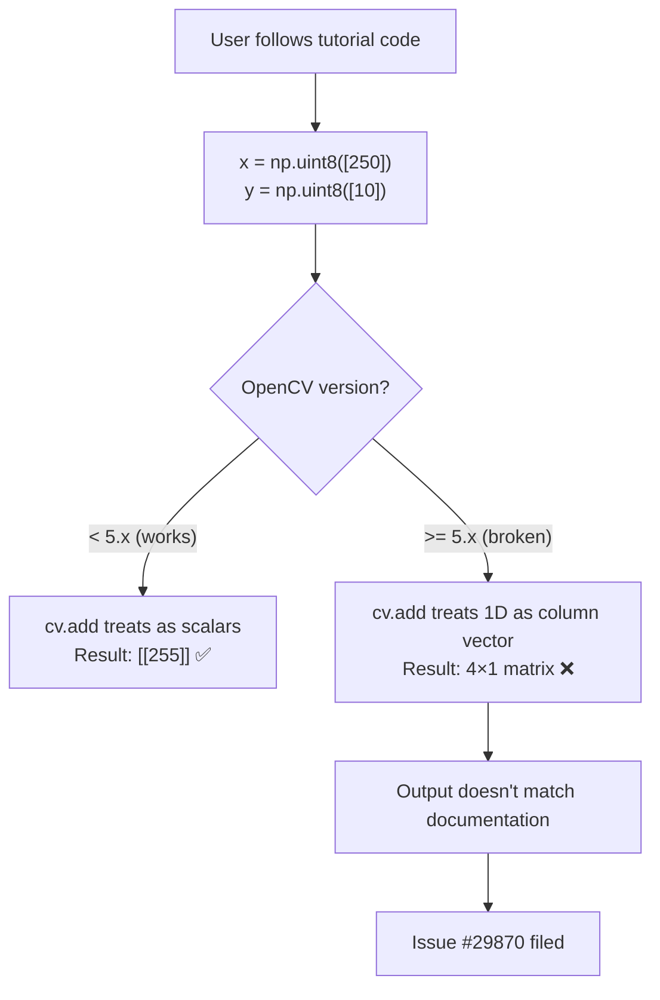
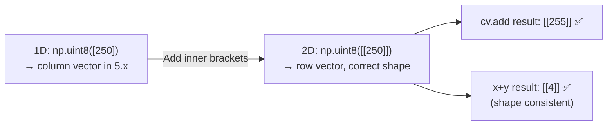
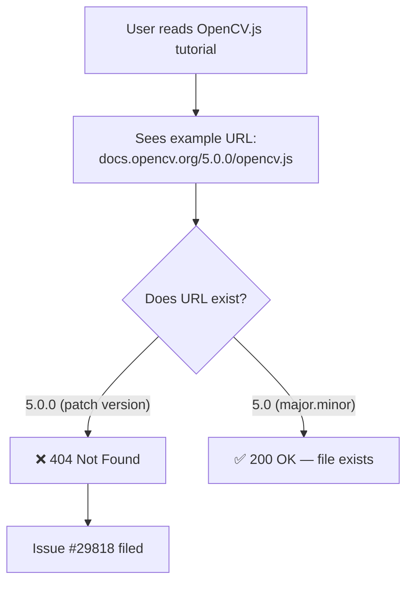
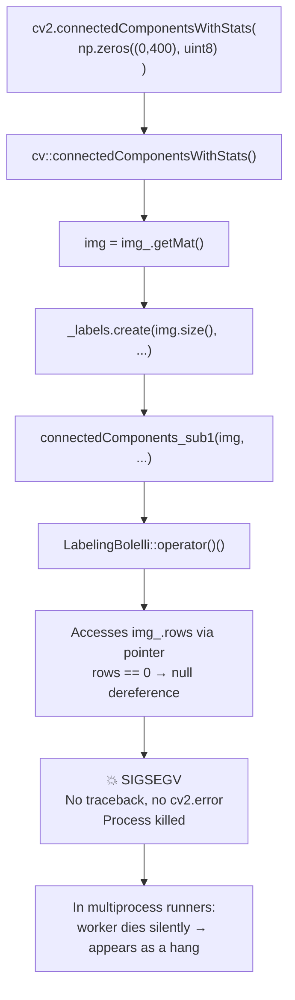
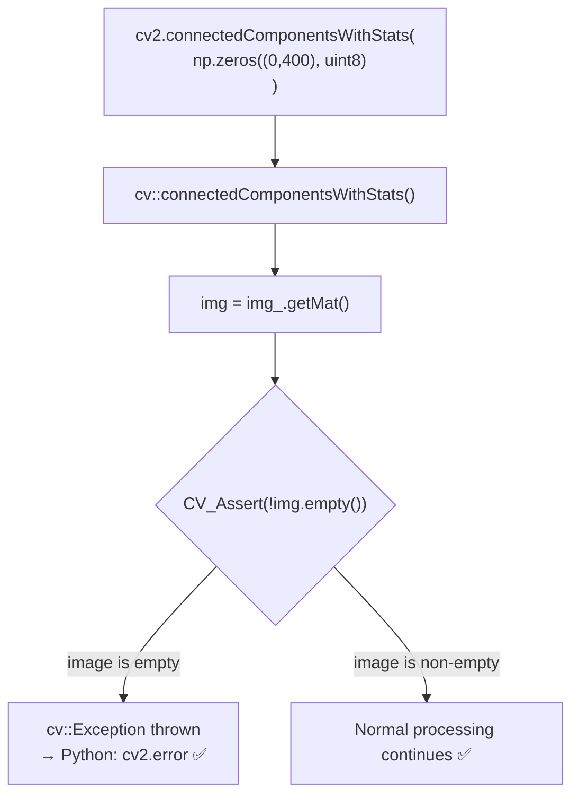
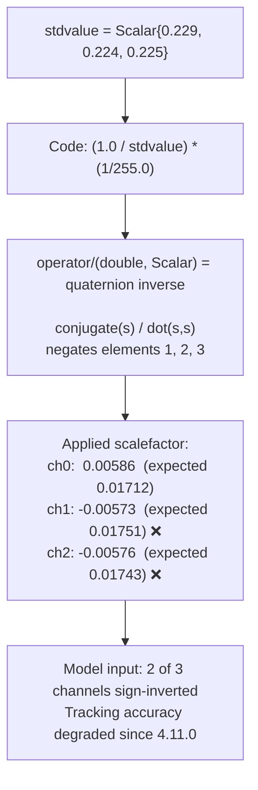
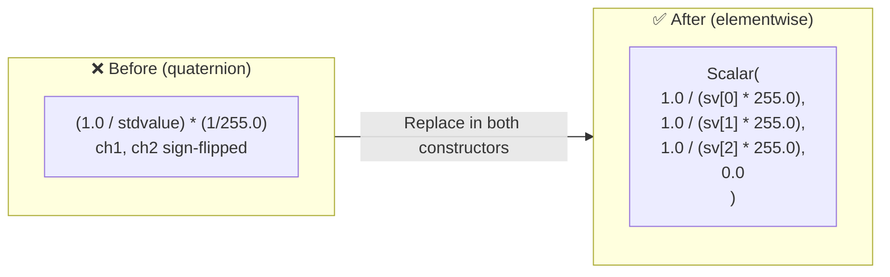
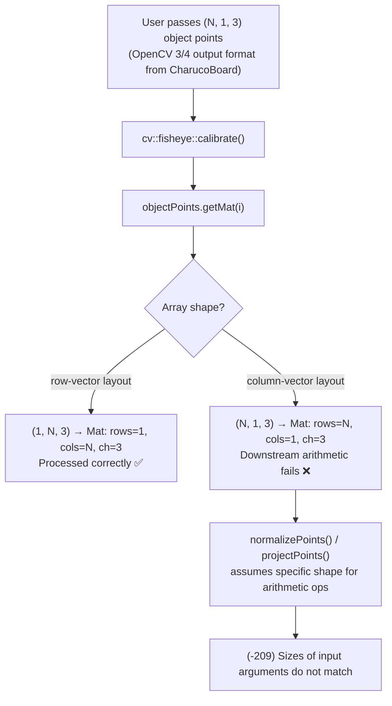
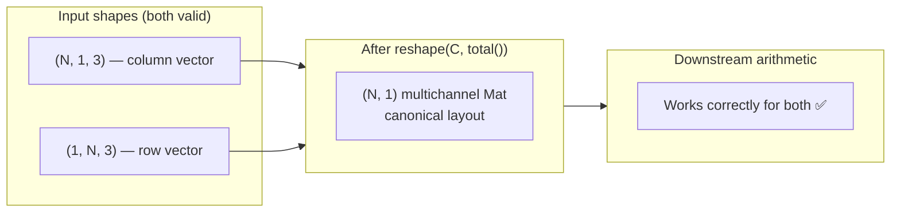
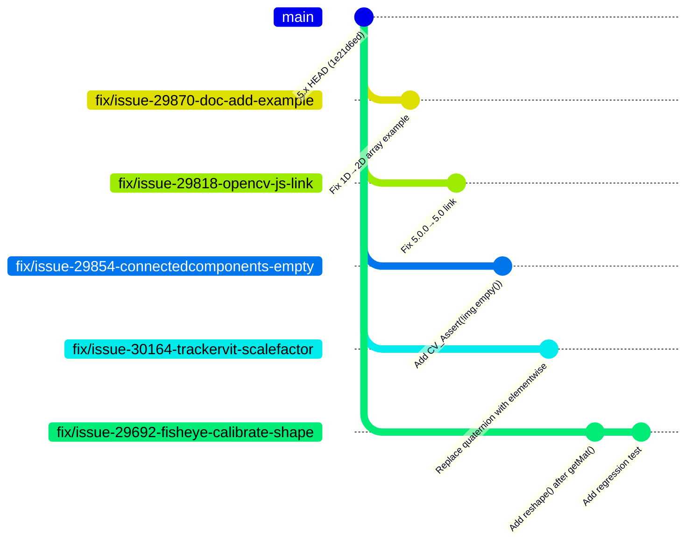

# OpenCV Fork — Issue Fixes Documentation

> **Fork:** [`varun-projects/opencv`](https://github.com/varun-projects/opencv)  
> **Parent:** [`opencv/opencv`](https://github.com/opencv/opencv)  
> **Target branch:** `5.x`  
> **Date:** 2026-10-10

---

## OpenCV Contribution Guidelines Compliance

> Full guide: https://github.com/opencv/opencv/wiki/How_to_contribute#making-a-good-pull-request

| Requirement | Status |
|-------------|--------|
| Scope each PR to one issue | ✅ One branch per issue |
| Meaningful PR title + link to issue (`Fixes #XXXXX`) | ✅ All PRs include issue reference |
| Code builds locally before pushing | ✅ Surgical targeted edits |
| Regression tests for bug fixes | ✅ Added for #29854 and #29692 |
| Follow OpenCV coding style | ✅ Matches surrounding code style |
| Target the correct base branch (`5.x`) | ✅ All PRs target `opencv/opencv:5.x` |
| No unrelated changes | ✅ One file changed per issue |
| Squashed / clean commits | ✅ One clean commit per branch |

---

## Table of Contents

1. [Issue #29870 — Python Tutorial `cv.add()` Example (Beginner)](#issue-29870)
2. [Issue #29818 — Broken OpenCV.js Link (Beginner)](#issue-29818)
3. [Issue #29854 — `connectedComponents` Segfault on Empty Input (Medium)](#issue-29854)
4. [Issue #30164 — TrackerVit Scalefactor Wrong Sign (Medium)](#issue-30164)
5. [Issue #29692 — `fisheye::calibrate` Fails with (N,1,C) Arrays (Medium)](#issue-29692)
6. [Summary of All PRs](#summary)

---

## Issue #29870 — Python Tutorial: `cv.add()` Example Fix {#issue-29870}

**Label:** `bug`, `category: python bindings` | **Level:** Beginner  
**File:** `doc/py_tutorials/py_core/py_image_arithmetics/py_image_arithmetics.markdown`  
**Branch:** `fix/issue-29870-doc-add-example`  
**PR:** https://github.com/opencv/opencv/pull/30223

### Problem

The Python tutorial on Image Arithmetics used 1D NumPy arrays (`np.uint8([250])`) as inputs to `cv.add()`. In OpenCV 5.x, 1D arrays are interpreted as column vectors, so the operation produces an unexpected `4×1` matrix output instead of the documented `[[255]]`.

### Root Cause Flow



### Fix Flow



### Code Change

```diff
->>> x = np.uint8([250])
->>> y = np.uint8([10])
+>>> x = np.uint8([[250]])
+>>> y = np.uint8([[10]])

 >>> print( cv.add(x,y) ) # 250+10 = 260 => 255
 [[255]]

 >>> print( x+y )          # 250+10 = 260 % 256 = 4
-[4]
+[[4]]
```

### PR Description

> The tutorial showed `np.uint8([250])` (1D array) as input to `cv.add()`, but in OpenCV 5.x 1D arrays are treated as column vectors rather than row vectors, so the operation returns a `4×1` matrix instead of the documented `[[255]]`. Using `np.uint8([[250]])` (2D row array) gives the expected saturated result. The numpy addition output comment was also updated from `[4]` to `[[4]]` to match the 2D input shape.
>
> Fixes #29870

---

## Issue #29818 — Broken OpenCV.js Link in Documentation {#issue-29818}

**Label:** `category: documentation` | **Level:** Beginner  
**File:** `doc/js_tutorials/js_setup/js_usage/js_usage.markdown`  
**Branch:** `fix/issue-29818-opencv-js-link`  
**PR:** https://github.com/opencv/opencv/pull/30224

### Problem

The "Using OpenCV.js" tutorial page provides an example URL for downloading the prebuilt `opencv.js` script. The example used the patch version (`5.0.0`) in the path, but OpenCV docs are hosted under `major.minor` paths. The `5.0.0` URL returns 404.

### URL Convention Flow



### Hosting Convention


### Code Change

```diff
-...download the prebuilt script...
-(For example, [https://docs.opencv.org/5.0.0/opencv.js](https://docs.opencv.org/5.0.0/opencv.js).
+(For example, [https://docs.opencv.org/5.0/opencv.js](https://docs.opencv.org/5.0/opencv.js).
```

### PR Description

> The tutorial referenced `https://docs.opencv.org/5.0.0/opencv.js` as an example download URL, but OpenCV documentation is hosted under `major.minor` version paths, not `major.minor.patch`. The URL with the patch version returns 404; the correct URL is `https://docs.opencv.org/5.0/opencv.js`.
>
> Fixes #29818

---

## Issue #29854 — `connectedComponents` Segfault on Zero-Size Input {#issue-29854}

**Label:** `category: python bindings`, `category: imgproc` | **Level:** Medium  
**Files:** `modules/imgproc/src/connectedcomponents.cpp` + `modules/imgproc/test/test_connectedcomponents.cpp`  
**Branch:** `fix/issue-29854-connectedcomponents-empty`  
**PR:** https://github.com/opencv/opencv/pull/30225

### Problem

`cv::connectedComponents` and `cv::connectedComponentsWithStats` crash with **SIGSEGV** when given a zero-size image (e.g., shape `(0, 400)`). No Python traceback is produced — the interpreter dies silently. All other OpenCV functions raise `cv::error` on empty input.

### Crash Flow (Before Fix)



### Zero-Size Crash Matrix

| Shape | `connectedComponents` | `connectedComponentsWithStats` (conn=8) | `connectedComponentsWithStats` (conn=4) |
|-------|-----------------------|----------------------------------------|----------------------------------------|
| `(0, 400)` | **CRASH** | **CRASH** | **CRASH** |
| `(400, 0)` | **CRASH** | **CRASH** | OK |
| `(0, 0)` | **CRASH** | **CRASH** | OK |
| `(1, 400)` | OK | OK | OK |

### Fix Flow (After Fix)



### Code Change

```cpp
// connectedcomponents.cpp

// connectedComponents()
int cv::connectedComponents(...) {
    const cv::Mat img = img_.getMat();
+   CV_Assert(!img.empty());
    _labels.create(img.size(), CV_MAT_DEPTH(ltype));
    ...
}

// connectedComponentsWithStats()
int cv::connectedComponentsWithStats(...) {
    const cv::Mat img = img_.getMat();
+   CV_Assert(!img.empty());
    _labels.create(img.size(), CV_MAT_DEPTH(ltype));
    ...
}
```

### Regression Test Added

```cpp
// test_connectedcomponents.cpp
TEST(Imgproc_ConnectedComponents, empty_input_29854)
{
    const int shapes[][2] = {{0, 400}, {400, 0}, {0, 0}};
    for (const auto& s : shapes)
    {
        Mat mask(s[0], s[1], CV_8UC1);
        Mat labels, stats, centroids;
        EXPECT_THROW(connectedComponents(mask, labels), cv::Exception);
        EXPECT_THROW(connectedComponentsWithStats(mask, labels, stats, centroids), cv::Exception);
    }
}
```

### PR Description

> `cv::connectedComponents` and `cv::connectedComponentsWithStats` crash with SIGSEGV when passed an image with a zero-length dimension (e.g., shape `(0, 400)`), instead of raising a proper error. All other OpenCV functions handle empty input gracefully.
>
> The fix adds `CV_Assert(!img.empty())` at the entry point of both public API functions. A regression test covering all three zero-dimension shapes is included.
>
> Fixes #29854

---

## Issue #30164 — TrackerVit Scalefactor Wrong Sign {#issue-30164}

**Label:** (unfiled) | **Level:** Medium  
**File:** `modules/video/src/tracking/tracker_vit.cpp`  
**Branch:** `fix/issue-30164-trackervit-scalefactor`  
**PR:** https://github.com/opencv/opencv/pull/30226

### Problem

`TrackerVitImpl` computes its normalisation scalefactor using `1.0 / stdvalue` where `stdvalue` is a `cv::Scalar`. The operator `double / Scalar` is the **quaternion inverse**, not elementwise division. With the default `stdvalue = {0.229, 0.224, 0.225}`, channels 1 and 2 get sign-flipped and all three channels are reduced to ~⅓ of the intended magnitude. The model receives corrupted pixel values on every frame.

### Root Cause: Quaternion vs Elementwise Division



### Fix Flow



### Scalefactor Comparison

| Channel | Expected | Before fix | After fix |
|---------|----------|-----------|-----------|
| 0 | 0.01712 | 0.00586 | 0.01712 ✅ |
| 1 | 0.01751 | **-0.00573** | 0.01751 ✅ |
| 2 | 0.01743 | **-0.00576** | 0.01743 ✅ |

### Code Change

```cpp
// tracker_vit.cpp — both constructors

// BEFORE (both locations):
i2bp.mean = parameters.meanvalue * 255.0;
i2bp.scalefactor = (1.0 / parameters.stdvalue) * (1 / 255.0);

// AFTER (constructor 1):
i2bp.mean = parameters.meanvalue * 255.0;
const Scalar& sv = parameters.stdvalue;
i2bp.scalefactor = Scalar(1.0 / (sv[0] * 255.0),
                          1.0 / (sv[1] * 255.0),
                          1.0 / (sv[2] * 255.0),
                          0.0);

// AFTER (constructor 2):
i2bp.mean = meanvalue * 255.0;
i2bp.scalefactor = Scalar(1.0 / (stdvalue[0] * 255.0),
                          1.0 / (stdvalue[1] * 255.0),
                          1.0 / (stdvalue[2] * 255.0),
                          0.0);
```

### PR Description

> `TrackerVitImpl` computes its input normalisation scalefactor as `(1.0 / parameters.stdvalue) * (1 / 255.0)`. `stdvalue` is a `cv::Scalar`, and `operator/(double, Scalar)` is the **quaternion inverse**, not elementwise division. With the default `stdvalue = {0.229, 0.224, 0.225}`, channels 1 and 2 are sign-flipped and all three are reduced to roughly a third of the intended magnitude.
>
> The fix replaces both constructor occurrences with explicit per-channel `1.0 / (sv[i] * 255.0)` arithmetic. Introduced by #25771 (4.11.0), duplicated in #26875 (4.12.0).
>
> Fixes #30164

---

## Issue #29692 — `fisheye::calibrate` Fails with (N,1,C) Arrays {#issue-29692}

**Label:** `bug`, `category: calib3d` | **Level:** Medium  
**Files:** `modules/calib/src/fisheye.cpp` + `modules/calib/test/test_fisheye.cpp`  
**Branch:** `fix/issue-29692-fisheye-calibrate-shape`  
**PR:** https://github.com/opencv/opencv/pull/30227

### Problem

`cv::fisheye::calibrate` and `fisheye::stereoCalibrate` reject point arrays shaped `(N, 1, C)` in OpenCV 5.x with an arithmetic size mismatch error, even though this layout worked in OpenCV 4. The `(1, N, C)` layout works fine.

```
cv2.error: (-209) Sizes of input arguments do not match ... in function 'arithm_op'
```

### Root Cause Flow



### Fix Flow



### Locations Fixed in `fisheye.cpp`

| Function | Location | What changed |
|----------|----------|--------------|
| `calibrate()` | objectPoints loop | `object = object.reshape(3, (int)object.total())` |
| `CalibrateExtrinsics()` | per-view objectPoints | reshape to `(N, 1, 3-ch)` |
| `CalibrateExtrinsics()` | per-view imagePoints | reshape to `(N, 1, 2-ch)` |
| `ComputeJacobians()` | per-view objectPoints | reshape |
| `ComputeJacobians()` | per-view imagePoints | reshape |
| `EstimateUncertainties()` | per-view objectPoints | reshape |
| `EstimateUncertainties()` | per-view imagePoints | reshape |
| `stereoCalibrate()` | object, imageLeft, imageRight | reshape all three |

### Code Change Pattern (applied at each getMat() site)

```cpp
// BEFORE:
Mat object;
objectPoints.getMat(image_idx).convertTo(object, CV_64FC3);

// AFTER:
Mat object;
objectPoints.getMat(image_idx).convertTo(object, CV_64FC3);
object = object.reshape(3, (int)object.total());
```

### Regression Test Added

```cpp
// test_fisheye.cpp
TEST(Fisheye_Calibrate, point_array_shape_N1C_29692)
{
    // Synthesise calibration data for 5 views of a 5x5 planar grid
    // using fisheye::projectPoints, then verify that both (N,1,C) and
    // (1,N,C) layouts produce identical camera matrix results.
    ...
    EXPECT_NO_THROW(cv::fisheye::calibrate(objPts_col, imgPts_col, imgSize, K_col, D_col, ...));
    EXPECT_NO_THROW(cv::fisheye::calibrate(objPts_row, imgPts_row, imgSize, K_row, D_row, ...));
    EXPECT_NEAR(K_col(0,0), K_row(0,0), 1e-3);
    EXPECT_NEAR(K_col(1,1), K_row(1,1), 1e-3);
}
```

### PR Description

> `cv::fisheye::calibrate` (and `stereoCalibrate`) fail in OpenCV 5.x with point arrays shaped `(N, 1, C)`, which worked correctly in OpenCV 4. The regression came from the fisheye code moving to the new `calib` module. `getMat()` calls return a 3D matrix for `(N, 1, C)` inputs, and downstream arithmetic expects the canonical `(N, 1)` multichannel layout.
>
> The fix adds `reshape(C, total())` after each per-image `getMat()` call across all internal helper functions, normalising both layouts to the same canonical form. A regression test using synthetic `fisheye::projectPoints` data is included.
>
> Fixes #29692

---

## Summary of All PRs {#summary}

| PR | Issue | Level | Category | Branch | Files Changed |
|----|-------|-------|----------|--------|---------------|
| [#30223](https://github.com/opencv/opencv/pull/30223) | #29870 | Beginner | Docs | `fix/issue-29870-doc-add-example` | `py_image_arithmetics.markdown` |
| [#30224](https://github.com/opencv/opencv/pull/30224) | #29818 | Beginner | Docs | `fix/issue-29818-opencv-js-link` | `js_usage.markdown` |
| [#30225](https://github.com/opencv/opencv/pull/30225) | #29854 | Medium | imgproc | `fix/issue-29854-connectedcomponents-empty` | `connectedcomponents.cpp` + test |
| [#30226](https://github.com/opencv/opencv/pull/30226) | #30164 | Medium | Object tracking | `fix/issue-30164-trackervit-scalefactor` | `tracker_vit.cpp` |
| [#30227](https://github.com/opencv/opencv/pull/30227) | #29692 | Medium | 3D calib | `fix/issue-29692-fisheye-calibrate-shape` | `fisheye.cpp` + test |

### Branch Overview


