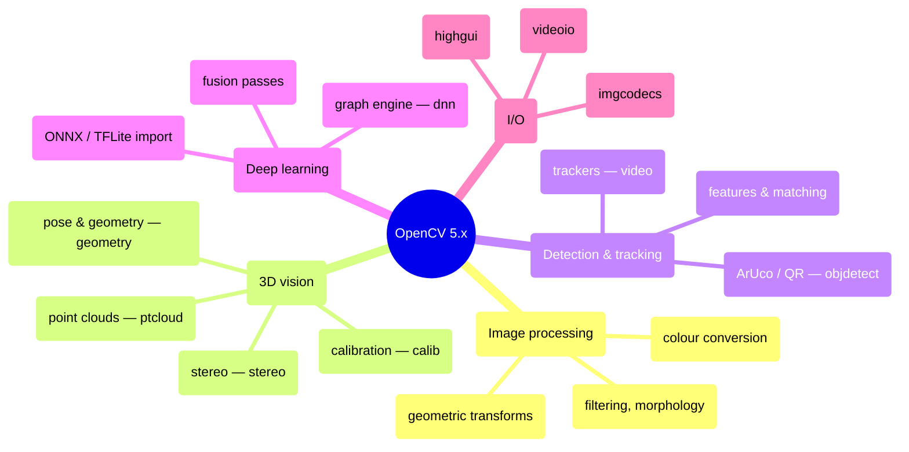
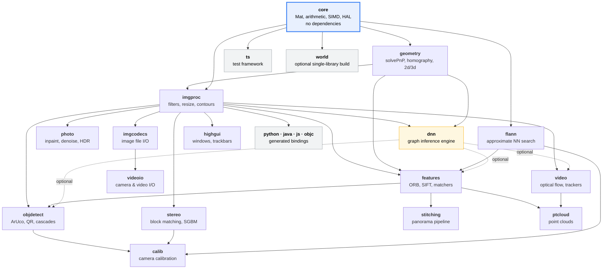
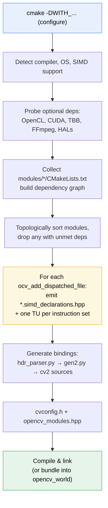

# 01 — Project Overview

[← Index](README.md) · [Next: Architecture →](02-architecture.md)

---

## 1. What OpenCV is

OpenCV (Open Source Computer Vision Library) is a C++ library of computer-vision and
image-processing algorithms, licensed Apache-2.0, with generated bindings for Python, Java,
Objective-C/Swift and JavaScript. The tree documented here is **`5.1.0-dev`** — the `5.x`
development branch.

The engineering problem OpenCV actually solves is less "implement image algorithms" and more
**"implement each algorithm once, then run it as fast as the hardware allows, everywhere."**
A single call like `cv::resize` may end up executing:

- a hand-written AVX-512 kernel on a Xeon,
- an Arm KleidiCV kernel on a Cortex-A55,
- an OpenCL kernel on a Mali GPU,
- or a portable C++ loop on a RISC-V board with no SIMD at all,

…while returning the same answer and exposing one signature to the user. Nearly every
architectural decision in the repository follows from that requirement, and so do a large
share of its bugs — including [six of the nine](issue-studies/README.md) studied in this
documentation.



---

## 2. Repository layout

```
opencv/
├── modules/          23 library modules — the actual library (see §3)
├── 3rdparty/         25 vendored dependencies, built only if the system lacks them
├── hal/              7 Hardware Abstraction Layer implementations (see §5)
├── cmake/            79 files — the build system (see §6)
├── include/          umbrella header: opencv2/opencv.hpp
├── apps/             end-user tools (interactive-calibration, model-diagnostics, …)
├── samples/          example programs, per language and per API (cpp, python, dnn, tapi, …)
├── doc/              Doxygen configuration + tutorials (py_tutorials, js_tutorials)
├── docs_sphinx/      Sphinx documentation for the Python API
├── platforms/        cross-compilation toolchains: Android, iOS, WinRT, semihosting, …
└── CMakeLists.txt    top-level build entry point
```

Two layout facts matter when navigating the code:

**Public headers vs. private sources.** Each module splits into
`modules/<name>/include/opencv2/<name>/` (the public API, parsed by the bindings generators)
and `modules/<name>/src/` (the implementation, invisible to users). A symbol is only part of
the public API if it is declared in the `include/` tree *and* marked with an export macro.
This boundary is why issue [#26498](issue-studies/hard-26498-flip-nd-arrays.md) mattered —
an internal implementation limit had become visible as a user-facing assertion failure.

**`src/` files carry suffix conventions** that tell you how they are compiled:

| Pattern | Meaning |
|---------|---------|
| `foo.cpp` | Ordinary source, compiled once at the baseline instruction set |
| `foo.dispatch.cpp` | Runtime dispatcher — picks the best available SIMD variant |
| `foo.simd.hpp` | The actual kernels, compiled *many times*, once per instruction set |
| `foo.simd_declarations.hpp` | **Generated** by CMake; declares which variants exist |
| `hal_replacement.hpp` | Declares the HAL hooks a third party may override |
| `opencl/*.cl` | OpenCL kernel sources, embedded into the binary as strings |

The `.dispatch.cpp` / `.simd.hpp` pair is the single most important convention in the
repository; it is explained in [features/02](features/02-core-simd-dispatch.md).

---

## 3. The 23 modules and what changed in 5.x



Dependencies are declared in each module's `CMakeLists.txt`. For example
`modules/imgproc/CMakeLists.txt`:

```cmake
ocv_define_module(imgproc opencv_core opencv_geometry WRAP java objc python js)
```

`ocv_define_module(<name> <required deps> [OPTIONAL <opt deps>] [WRAP <languages>])` both
declares the link dependencies and registers which bindings generators should process the
module. `cmake/OpenCVModule.cmake` flattens these declarations into
`OPENCV_MODULE_<name>_DEPS` and topologically sorts the build.

### The 5.x module reorganisation

The biggest structural change from 4.x is that the monolithic `calib3d` and `features2d`
modules were split along the line between *geometry* (stateless mathematics) and
*calibration* (parameter fitting):

| 4.x module | 5.x modules | Rationale |
|------------|-------------|-----------|
| `calib3d` | **`geometry`** — `solvePnP`, `findHomography`, `Rodrigues`, epipolar geometry<br>**`calib`** — `calibrateCamera`, `fisheye::calibrate`, stereo rectification<br>**`stereo`** — `StereoBM`, `StereoSGBM` | `geometry` has almost no dependencies and is needed by `imgproc`; calibration needs `objdetect` (pattern detection) and `flann`. Keeping them together forced a dependency cycle. |
| `features2d` | **`features`** | Renamed; `features2d.hpp` is kept as a compatibility header. |

This split is why the two 3D-vision bugs in this documentation live in *different* modules:
[`solvePnPRansac`](issue-studies/hard-29573-solvepnp-ransac-inliers.md) is in
`modules/geometry/src/solvepnp.cpp`, while
[`fisheye::calibrate`](issue-studies/medium-29692-fisheye-point-shape.md) is in
`modules/calib/src/fisheye.cpp`. They share an input-format convention but no code — which is
precisely how #29692 happened.

Compatibility headers (`opencv2/calib3d.hpp`, `opencv2/features2d.hpp`) still exist so most 4.x
includes keep compiling.

> **Note on `ml`.** `modules/ml/` in this tree contains only a `perf/` directory. The classical
> machine-learning implementations (SVM, decision trees, …) are no longer part of this
> repository's main module set.

---

## 4. The module-internal skeleton

Every module follows the same shape, which makes the repository navigable once learned:

```
modules/<name>/
├── CMakeLists.txt      dependencies + dispatched-file declarations
├── include/opencv2/    PUBLIC API — parsed by bindings generators
├── src/                implementation (+ opencl/*.cl kernels)
├── test/               accuracy tests (gtest) — test_*.cpp
├── perf/               performance tests — perf_*.cpp
├── misc/               per-language binding hints (python/java/objc)
└── doc/                Doxygen fragments, tutorial sources
```

Three practical consequences:

1. **A bug fix belongs in `src/` plus a regression test in `test/`.** All but one of the
   fixes documented in `issue-studies/` follow exactly this pattern — the exception is
   [#29893](issue-studies/hard-29893-multiply-16u-work-type.md), where the intended test was
   never actually committed.
2. **`misc/python/` holds binding overrides.** When the generated signature is wrong,
   it is corrected here rather than by distorting the C++ API.
3. **`test/` is where executable truth lives.** `modules/<name>/test/test_*.cpp` is the
   fastest way to learn an API's real contract, including its edge cases.

---

## 5. Hardware abstraction: `hal/`

`hal/` holds seven optional, swappable backends that can replace OpenCV's own kernels:

| HAL | Vendor / target |
|-----|-----------------|
| `carotene` | Arm NEON kernels (long-standing, bundled) |
| `kleidicv` | Arm's newer optimised vision kernels |
| `armpl` | Arm Performance Libraries |
| `fastcv` | Qualcomm FastCV |
| `ipp` | Intel Integrated Performance Primitives |
| `ndsrvp` | Andes RISC-V DSP extensions |
| `riscv-rvv` | RISC-V Vector extension |

A HAL is selected at **configure time** (`-DWITH_KLEIDICV=ON`) and intercepts calls at
**run time**. The contract is deliberately minimal — see
[features/03](features/03-core-hal-backends.md).

This is also where a whole bug class lives: when two implementations of the same operation
disagree, the discrepancy is a bug even if neither side crashes. Issue
[#29985](issue-studies/hard-29985-resize-realized-scale.md) was discovered exactly this way —
KleidiCV and OpenCV's own scalar `resize` computed sampling coordinates from different values,
and the mismatch only became visible when the HAL was enabled.

---

## 6. How the build works



Two configure-time steps deserve attention because they generate code that does not exist in
the repository:

**Dispatched-file expansion.** `modules/core/CMakeLists.txt` opens with a block of
declarations:

```cmake
ocv_add_dispatched_file(arithm SSE2 SSE4_1 AVX2 NEON_FP16 VSX3 LASX)
ocv_add_dispatched_file(matmul SSE2 SSE4_1 AVX2 AVX512_SKX NEON_DOTPROD LASX)
```

For each line, CMake compiles `arithm.simd.hpp` once per *supported* instruction set from that
list, each in its own translation unit with the matching compiler flags, and writes
`arithm.simd_declarations.hpp` declaring which variants were actually built. Only then does
`arithm.dispatch.cpp` know what it is allowed to dispatch to. The consequence — that a
`#if` inside a `.simd.hpp` file is evaluated once per instruction set, with different macro
values each time — is the root of issue
[#30151](issue-studies/hard-30151-gemm-cv64f-simd-guard.md).

**Binding generation.** `modules/python/src2/hdr_parser.py` parses the public headers of every
module declared `WRAP python`, and `gen2.py` emits the C++ glue for `cv2`. Nothing is
hand-written per function; the 709 `CV_EXPORTS_W`, 1471 `CV_WRAP` and 250 `CV_PROP_RW`
annotations in the headers are the entire specification. See
[features/11](features/11-bindings.md).

### Options worth knowing

| Option | Effect |
|--------|--------|
| `BUILD_opencv_world=ON` | Link every module into one `opencv_world` library |
| `CPU_BASELINE` / `CPU_DISPATCH` | Minimum required vs. runtime-selected instruction sets |
| `WITH_OPENCL`, `WITH_CUDA` | Enable the GPU backends |
| `WITH_KLEIDICV`, `WITH_CAROTENE`, `WITH_IPP` | Select a HAL |
| `BUILD_TESTS`, `BUILD_PERF_TESTS` | Build `opencv_test_<module>` / `opencv_perf_<module>` |
| `OPENCV_ENABLE_NONFREE` | Include patent-encumbered algorithms |

A minimal configuration for working on the library itself:

```bash
cmake -B build -DCMAKE_BUILD_TYPE=Release -DBUILD_TESTS=ON \
      -DBUILD_LIST=core,imgproc,geometry,calib,objdetect,video
cmake --build build -j"$(nproc)"
./build/bin/opencv_test_core --gtest_filter='Core_Flip.*'
```

`BUILD_LIST` is the single most useful flag when iterating on a fix: it cuts a full build
(tens of minutes) down to the few modules that matter.

---

## 7. Testing

OpenCV's own test framework is the `ts` module, a thin layer over GoogleTest adding
tolerance-aware comparison helpers and test-data management.

| Kind | Location | Binary | Purpose |
|------|----------|--------|---------|
| Accuracy | `modules/<m>/test/` | `opencv_test_<m>` | Correctness, including regressions |
| Performance | `modules/<m>/perf/` | `opencv_perf_<m>` | Guard against speed regressions |
| Python | `modules/python/test/` | `pytest` | Binding-level behaviour |

The convention for regression tests — visible throughout `issue-studies/` — is to name the
test after the issue number:

```cpp
TEST(Core_Flip, ndim_26498)                       // modules/core/test/test_nd_transform.cpp
TEST(Imgproc_ConnectedComponents, empty_input_29854)
TEST(Calib3d_SolvePnPRansac, inlier_refinement_29573)
```

This makes `git log -S29854` and `grep -rn 29854 modules/` find the bug, the fix and its test
together — a small convention that pays for itself every time a fix is revisited.

---

## 8. Where to go next

- To understand *how* the layers fit together: [02 — Architecture](02-architecture.md).
- To see a single call pass through all of them: [03 — Lifecycle of a Call](03-call-lifecycle.md).
- To see what goes wrong in practice: [`issue-studies/`](issue-studies/README.md).
