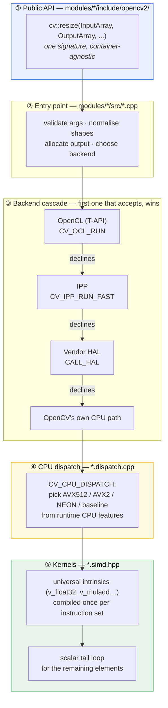
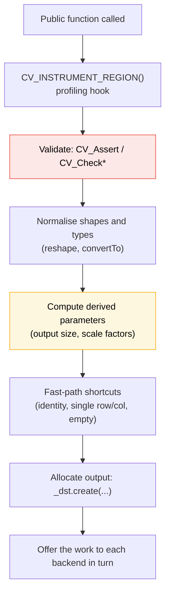
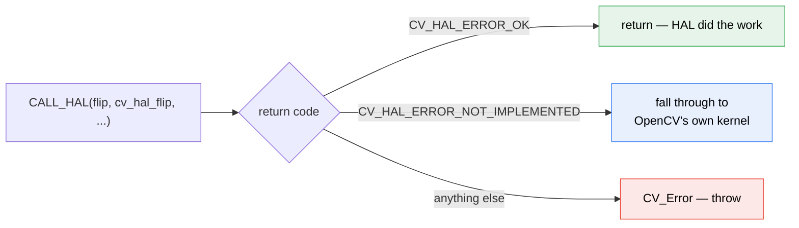
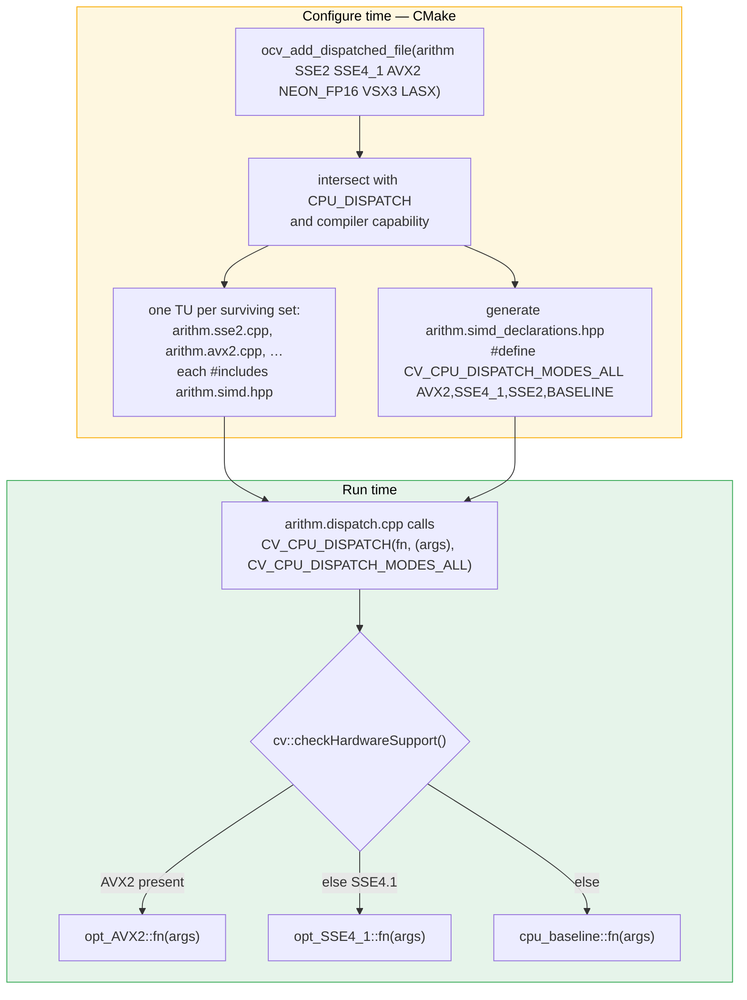
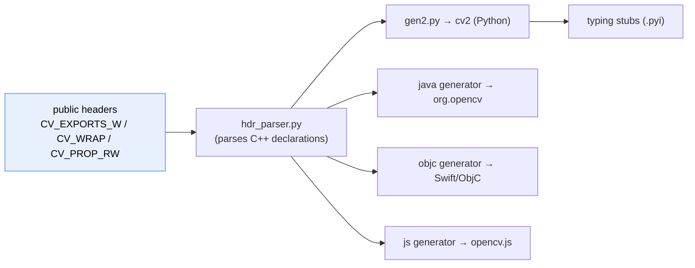
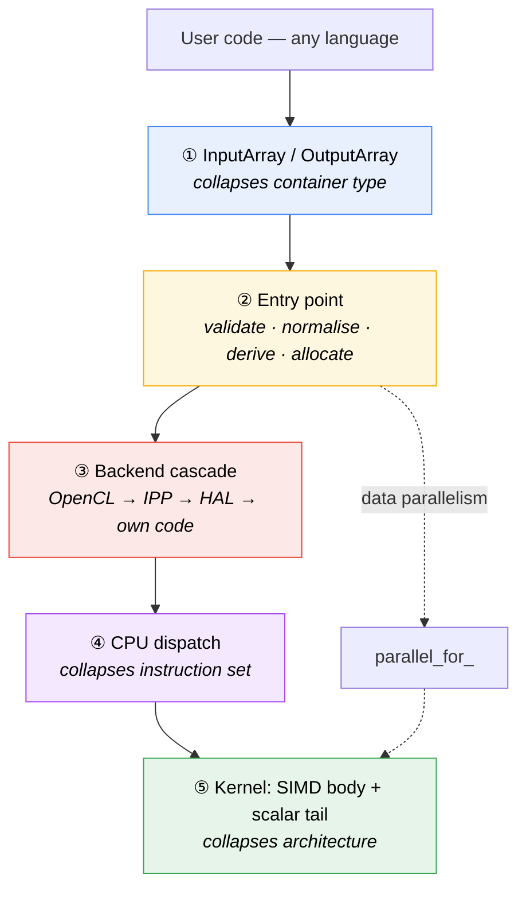

# 02 — Architecture

[← Project Overview](01-project-overview.md) · [Index](README.md) · [Next: Lifecycle of a Call →](03-call-lifecycle.md)

---

## 1. The central design problem

OpenCV must expose **one** function signature per algorithm while supporting, for that single
algorithm:

- several element types (`CV_8U`, `CV_16U`, `CV_32F`, `CV_64F`, …),
- several argument containers (`Mat`, `UMat`, `std::vector`, `Matx`, `cuda::GpuMat`),
- several instruction sets *on the same binary*, chosen at run time,
- several whole-operation replacements (vendor HAL, IPP, OpenCL, CUDA),
- and a fallback that works where none of the above exist.

A naïve design multiplies out to thousands of entry points. OpenCV instead inserts **four
adapter layers** between the user and the kernel, each collapsing one of those dimensions.



Each boundary in that diagram is a place where two pieces of code must agree about something
that the compiler cannot check. **Every single issue study in this documentation is a
disagreement at one of these boundaries** — which is the strongest argument for learning the
layer model before reading any algorithm:

| Boundary | What must agree | Bug that broke it |
|----------|-----------------|-------------------|
| ① ↔ user | Which array shapes are accepted | [#29692](issue-studies/medium-29692-fisheye-point-shape.md), [#26498](issue-studies/hard-26498-flip-nd-arrays.md) |
| ① ↔ user | What a documented output *means* | [#29573](issue-studies/hard-29573-solvepnp-ransac-inliers.md) |
| ② | Preconditions actually hold | [#29854](issue-studies/medium-29854-connectedcomponents-empty.md) |
| ② ↔ ③ | Parameters mean the same to every backend | [#29985](issue-studies/hard-29985-resize-realized-scale.md) |
| ④ ↔ ⑤ | `#if` guards match the code they protect | [#30151](issue-studies/hard-30151-gemm-cv64f-simd-guard.md) |
| ⑤ SIMD ↔ tail | Both paths compute the same function | [#29893](issue-studies/hard-29893-multiply-16u-work-type.md) |

---

## 2. Layer ① — the public API and `InputArray`

### Collapsing the container dimension

Public functions do not take `Mat`. They take `InputArray` (= `const _InputArray&`), a
*type-erasing reference* that can refer to any supported container without copying it.

```cpp
void resize(InputArray src, OutputArray dst, Size dsize, double fx, double fy, int interp);
```

`_InputArray` stores a `void*` plus a flags word encoding the container kind
(`modules/core/include/opencv2/core/mat.hpp:286`):

```cpp
enum KindFlag {
    KIND_SHIFT = 16,
    NONE = 0 << KIND_SHIFT,   MAT = 1 << KIND_SHIFT,
    MATX = 2 << KIND_SHIFT,   STD_VECTOR = 3 << KIND_SHIFT,
    STD_VECTOR_VECTOR = 4 << KIND_SHIFT,  STD_VECTOR_MAT = 5 << KIND_SHIFT,
    OPENGL_BUFFER = 7 << KIND_SHIFT,      CUDA_HOST_MEM = 8 << KIND_SHIFT,
    CUDA_GPU_MAT = 9 << KIND_SHIFT,       UMAT = 10 << KIND_SHIFT,
    /* … 17 kinds in total … */
};
```

So all of these compile to the same `cv::resize`, with no overloads and no conversions:

```cpp
cv::Mat                 m;  cv::resize(m,   out, ...);
cv::UMat                u;  cv::resize(u,   out, ...);   // → OpenCL path
std::vector<cv::Point2f> v; cv::resize(v,   out, ...);
cv::Matx33f             x;  cv::resize(x,   out, ...);
```

### The cost: a run-time contract instead of a compile-time one

The adapter's power is also its hazard. `InputArray` accepts *anything*, so the real contract
— which kinds, shapes, depths and channel counts a given function supports — exists only as
`CV_Assert` statements inside the implementation, and as prose in the Doxygen comment.

The accessors each function calls decide what it will tolerate:

| Call | Returns | Consequence |
|------|---------|-------------|
| `.getMat()` | `Mat` header, no copy | Accepts whatever layout arrived; **caller must normalise** |
| `.getUMat()` | `UMat` | Forces the OpenCL path |
| `.getMatVector(v)` | `std::vector<Mat>` | For `InputArrayOfArrays` |
| `.dims()`, `.size()`, `.type()` | metadata | Cheap pre-dispatch inspection |
| `.needed()` | `bool` | True if the caller actually wants this output |

Two bugs in this documentation are precisely failures of this normalisation step:

- **[#29692](issue-studies/medium-29692-fisheye-point-shape.md)** — `cv::calibrateCamera`
  follows `getMat()` with `reshape()` to canonicalise point layout; `fisheye::calibrate`
  called `getMat()` and used `rows` directly. Same contract, two implementations, one of them
  wrong for `(1, N, C)` input.
- **[#26498](issue-studies/hard-26498-flip-nd-arrays.md)** — `cv::flip` asserted
  `dims() <= 2`, but the Python bridge legitimately produces `dims() == 3` for arrays with
  more than 512 channels.

`OutputArray` adds one more subtlety worth internalising: it is **lazily allocated**. The
callee calls `_dst.create(size, type)` and the array materialises only then. A function that
asserts *after* `create()` can leave a partially-initialised output behind, which is why
validation belongs at the very top of an entry point — the lesson of
[#29854](issue-studies/medium-29854-connectedcomponents-empty.md).

> Detailed treatment: [features/01 — Mat & InputArray](features/01-core-mat-and-inputarray.md).

---

## 3. Layer ② — the entry point

The entry point is the only place that sees the whole problem. Its responsibilities, in order:



Steps C and E are where entry-point bugs concentrate.

**Step C — validation.** OpenCV's idiom is to fail loudly and early:

```cpp
CV_Assert(!img.empty());                        // throws cv::Exception
CV_CheckLT(_axis, ndim, "flipND: axis out of range");   // throws with context
CV_CheckTypeEQ(src.type(), CV_8UC1, "");
```

`CV_Assert` is **not** `assert` — it is compiled into release builds and throws
`cv::Exception`, which the Python bindings translate into `cv2.error`. Preferring
`CV_Check*` over `CV_Assert` is the house style for new code because the message names the
offending values. The entire fix for #29854 was adding one missing `CV_Assert` — the
difference between a catchable `cv2.error` and a `SIGSEGV` that kills the interpreter with no
traceback.

**Step E — derived parameters.** When a parameter can be computed two ways, the entry point
must pick one and make *every* backend use it. `cv::resize`
(`modules/imgproc/src/resize.cpp:3579`) illustrates both the pattern and the failure:

```cpp
if (dsize.empty()) {
    dsize = Size(saturate_cast<int>(ssize.width * inv_scale_x), ...);
    // ← the realized ratio dsize/ssize now differs from inv_scale_x, because of rounding
} else {
    inv_scale_x = (double)dsize.width / ssize.width;   // realized ratio — correct
}
...
hal::resize(..., inv_scale_x, inv_scale_y, interpolation);   // whichever value survived
```

Both `dsize` *and* `inv_scale_x` are passed down. A backend may believe either one. When they
disagree, two correct-looking backends produce different images — exactly
[#29985](issue-studies/hard-29985-resize-realized-scale.md).

---

## 4. Layer ③ — the backend cascade

Backends are offered the work in a fixed order, and the **first one that accepts it returns
immediately**. Each is guarded by a macro that encodes "try this, but fall through if it
declines".

From `modules/core/src/count_non_zero.dispatch.cpp:119` — a compact, complete example:

```cpp
int countNonZero(InputArray _src)
{
    CV_INSTRUMENT_REGION();
    int type = _src.type(), cn = CV_MAT_CN(type);
    CV_Assert(cn == 1);

#ifdef HAVE_OPENCL
    CV_OCL_RUN_(OCL_PERFORMANCE_CHECK(_src.isUMat()) && _src.dims() <= 2,
                ocl_countNonZero(_src, res), res)        // ① GPU, only if src is a UMat
#endif

    Mat src = _src.getMat();
    CV_IPP_RUN_FAST(ipp_countNonZero(src, res), res);    // ② Intel IPP

    CountNonZeroFunc func = getCountNonZeroTab(src.depth());  // ③ CPU dispatch
    CV_Assert(func != 0);

    const Mat* arrays[] = {&src, 0};
    uchar* ptrs[1] = {};
    NAryMatIterator it(arrays, ptrs);                    // ④ iterate N-D as 2-D planes
    int total = (int)it.size, nz = 0;
    for (size_t i = 0; i < it.nplanes; i++, ++it)
        nz += func(ptrs[0], total);
    return nz;
}
```

Four mechanisms are visible here, and all four recur everywhere in the library:

### 4.1 OpenCL — the T-API

`CV_OCL_RUN(condition, call)` runs the OpenCL implementation only if the condition holds, and
the condition almost always includes `isUMat()`. This is the **Transparent API**: the user
opts into GPU execution by choosing `UMat` instead of `Mat` as the container, not by calling a
different function.

```cpp
cv::Mat  a, b;  cv::resize(a, b, sz);   // CPU
cv::UMat a, b;  cv::resize(a, b, sz);   // same call → OpenCL kernel
```

`UMat` owns memory that may live on the device; mapping happens lazily when `getMat()` is
called. Kernels live in `modules/*/src/opencl/*.cl` and are embedded in the binary as strings
at build time.

### 4.2 IPP

`CV_IPP_RUN_FAST(fn, retval)` calls into Intel's Integrated Performance Primitives when
available. The implementations are isolated in `#if defined HAVE_IPP` blocks and frequently
contain version- and CPU-specific bail-outs — note this real example from the same file:

```cpp
#if IPP_VERSION_X100 < 201801
    if (cv::ipp::getIppTopFeatures() == ippCPUID_SSE42)
        return false;   // this IPP version is slower than our own SSE4.2 code
#endif
```

A backend declining because it would be *slower* is a normal, expected outcome.

### 4.3 The vendor HAL

`CALL_HAL` is the most interesting of the three because it is a **stable ABI for third
parties**. Declarations live in `modules/core/src/hal_replacement.hpp`, where every hook has a
default that declines:

```cpp
inline int hal_ni_flip(int src_type, const uchar* src_data, size_t src_step,
                       int src_width, int src_height, uchar* dst_data,
                       size_t dst_step, int flip_mode)
{ return CV_HAL_ERROR_NOT_IMPLEMENTED; }

#define cv_hal_flip hal_ni_flip       // a custom HAL header #defines this to its own function
```

and the call-site macro (`hal_replacement.hpp:1320`) encodes the three-way protocol:

```cpp
#define CALL_HAL_RET2(name, fun, retval, ...)                                  \
{                                                                              \
    int res = __CV_EXPAND(fun(__VA_ARGS__));                                   \
    if (res == CV_HAL_ERROR_OK)                                                \
        return retval;                            /* HAL handled it — done  */ \
    else if (res != CV_HAL_ERROR_NOT_IMPLEMENTED)                              \
        CV_Error_(cv::Error::StsInternal,         /* HAL failed — propagate  */ \
        ("HAL implementation " CVAUX_STR(name) " ==> " CVAUX_STR(fun)          \
         " returned %d (0x%08x)", res, res));                                  \
}                                             /* NOT_IMPLEMENTED — fall through */
```



The design is excellent for vendors — implement one function, get accelerated, decline the
rest — and it creates a specific, subtle bug class: **a HAL that interprets a parameter
differently from OpenCV is undetectable until someone diffs the outputs.** #29985 is that bug.

### 4.4 `NAryMatIterator` — collapsing dimensionality

Most kernels are written for contiguous 1-D or 2-D runs. `NAryMatIterator` walks an N-D `Mat`
as a sequence of planes, coalescing them into one giant run when the data is contiguous. This
is how `countNonZero` supports arbitrary `dims` with a kernel that only understands a flat
pointer and a length.

> Detailed treatment: [features/03 — HAL & Backends](features/03-core-hal-backends.md).

---

## 5. Layer ④ — CPU dispatch

### The problem

Shipping one binary that runs well on a 2009 Core 2 and a 2024 Sapphire Rapids means the
AVX-512 kernel must *exist* in the binary but must never *execute* on a CPU that lacks
AVX-512. Compiling the whole library with `-mavx512f` is not an option.

### The solution: compile the same source many times



The dispatcher side is a one-liner (`count_non_zero.dispatch.cpp:16`):

```cpp
static CountNonZeroFunc getCountNonZeroTab(int depth)
{
    CV_INSTRUMENT_REGION();
    CV_CPU_DISPATCH(getCountNonZeroTab, (depth), CV_CPU_DISPATCH_MODES_ALL);
}
```

`CV_CPU_DISPATCH` expands to a chain of `if (CV_CPU_HAS_SUPPORT_AVX2) return opt_AVX2::...`
tests, ordered best-first, ending at the baseline. Each `opt_*` namespace is a separate
compilation of the *same* `.simd.hpp` file with different flags and different macro values.

### The consequence that causes bugs

Because `foo.simd.hpp` is compiled N times with N different macro environments, the
preprocessor conditionals inside it are evaluated N times with different answers. A guard must
therefore name the capability its code *actually* needs — not a related one.

The relevant macros, defined in `modules/core/include/opencv2/core/hal/intrin.hpp`:

| Macro | Meaning |
|-------|---------|
| `CV_SIMD` | A fixed-width SIMD backend is available |
| `CV_SIMD_64F` | …**and it supports `double` vectors** |
| `CV_SIMD_SCALABLE` / `_64F` | Scalable vectors (RISC-V RVV, SVE) |
| `CV_SIMD_WIDTH` | Register width in bytes |

`CV_SIMD` and `CV_SIMD_64F` are **not** the same, and 32-bit Arm is the proof
(`intrin_neon.hpp:60`):

```cpp
#define CV_SIMD128 1
#if defined(__aarch64__) || defined(_M_ARM64) || defined(_M_ARM64EC)
#define CV_SIMD128_64F 1       // AArch64 has float64 NEON
#else
#define CV_SIMD128_64F 0       // ARMv7 NEON: 32-bit floats only
#endif
```

On ARMv7, `CV_SIMD == 1` but `CV_SIMD_64F == 0`. Code guarded by `CV_SIMD` that manipulates
`double` vectors is therefore compiled on a target where `double` vectors do not exist. That
is [#30151](issue-studies/hard-30151-gemm-cv64f-simd-guard.md), and the same mismatch in 4.x
caused `double` buffers to be reinterpreted as `float` and `cv::gemm` to return NaN.

> Detailed treatment: [features/02 — SIMD & CPU Dispatch](features/02-core-simd-dispatch.md).

---

## 6. Layer ⑤ — kernels and universal intrinsics

Kernels are written once against **universal intrinsics**, a portable vector vocabulary that
maps onto SSE, AVX, NEON, VSX, LASX, RVV and a scalar emulation:

```cpp
v_float32 va = vx_setall_f32(a);
v_float32 vb = vx_load(b_ptr);
v_float32 vd = v_muladd(va, vb, vd);    // fused multiply-add where available
v_store_aligned(dst, vd);
```

`v_float32` is an alias for whichever native vector type the current compilation targets, so
one kernel body serves every architecture. `VTraits<v_float32>::vlanes()` gives the lane count
— a *runtime* call, because scalable architectures do not know it at compile time.

### The structural hazard: every kernel is two implementations

A vector loop can only process whole registers, so essentially every kernel looks like this:

```cpp
int x = 0;
for (; x <= len - vlanes; x += vlanes) {   // ① SIMD body: whole registers
    /* vector math */
}
for (; x < len; x++) {                      // ② scalar tail: leftovers
    /* scalar math — must compute the same function */
}
```

Nothing enforces that ① and ② agree. When they are written with different intermediate types,
the function silently changes behaviour partway through the array — observable only for
lengths that are not a multiple of the register width, or in the tail of longer arrays. That
is exactly [#29893](issue-studies/hard-29893-multiply-16u-work-type.md): the SIMD path used a
saturating integer multiply, the tail used `float`, and `65535 × 65535` came out as `0`
instead of `65535` — but only for arrays shorter than one register.

> Detailed treatment: [features/02 — SIMD & CPU Dispatch](features/02-core-simd-dispatch.md).

---

## 7. Cross-cutting: parallelism

Orthogonal to the five layers, data parallelism is expressed with `cv::parallel_for_`:

```cpp
cv::parallel_for_(cv::Range(0, rows), [&](const cv::Range& r) {
    for (int y = r.start; y < r.end; y++) { /* process row y */ }
}, nstripes);
```

The backend is chosen at build time (`modules/core/src/parallel.cpp`), in this priority order:
TBB → HPX → OpenMP → GCD (Apple) → Concurrency (Windows) → pthreads → sequential.
`CV_PARALLEL_FRAMEWORK` records the winner, and `cv::setNumThreads(0)` disables threading.

Two facts shape how this interacts with bugs:

1. **Nested `parallel_for_` does not nest.** An inner call runs sequentially, so a
   parallelised algorithm calling a parallelised primitive does not oversubscribe.
2. **Per-call allocations inside worker threads multiply.** Anything leaked inside a
   `parallel_for_` body leaks once per stripe per call. This is why the
   [AprilTag heap leak](issue-studies/hard-27714-apriltag-heap-leak.md) presented as
   multi-gigabyte RSS growth under threading while being invisible in single-threaded runs —
   the leak itself is architecture-independent, but concurrency changed its scale and made it
   look like a threading bug.

> Detailed treatment: [features/04 — Parallelism](features/04-core-parallel-for.md).

---

## 8. Cross-cutting: bindings



Bindings are *generated*, never hand-written per function. A module participates by declaring
`WRAP python java objc js` in its `CMakeLists.txt`; the annotations in its headers are the
complete specification.

The Python bridge adds a translation that is a recurring source of surprise: NumPy arrays
become `Mat`, and a trailing array dimension may become *either* a channel count *or* a third
`Mat` dimension. The switchover happens at `CV_CN_MAX` = 512 channels, and functions that
only accept `dims() <= 2` break at exactly that threshold — the mechanism behind
[#26498](issue-studies/hard-26498-flip-nd-arrays.md).

> Detailed treatment: [features/11 — Language Bindings](features/11-bindings.md).

---

## 9. Summary



The five layers exist to collapse five dimensions of variation into one API. The price is that
each boundary carries an unchecked agreement — about shapes, about parameter meaning, about
which hardware capability a `#if` refers to, about whether two code paths compute the same
function. Those agreements are invisible to the compiler and are therefore where the bugs
are.

Next: [03 — Lifecycle of a Call](03-call-lifecycle.md) walks a single function through all
five layers in real code.
