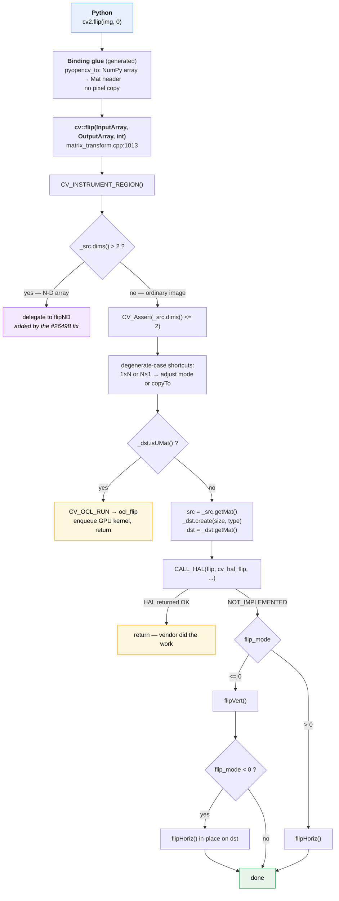
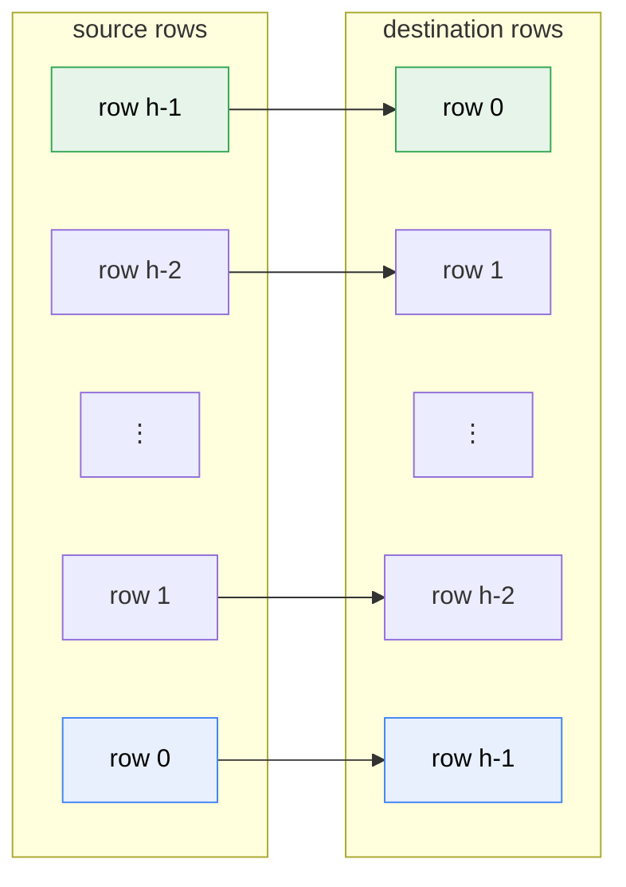
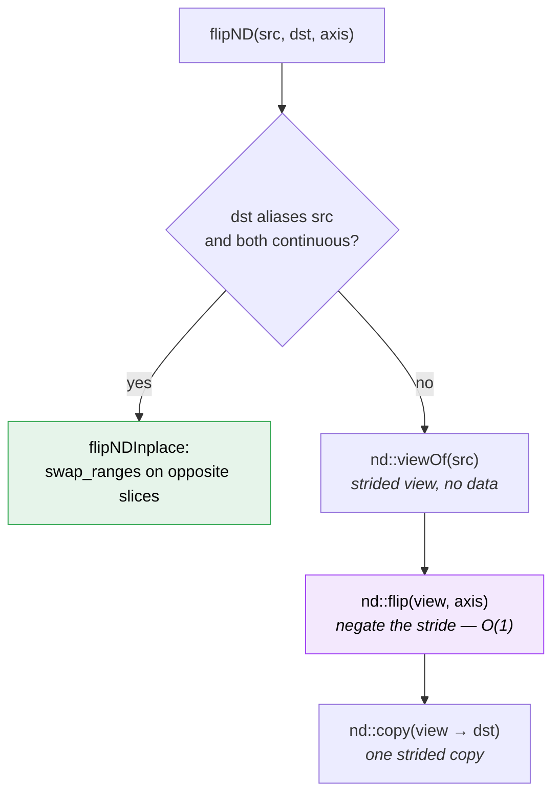

# 03 — Lifecycle of a Call

[← Architecture](02-architecture.md) · [Index](README.md) · [Next: features/ →](features/README.md)

---

This document traces **one** function — `cv::flip` — from a user's `cv2.flip(img, 0)` down to
the vector instructions that move the bytes, quoting the real code at every step.

`cv::flip` is the right specimen: it is simple enough to read completely, yet it exercises the
entire architecture — the `InputArray` adapter, lazy output allocation, an OpenCL path, a HAL
hook, element-size-based kernel selection, universal intrinsics with a scalar tail, and an N-D
delegation branch that exists only because of
[issue #26498](issue-studies/hard-26498-flip-nd-arrays.md).

All code is from `modules/core/src/matrix_transform.cpp` at commit `1e21d6ed7`.

---

## The whole journey



---

## Step 1 — Crossing the language boundary

`cv2.flip` does not exist in the C++ source. It is generated at build time by
`modules/python/src2/gen2.py` from this declaration in
`modules/core/include/opencv2/core.hpp`:

```cpp
CV_EXPORTS_W void flip(InputArray src, OutputArray dst, int flipCode);
```

`CV_EXPORTS_W` means "export **and** wrap". The generator emits an argument-parsing function
that converts each Python object to its C++ type, calls `cv::flip`, and converts the result
back. For a NumPy array the conversion builds a `Mat` **header pointing at NumPy's own
buffer** — no pixels are copied, which is why OpenCV and NumPy interoperate cheaply.

This conversion is also where an array's trailing dimension is interpreted as either a
*channel count* or a *third dimension*. The cutover at 512 channels is the mechanism behind
#26498; see [features/11](features/11-bindings.md).

---

## Step 2 — Layer ①→②: the entry point

```cpp
void flip( InputArray _src, OutputArray _dst, int flip_mode )
{
    CV_INSTRUMENT_REGION();
```

`CV_INSTRUMENT_REGION()` is a no-op unless OpenCV was built with instrumentation, in which
case it registers the call on a profiling stack. Essentially every public function opens with
it.

### 2a. The N-D branch

```cpp
    if( _src.dims() > 2 )
    {
        if (flip_mode == 0)       flipND(_src, _dst, 0);      // rows
        else if (flip_mode > 0)   flipND(_src, _dst, 1);      // columns
        else {
            Mat tmp;
            flipND(_src, tmp, 0);
            flipND(tmp, _dst, 1);
        }
        return;
    }

    CV_Assert( _src.dims() <= 2 );
```

This branch is the [#26498](issue-studies/hard-26498-flip-nd-arrays.md) fix. Note the shape of
the solution: the N-D case is **routed away** at the very top, and the entire 2-D path below is
untouched. Nothing downstream needs to learn about N-D arrays, and no optimised kernel has to
grow a new code path. That placement — before the assert, before the shortcuts, before the
backends — is what makes a 19-line patch safe in a function with this many branches.

### 2b. Degenerate shapes

```cpp
    Size size = _src.size();

    if (flip_mode < 0)
    {
        if (size.width == 1)  flip_mode = 0;     // a column vector: "both axes" == rows only
        if (size.height == 1) flip_mode = 1;     // a row vector: "both axes" == columns only
    }

    if ((size.width == 1 && flip_mode > 0) ||
        (size.height == 1 && flip_mode == 0))
    {
        return _src.copyTo(_dst);                // flipping a single row along itself: a copy
    }
```

Normalising requests that are no-ops *before* dispatch means no kernel has to handle a
degenerate case. Compare with #29854, where the degenerate case (a zero-size image) was
*not* filtered and reached a kernel that could not handle it.

### 2c. The OpenCL fork

```cpp
    CV_OCL_RUN( _dst.isUMat(), ocl_flip(_src, _dst, flip_mode))
```

The Transparent API in one line: if the *destination* is a `UMat`, try the GPU. `CV_OCL_RUN`
expands to "call it; if it returns true, `return`". The user never named a GPU function —
they chose a container type.

### 2d. Lazy output allocation

```cpp
    Mat src = _src.getMat();
    int type = src.type();
    _dst.create( size, type );
    Mat dst = _dst.getMat();
```

`_dst.create()` is the moment the output memory exists. If `_dst` already holds a correctly
sized and typed buffer, `create` is a no-op and the buffer is reused — which is how
`cv::flip(a, a, 0)` and tight loops over frames avoid reallocating.

The ordering matters: validation must happen **before** `create()`, or a throwing function
leaves a half-built output behind.

---

## Step 3 — Layer ③: offering the work to the HAL

```cpp
    CALL_HAL(flip, cv_hal_flip, type, src.ptr(), src.step, src.cols, src.rows,
             dst.ptr(), dst.step, flip_mode);
```

This is the vendor hook. In a default build `cv_hal_flip` is `hal_ni_flip`, which returns
`CV_HAL_ERROR_NOT_IMPLEMENTED`, and the macro falls through. In a KleidiCV or Carotene build
the same macro may execute an Arm-tuned kernel and `return` before any OpenCV code runs.

Observe what crosses this boundary: raw pointers, steps, dimensions, a type code and the mode.
No `Mat`, no C++ objects — the HAL is a C ABI, which is what makes it independently
compilable by a third party. It is also why the HAL can only be given *primitive* parameters,
and why a disagreement about what those parameters mean is so hard to detect
([#29985](issue-studies/hard-29985-resize-realized-scale.md)).

---

## Step 4 — Layers ④→⑤: selecting and running the kernel

```cpp
    size_t esz = CV_ELEM_SIZE(type);

    if( flip_mode <= 0 )
        flipVert( src.ptr(), src.step, dst.ptr(), dst.step, src.size(), esz );
    else
        flipHoriz( src.ptr(), src.step, dst.ptr(), dst.step, src.size(), esz );

    if( flip_mode < 0 )
        flipHoriz( dst.ptr(), dst.step, dst.ptr(), dst.step, dst.size(), esz );
}
```

Three things to notice:

1. **Type collapses to element size.** The kernels never learn whether they hold `CV_8UC3` or
   `CV_16SC1` — only that elements are `esz` bytes wide. Flipping is a pure data movement, so
   `CV_ELEM_SIZE` is the *entire* type information needed. This single abstraction replaces a
   combinatorial table of depth × channels.
2. **`flip_mode < 0` is composed, not implemented.** "Both axes" is a vertical flip followed by
   an in-place horizontal flip, reusing both kernels. The N-D branch in step 2a mirrors this
   composition.
3. **The second `flipHoriz` is deliberately in-place** (`dst` as both source and
   destination) — safe because `flipHoriz` processes each row independently, swapping from
   both ends toward the middle.

### 4a. `flipVert` — the canonical kernel shape

```cpp
static void
flipVert( const uchar* src0, size_t sstep, uchar* dst0, size_t dstep, Size size, size_t esz )
{
    const uchar* src1 = src0 + (size.height - 1)*sstep;   // last row
    uchar* dst1 = dst0 + (size.height - 1)*dstep;
    size.width *= (int)esz;                                // width in BYTES

    for( int y = 0; y < (size.height + 1)/2; y++, src0 += sstep, src1 -= sstep,
                                                  dst0 += dstep, dst1 -= dstep )
    {
        int i = 0;
#if (CV_SIMD || CV_SIMD_SCALABLE)
        {
            for (; i <= size.width - VTraits<v_uint8>::vlanes(); i += VTraits<v_uint8>::vlanes())
            {
                v_int32 t0 = v_reinterpret_as_s32(vx_load(src0 + i));
                v_int32 t1 = v_reinterpret_as_s32(vx_load(src1 + i));
                v_store(dst0 + i, v_reinterpret_as_u8(t1));
                v_store(dst1 + i, v_reinterpret_as_u8(t0));
            }
        }
#endif
        if (isAligned<sizeof(int)>(src0, src1, dst0, dst1))
        {
            for( ; i <= size.width - 16; i += 16 )   // 4-int unrolled scalar
            { /* ... */ }
        }
        /* ... byte-wise remainder ... */
    }
}
```



The loop runs `(height + 1) / 2` times, swapping a pair of rows per iteration, so the middle
row of an odd-height image is handled by the `+1` and copied to itself. Each row is three
nested fallbacks: vector-width chunks, then 16-byte chunks via `int` loads, then single bytes.
This **SIMD body + progressively narrower tails** shape is the standard OpenCV kernel idiom.

It is also the shape that caused [#29893](issue-studies/hard-29893-multiply-16u-work-type.md).
Here the SIMD and scalar paths provably agree, because both merely *move bytes* — there is no
arithmetic to disagree about. In an arithmetic kernel, the two paths are two independent
implementations of the same formula, and keeping them consistent is a real obligation.

### 4b. `flipHoriz` — dispatch on element size

A horizontal flip reverses elements within a row, so the kernel must move whole elements
rather than bytes. `flipHoriz` picks a vector lane type matching `esz`, subject to alignment:

```cpp
static void flipHoriz( const uchar* src, size_t sstep, uchar* dst, size_t dstep,
                       Size size, size_t esz )
{
#if CV_SIMD || CV_SIMD_SCALABLE
#if CV_STRONG_ALIGNMENT
    const size_t alignMark = ((size_t)src)|((size_t)dst)|sstep|dstep;
#else
    const size_t alignMark = 0;   // unaligned access allowed: checks below fold to true
#endif
    switch(esz)
    {
        case 1:   flipHoriz_single<v_uint8>(...);  return;        // CV_8UC1
        case 2:   if (isAligned<2>(alignMark)) { flipHoriz_single<v_uint16>(...); return; } break;
        case 3:   flipHoriz_c3<v_uint8>(...);      return;        // CV_8UC3 — special-cased
        case 4:   if (isAligned<4>(alignMark)) { flipHoriz_single<v_uint32>(...); return; } break;
        case 6:   if (isAligned<2>(alignMark)) { flipHoriz_c3<v_uint16>(...); return; } break;
        case 8:   if (isAligned<8>(alignMark)) { flipHoriz_single<v_uint64>(...); return; } break;
        case 12:  if (isAligned<4>(alignMark)) { flipHoriz_c3<v_uint32>(...); return; } break;
        case 16:  flipHoriz_vlanes_dispatch<16>(...); return;
#if CV_SIMD128
        case 24:  if (isAligned<8>(alignMark)) { flipHoriz_24(...); return; } break;   // CV_64FC3
#endif
        case 32:  flipHoriz_vlanes_dispatch<32>(...); return;
        default:  break;
    }
#endif
    flipHoriz_generic(src, sstep, dst, dstep, size, esz);   // always correct, never fast
}
```

Two patterns worth extracting:

- **3-channel sizes get their own kernels** (`flipHoriz_c3`, `esz` 3/6/12). An odd element
  size cannot be loaded as one power-of-two vector lane, and RGB images are too common to
  leave on the generic path. Where the library bends its own abstractions, the reason is
  almost always a dominant real-world case.
- **Every specialised case can decline.** If alignment fails, control `break`s out of the
  switch and falls to `flipHoriz_generic`. The fast paths are optional; the generic path is
  the contract. This is the same "optimisation may decline, correctness may not" discipline as
  the HAL cascade — one level down.

---

## Step 5 — the N-D path, for contrast

If step 2a took the `dims() > 2` branch, execution instead reaches `flipND`
(`matrix_transform.cpp:1069`):

```cpp
void flipND(InputArray _src, OutputArray _dst, int _axis)
{
    CV_INSTRUMENT_REGION();
    Mat src = _src.getMat();

    int ndim = src.dims;
    CV_CheckLT(_axis, ndim, "flipND: given axis is out of range");
    CV_CheckGE(_axis, -ndim, "flipND: given axis is out of range");
    int axis = (_axis + ndim) % ndim;            // negative axes count from the end, NumPy-style

    _dst.create(ndim, src.size.p, src.type());
    Mat dst = _dst.getMat();
    if (dst.data == src.data && src.isContinuous() && dst.isContinuous())
    {
        flipNDInplace(dst, axis);                // genuine in-place: swap slices, no temporary
        return;
    }

    nd::View v = nd::viewOf(src);
    nd::flip(v, axis);                           // reverse a stride — O(1), moves nothing
    nd::copy(v, nd::viewOf(dst));                // materialise the view
}
```

This is a different and arguably more elegant strategy than the 2-D path:



`nd::flip` does not move any data: it reverses the sign of a stride and offsets the base
pointer, so the *view* reads the axis backwards. `nd::copy` then performs a single strided
copy. The flip becomes free; only the unavoidable copy costs anything. `CV_CheckLT`/`CV_CheckGE`
also accept negative axes, matching NumPy semantics.

Why does the 2-D path not do this? Because a strided copy cannot use the wide aligned
loads/stores that `flipVert` and `flipHoriz` depend on. The 2-D path trades generality for
memory bandwidth on the overwhelmingly common case; `flipND` trades speed for generality. The
#26498 fix keeps both and simply routes between them.

---

## What this call teaches about the codebase

| Observation | Where it generalises |
|-------------|----------------------|
| One public signature; containers collapse via `InputArray` | Every public function |
| Validation and normalisation happen first, at the top | Entry-point convention; #29854 broke it |
| Output memory appears at `_dst.create()`, not before | Every `OutputArray` |
| Backends are *offered* the work and may decline | `CV_OCL_RUN`, `CV_IPP_RUN`, `CALL_HAL` |
| Rich types collapse to the minimum the kernel needs (`esz`) | Data-movement ops throughout |
| Complex modes are composed from simpler kernels | `flip_mode < 0`; `flipND` chaining |
| Kernels are a SIMD body plus narrowing tails | Every `*.simd.hpp` |
| Fast paths may bail out; the generic path never does | Kernel selection everywhere |
| New capability is added by routing at the top, not by editing kernels | The #26498 fix |

The last row is the most useful thing to carry into the issue studies. Four of the nine fixes
documented there are *routing* or *validation* changes at an entry point rather than
modifications to algorithms — and they are the safest patches in the set precisely because
they leave the optimised machinery alone.

Next: [`features/`](features/README.md) for subsystem-by-subsystem detail, or
[`issue-studies/`](issue-studies/README.md) to see these layers break.
