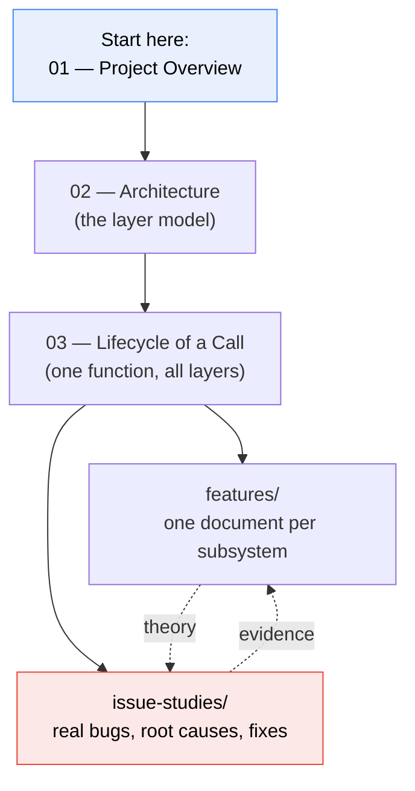

# OpenCV 5.x — Project, Architecture and Code Documentation

> **Fork:** [`varun-projects/opencv`](https://github.com/varun-projects/opencv) · **Upstream:** [`opencv/opencv`](https://github.com/opencv/opencv)
> **Tree documented:** branch `5.x`, `CV_VERSION 5.1.0-dev`, merge commit `1e21d6ed7`
> **Branch:** `intro`

This folder is a from-source guide to the OpenCV repository: what the project is, how it is
architected, how a single API call actually travels through the code, and — in
[`issue-studies/`](issue-studies/) — detailed autopsies of real bugs that were found and fixed in
this fork.

Everything here was written by reading the tree at the commit above. File and line references
(`modules/core/src/matmul.simd.hpp:411`) point at that commit, so they can be checked directly.

---

## How to read this

| # | Document | What it answers |
|---|----------|-----------------|
| 01 | [Project Overview](01-project-overview.md) | What OpenCV is, repository layout, what changed in 5.x, how the build works |
| 02 | [Architecture](02-architecture.md) | The layer model: public API → dispatch → backends. Module dependency graph. |
| 03 | [Lifecycle of a Call](03-call-lifecycle.md) | `cv::flip()` traced end-to-end through every layer, with the real code |

### Feature documentation — [`features/`](features/)

One document per major subsystem. See [`features/README.md`](features/README.md) for the index.

| Document | Subsystem |
|----------|-----------|
| [01 — Mat & InputArray](features/01-core-mat-and-inputarray.md) | The data model: `Mat`, `UMat`, N-D arrays, the `InputArray` adapter |
| [02 — SIMD & CPU Dispatch](features/02-core-simd-dispatch.md) | Universal intrinsics, baseline vs. dispatched code, `CV_CPU_DISPATCH` |
| [03 — HAL & Backends](features/03-core-hal-backends.md) | The HAL contract, KleidiCV/Carotene/IPP, OpenCL T-API, CUDA |
| [04 — Parallelism](features/04-core-parallel-for.md) | `parallel_for_`, the threading backends, nested-parallelism rules |
| [05 — Geometric Transforms](features/05-imgproc-geometric-transforms.md) | `resize`, `warpAffine`, `remap`: the coordinate-mapping core of imgproc |
| [06 — Pose Estimation](features/06-geometry-pose-estimation.md) | `solvePnP`, RANSAC, the robust-estimation framework |
| [07 — Camera Calibration](features/07-calib-camera-calibration.md) | Pinhole & fisheye calibration, the point-array shape contract |
| [08 — ArUco & AprilTag](features/08-objdetect-aruco.md) | Marker detection, the AprilTag quad-fitting pipeline |
| [09 — Object Tracking](features/09-video-tracking.md) | The `Tracker` interface, `TrackerVit`, DNN preprocessing |
| [10 — DNN Engine](features/10-dnn-engine.md) | The 5.x graph engine, layer fusion, backends and targets |
| [11 — Language Bindings](features/11-bindings.md) | How `cv2` is generated from C++ headers; the NumPy bridge |

### Issue studies — [`issue-studies/`](issue-studies/)

Nine medium-to-hard bugs fixed in this fork, each with the upstream report, a root-cause
analysis, annotated code, flowcharts, and an honest assessment of the fix's limits.
Index and selection criteria: [`issue-studies/README.md`](issue-studies/README.md).

| Study | Issue | Difficulty | The lesson in one line |
|-------|-------|------------|------------------------|
| [connectedComponents on empty input](issue-studies/medium-29854-connectedcomponents-empty.md) | [#29854](https://github.com/opencv/opencv/issues/29854) | Medium | A missing precondition check turns a user error into SIGSEGV |
| [fisheye point-array shapes](issue-studies/medium-29692-fisheye-point-shape.md) | [#29692](https://github.com/opencv/opencv/issues/29692) | Medium | An input contract honoured in one module and forgotten in another |
| [TrackerVit scalefactor](issue-studies/medium-30164-trackervit-scalefactor.md) | [#30164](https://github.com/opencv/opencv/issues/30164) | Medium | `1.0 / Scalar` is quaternion inverse, not elementwise reciprocal |
| [cv::flip on N-D arrays](issue-studies/hard-26498-flip-nd-arrays.md) | [#26498](https://github.com/opencv/opencv/issues/26498) | Hard | A 512-channel implementation limit leaking into the public API |
| [AprilTag heap leak](issue-studies/hard-27714-apriltag-heap-leak.md) | [#27714](https://github.com/opencv/opencv/issues/27714) | Hard | One raw `calloc` among RAII buffers, leaked on an early return |
| [solvePnPRansac inliers](issue-studies/hard-29573-solvepnp-ransac-inliers.md) | [#29573](https://github.com/opencv/opencv/issues/29573) | Hard | Reporting a consensus set that no longer matches the returned model |
| [multiply 16U work type](issue-studies/hard-29893-multiply-16u-work-type.md) | [#29893](https://github.com/opencv/opencv/issues/29893) | Hard | `float` as an accumulator silently loses the top of the `uint32` range |
| [resize realized scale](issue-studies/hard-29985-resize-realized-scale.md) | [#29985](https://github.com/opencv/opencv/issues/29985) | Hard | Two backends deriving the same ratio two different ways |
| [GEMM CV_64F SIMD guard](issue-studies/hard-30151-gemm-cv64f-simd-guard.md) | [#30151](https://github.com/opencv/opencv/issues/30151) | Hard | A `#if` guard that does not match the dependency it protects |

---

## Conventions used in these documents

- **Code references** are `path:line` against commit `1e21d6ed7`. Line numbers drift; the
  surrounding function name is always given so the code stays findable.
- **Flowcharts** are [Mermaid](https://mermaid.js.org/), which GitHub renders natively.
  Red nodes are bugs or failure paths, green nodes are correct paths.
- **Verified vs. inferred.** Where a claim comes from reading code, it is stated plainly.
  Where it is an inference that was *not* verified by building or running OpenCV, it is marked
  **(unverified)**. No fix in `issue-studies/` was validated by a local build — see the
  [honest-limits note](issue-studies/README.md#what-was-not-done) in the issue-studies index.

## What is deliberately not covered

- The `3rdparty/` vendored libraries (libjpeg-turbo, zlib-ng, protobuf, …) beyond naming them.
- CUDA kernel internals (`modules/core/src/cuda/`) and the `cudev` headers.
- Platform packaging (`platforms/`: Android, iOS, WinRT, Maven toolchains).
- The `ml` module, which in this 5.x tree retains only a `perf/` directory — its
  implementation has moved out of the main repository.
