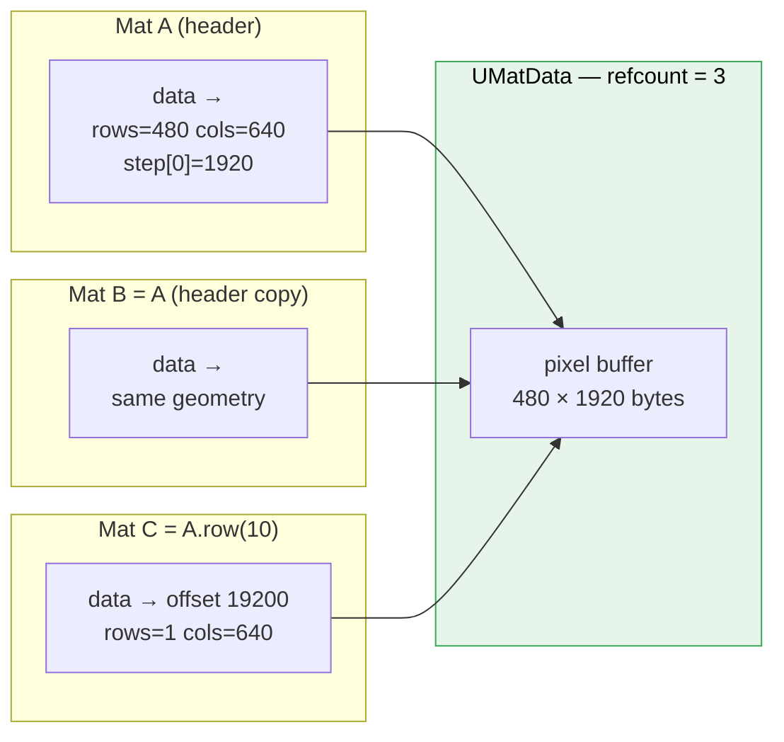
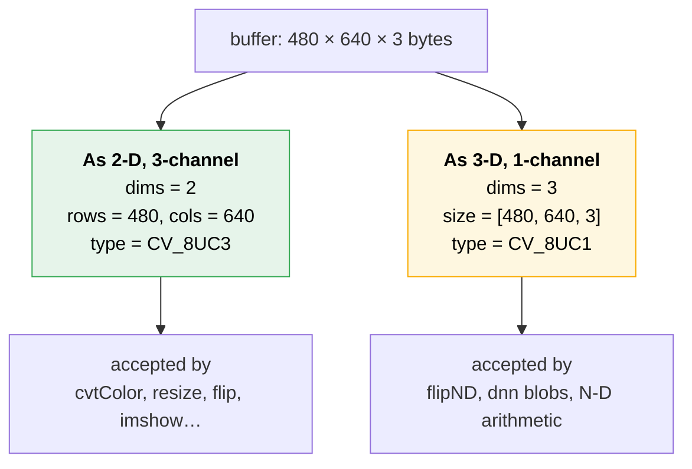

# 01 — `Mat`, `UMat` and the `InputArray` Adapter

[← features index](README.md) · [Next: SIMD & Dispatch →](02-core-simd-dispatch.md)

**Module:** `core` · **Key files:** `modules/core/include/opencv2/core/mat.hpp`,
`modules/core/src/matrix.cpp`, `modules/core/include/opencv2/core/hal/interface.h`

---

## 1. Why this comes first

`cv::Mat` is the type every OpenCV function touches, and its design decisions propagate into
every API in the library. Three of them cause recurring surprises:

1. A `Mat` is a **reference-counted view** of a buffer, not a value. Copying is O(1).
2. A trailing axis can be either a **channel count** or a **dimension**, and which one it is
   changes what functions will accept the array.
3. The same N points can be laid out several ways, all of them "valid", and each function
   decides for itself which it tolerates.

Points 2 and 3 are the direct causes of
[#26498](../issue-studies/hard-26498-flip-nd-arrays.md) and
[#29692](../issue-studies/medium-29692-fisheye-point-shape.md).

---

## 2. The structure of a `Mat`

The data members (`mat.hpp:2491`) are few, and worth memorising:

```cpp
class CV_EXPORTS Mat
{
public:
    int flags;        // depth + channel count + continuity + magic signature
    int dims;         // number of dimensions (2 for an ordinary image; up to CV_MAX_DIM = 32)
    int rows, cols;   // valid only when dims == 2; both -1 otherwise
    uchar* data;      // pointer to the FIRST element of THIS view
    const uchar* datastart;  // start of the underlying allocation
    const uchar* dataend;
    const uchar* datalimit;
    MatAllocator* allocator;
    UMatData* u;      // the reference-counted buffer descriptor (shared between views)
    MatSize size;     // size[i] for each of dims axes
    MatStep step;     // step[i] = BYTES between consecutive elements along axis i
};
```



### Consequences of the header/buffer split

| Code | Effect |
|------|--------|
| `Mat b = a;` | New header, `refcount++`. **Shares pixels.** |
| `Mat b = a.clone();` | Deep copy. |
| `a.copyTo(b);` | Deep copy, reusing `b`'s buffer if the geometry already matches. |
| `Mat r = a.row(5);` | Header pointing into `a`. Writing to `r` writes to `a`. |
| `a.reshape(3, n)` | **New header, same bytes.** O(1), requires continuity. |
| `a.release()` | `refcount--`; frees only at zero. |

`step` being in *bytes*, stored *per axis*, is what makes sub-matrix views possible: a
region of interest has the parent's `step[0]` but smaller `size`, so rows are not contiguous.
Hence `isContinuous()` must be checked before any code treats a `Mat` as one flat array —
and why `reshape()` fails on a non-continuous matrix.

---

## 3. Type encoding — and what changed in 5.x

A type is one `int` packing depth and channel count
(`modules/core/include/opencv2/core/hal/interface.h:50`):

```c
#define CV_CN_MAX     128
#define CV_CN_SHIFT   5
#define CV_DEPTH_MAX  (1 << CV_CN_SHIFT)        /* 32 */

#define CV_MAT_DEPTH(flags)   ((flags) & CV_MAT_DEPTH_MASK)
#define CV_MAKETYPE(depth,cn) (CV_MAT_DEPTH(depth) + (((cn)-1) << CV_CN_SHIFT))
```

So `CV_8UC3` is "depth 0, channels 3" in one integer, and `CV_MAT_CN(type)` /
`CV_MAT_DEPTH(type)` unpack it.

> ### ⚠️ A 5.x change that invalidates older documentation
>
> | | 4.x | **5.x (this tree)** |
> |---|---|---|
> | `CV_CN_SHIFT` | 3 | **5** |
> | `CV_DEPTH_MAX` | 8 | **32** |
> | `CV_CN_MAX` | 512 | **128** |
>
> 5.x spends more bits on depth to make room for new element types (`CV_16F`, `CV_16BF`,
> `CV_Bool`, `CV_32U`, `CV_64U`, `CV_64S`), and pays for it with a lower channel ceiling.
> **The maximum channel count in 5.x is 128, not 512.** Any explanation of
> [#26498](../issue-studies/hard-26498-flip-nd-arrays.md) that cites 512 is describing 4.x,
> where the bug was originally reported.

Depths available in 5.x: `CV_8U CV_8S CV_16U CV_16S CV_32S CV_32F CV_64F CV_16F CV_16BF
CV_Bool CV_64U CV_64S CV_32U`.

---

## 4. Channels vs. dimensions — the ambiguity that breaks functions

A `(480, 640, 3)` buffer can be described two ways, and both are legal `Mat`s:



Most image functions assert `dims() <= 2`, because their kernels index `(row, col)` and treat
channels as interleaved within an element. That assert is correct and necessary — but it makes
the 2-D/3-D choice *user-visible*, and the choice is made automatically by the Python bridge
based on the channel count. When an array has more channels than `CV_CN_MAX`, the 2-D
representation becomes impossible, and every `dims() <= 2` function becomes unreachable. That
cliff edge is #26498.

`CV_MAX_DIM` is 32 (`cvdef.h:479`), so `dims` can range from 1 to 32.

---

## 5. Point-array layouts — the other ambiguity

For a set of N points, OpenCV accepts several equivalent layouts, which is convenient for
users and a persistent hazard for implementers:

| Layout | `rows` | `cols` | `channels()` | `total()` |
|--------|--------|--------|--------------|-----------|
| `(N, 1, 3)` — column of points | N | 1 | 3 | N |
| `(1, N, 3)` — row of points | 1 | N | 3 | N |
| `(N, 3)` — plain 2-D matrix | N | 3 | 1 | 3N |
| `std::vector<Point3f>` | N | 1 | 3 | N |

A function that reads `mat.rows` as "the number of points" is correct for layouts 1 and 4 and
**silently wrong** for layout 2 — it sees one point. The library's defence is to canonicalise
immediately after `getMat()`:

```cpp
Mat object = objectPoints.getMat(i);
object = object.reshape(3, (int)object.total());   // → always (N, 1, 3)
```

`total()` is the element count regardless of layout, so `reshape(channels, total())` maps every
valid input onto the canonical column-of-points form. `cv::calibrateCamera` does this;
`fisheye::calibrate` did not, which is exactly
[#29692](../issue-studies/medium-29692-fisheye-point-shape.md).

`checkVector(elemChannels, depth)` is the matching validation helper: it returns the point
count if the array can be read as N points of the given channel count, and −1 otherwise.
`solvePnPRansac` uses it as a precondition check
(`modules/geometry/src/solvepnp.cpp:196`).

---

## 6. `InputArray` — collapsing the container dimension

Public functions take `InputArray` (`= const _InputArray&`), a type-erasing reference that
holds a `void*` and a flags word identifying the container kind (`mat.hpp:286`):

```cpp
enum KindFlag {
    KIND_SHIFT = 16,
    FIXED_TYPE = 0x8000 << KIND_SHIFT,
    FIXED_SIZE = 0x4000 << KIND_SHIFT,
    NONE = 0 << KIND_SHIFT,            MAT = 1 << KIND_SHIFT,
    MATX = 2 << KIND_SHIFT,            STD_VECTOR = 3 << KIND_SHIFT,
    STD_VECTOR_VECTOR = 4 << KIND_SHIFT, STD_VECTOR_MAT = 5 << KIND_SHIFT,
    OPENGL_BUFFER = 7 << KIND_SHIFT,   CUDA_HOST_MEM = 8 << KIND_SHIFT,
    CUDA_GPU_MAT = 9 << KIND_SHIFT,    UMAT = 10 << KIND_SHIFT,
    STD_VECTOR_UMAT = 11 << KIND_SHIFT, STD_BOOL_VECTOR = 12 << KIND_SHIFT,
    STD_VECTOR_CUDA_GPU_MAT = 13 << KIND_SHIFT, STD_ARRAY_MAT = 15 << KIND_SHIFT,
    CUDA_GPU_MATND = 16 << KIND_SHIFT, STD_VECTOR_CUDA_GPU_MAT_ND = 17 << KIND_SHIFT
};
```

The family:

| Type | Alias for | Use |
|------|-----------|-----|
| `InputArray` | `const _InputArray&` | Read-only input |
| `OutputArray` | `const _OutputArray&` | Output, allocated by the callee |
| `InputOutputArray` | `const _InputOutputArray&` | In-place |
| `InputArrayOfArrays` | `InputArray` | A sequence of arrays (per-view point sets) |
| `noArray()` | an empty `_InputOutputArray` | "I don't want this optional argument" |

Key methods: `getMat()`, `getUMat()`, `getMatVector()`, `dims()`, `size()`, `type()`,
`depth()`, `channels()`, `total()`, `empty()`, `isUMat()`, `kind()`, and — on outputs —
`create()`, `needed()`, `release()`.

### `OutputArray` is lazy

```cpp
void f(InputArray _src, OutputArray _dst)
{
    Mat src = _src.getMat();
    CV_Assert(!src.empty());          // ① validate BEFORE allocating
    _dst.create(src.size(), src.type());   // ② output exists from here on
    Mat dst = _dst.getMat();
    /* ... */
}
```

`needed()` lets a function skip computing an output the caller passed `noArray()` for — the
pattern `if (_inliers.needed()) { ... }` in `solvePnPRansac`.

The ordering in that snippet is the entry-point contract, and reversing it is a real bug
class: #29854 reached `_labels.create(...)` *before* discovering the input was empty.

---

## 7. `UMat` and the Transparent API

`UMat` has the same interface as `Mat` but its buffer may live in device memory. Choosing it
changes which backend runs, with no change to the call:

```cpp
cv::Mat  a, b;  cv::resize(a, b, sz);   // CPU
cv::UMat a, b;  cv::resize(a, b, sz);   // OpenCL kernel, if available
```

Functions detect this with `_src.isUMat()` / `_dst.isUMat()` and branch through
`CV_OCL_RUN`. Data moves lazily: `umat.getMat(ACCESS_READ)` maps the buffer back to the host,
and `Mat::getUMat()` does the reverse. Each transfer is a potential stall, so mixing the two
types in a pipeline can be slower than either alone.

---

## 8. Practical reference

### Creating

```cpp
Mat m(480, 640, CV_8UC3);                       // uninitialised
Mat m = Mat::zeros(480, 640, CV_32F);
int sz[] = {4, 6, 513};  Mat nd(3, sz, CV_8U);  // N-D
Mat wrap(h, w, CV_8UC1, external_ptr, step);    // wrap foreign memory — no ownership
Mat roi = big(Rect(10, 10, 100, 100));          // view, shares pixels
```

### Accessing

```cpp
m.at<Vec3b>(y, x)[0] = 255;      // bounds-checked in debug builds
uchar* row = m.ptr<uchar>(y);    // row pointer — the fast path
for (auto& px : Mat_<Vec3b>(m))  // typed iteration
```

### Inspecting

```cpp
m.empty(); m.isContinuous(); m.dims; m.size(); m.total();
m.type(); m.depth(); m.channels(); m.elemSize(); m.step[0];
m.checkVector(3, CV_32F);        // → point count, or -1
```

### Rules of thumb

1. **Check `isContinuous()`** before flat-pointer iteration or `reshape()`.
2. **Canonicalise point layouts** with `reshape(cn, total())` right after `getMat()`.
3. **Validate before `create()`**, always.
4. **`Mat` assignment shares**; use `clone()`/`copyTo()` when you need independence.
5. **Watch the 2-D/N-D boundary** at 128 channels in 5.x — a function is either `dims<=2` or
   N-D aware, and users cannot tell which from the signature.

---

## 9. Related studies

- [#26498 — `cv::flip` on N-D arrays](../issue-studies/hard-26498-flip-nd-arrays.md):
  the channel/dimension cliff made visible to users.
- [#29692 — fisheye point-array shapes](../issue-studies/medium-29692-fisheye-point-shape.md):
  the missing `reshape()` canonicalisation.
- [#29854 — `connectedComponents` on empty input](../issue-studies/medium-29854-connectedcomponents-empty.md):
  validation ordering relative to `create()`.
