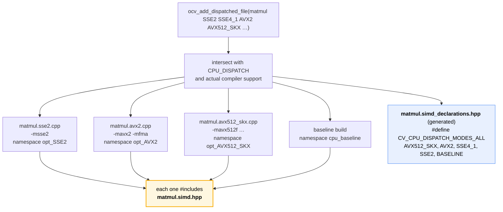
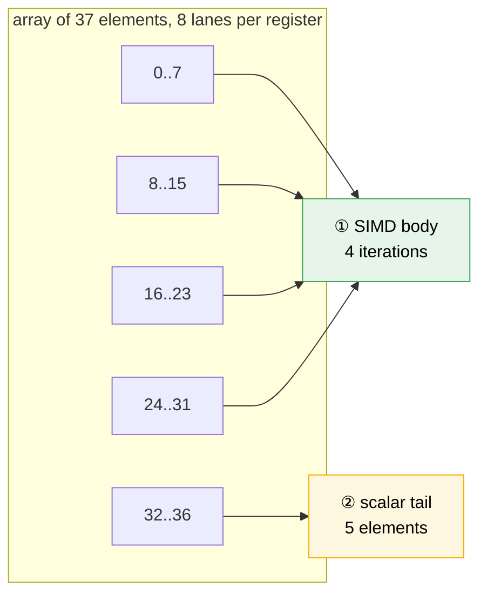

# 02 — SIMD, Universal Intrinsics and CPU Dispatch

[← Mat & InputArray](01-core-mat-and-inputarray.md) · [features index](README.md) · [Next: HAL & Backends →](03-core-hal-backends.md)

**Module:** `core` · **Key files:**
`modules/core/include/opencv2/core/hal/intrin.hpp`,
`modules/core/include/opencv2/core/cv_cpu_dispatch.h`,
`modules/core/CMakeLists.txt`, any `*.dispatch.cpp` / `*.simd.hpp` pair

---

## 1. The requirement

One shipped binary must run on a CPU with no SIMD at all *and* exploit AVX-512 where it
exists. That rules out both compiling everything at the highest instruction set (crashes
elsewhere) and compiling everything at the lowest (wastes most of the hardware).

OpenCV's answer has two halves, and conflating them is the source of real bugs:

| Problem | Mechanism | Resolved at |
|---------|-----------|-------------|
| "Write a kernel once for all architectures" | **Universal intrinsics** | Compile time |
| "Ship many versions, pick the best at startup" | **CPU dispatch** | Run time |

---

## 2. Universal intrinsics

A portable vector vocabulary that maps onto SSE/AVX/NEON/VSX/LASX/RVV, or onto a scalar
emulation where nothing exists.

```cpp
v_float32 va = vx_setall_f32(scalar);     // broadcast
v_float32 vb = vx_load(ptr);              // unaligned load
v_float32 vc = vx_load_aligned(ptr);      // aligned load
v_float32 vd = v_muladd(va, vb, vc);      // a*b + c, fused where available
v_store(dst, vd);
v_store_aligned(dst, vd);
```

The vector types are aliases resolved per compilation:

| Universal type | SSE2 | AVX2 | NEON |
|----------------|------|------|------|
| `v_uint8` | `__m128i` (16 lanes) | `__m256i` (32) | `uint8x16_t` (16) |
| `v_float32` | `__m128` (4) | `__m256` (8) | `float32x4_t` (4) |
| `v_float64` | `__m128d` (2) | `__m256d` (4) | `float64x2_t` (2, **AArch64 only**) |

Lane count comes from `VTraits<v_float32>::vlanes()` — a **function call, not a constant**,
because scalable architectures (RISC-V RVV, Arm SVE) only know their vector length at run
time. Writing `4` where `vlanes()` belongs is portable-looking code that breaks on RVV.

### The capability macros

Declared in `intrin.hpp`; these are what kernel `#if` guards test:

| Macro | True when |
|-------|-----------|
| `CV_SIMD` | A fixed-width SIMD backend exists |
| `CV_SIMD_64F` | …**and `double` vectors exist** |
| `CV_SIMD_SCALABLE` | A scalable-vector backend exists |
| `CV_SIMD_SCALABLE_64F` | …with `double` support |
| `CV_SIMD_WIDTH` | Register width in bytes |
| `CV_SIMD128`, `CV_SIMD256`, `CV_SIMD512` | Specific widths available |

> ### ⚠️ `CV_SIMD` does not imply `CV_SIMD_64F`
>
> `intrin_neon.hpp:59`:
>
> ```cpp
> #define CV_SIMD128 1
> #if defined(__aarch64__) || defined(_M_ARM64) || defined(_M_ARM64EC)
> #define CV_SIMD128_64F 1       // AArch64: float64 NEON exists
> #else
> #define CV_SIMD128_64F 0       // ARMv7 NEON: 32-bit floats only
> #endif
> ```
>
> and `intrin.hpp:524` ties them together:
>
> ```cpp
> #define CV_SIMD      CV_SIMD128
> #define CV_SIMD_64F  CV_SIMD128_64F
> ```
>
> **On 32-bit Arm, `CV_SIMD == 1` and `CV_SIMD_64F == 0`.** Guarding `double`-vector code
> with `CV_SIMD` therefore compiles it for a target where `v_float64` does not exist. That
> mismatch is [#30151](../issue-studies/hard-30151-gemm-cv64f-simd-guard.md); in 4.x the same
> confusion caused `cv::gemm` to reinterpret `double` buffers as `float` and return NaN.

---

## 3. CPU dispatch: compiling one file many times

### Declaration

`modules/core/CMakeLists.txt` opens with the dispatch manifest:

```cmake
ocv_add_dispatched_file(arithm  SSE2 SSE4_1 AVX2 NEON_FP16 VSX3 LASX)
ocv_add_dispatched_file(matmul  SSE2 SSE4_1 AVX2 AVX512_SKX NEON_DOTPROD LASX)
ocv_add_dispatched_file(stat    SSE4_2 AVX2 AVX512_SKX AVX512_ICL LASX)
ocv_add_dispatched_file(lut     AVX512_ICL)
```

### What CMake generates



**The single most important consequence:** `matmul.simd.hpp` is compiled once per instruction
set, each time with a *different* macro environment. Every `#if` inside it is evaluated
several times with different answers. A kernel author is effectively writing N programs.

### The run-time side

`*.dispatch.cpp` contains the thin selector. From
`modules/core/src/count_non_zero.dispatch.cpp:10`:

```cpp
#include "count_non_zero.simd.hpp"
#include "count_non_zero.simd_declarations.hpp"  // defines CV_CPU_DISPATCH_MODES_ALL

static CountNonZeroFunc getCountNonZeroTab(int depth)
{
    CV_INSTRUMENT_REGION();
    CV_CPU_DISPATCH(getCountNonZeroTab, (depth), CV_CPU_DISPATCH_MODES_ALL);
}
```

`CV_CPU_DISPATCH` expands (via `cv_cpu_helper.h`) into a best-first cascade:

```cpp
if (CV_CPU_HAS_SUPPORT_AVX512_SKX) return opt_AVX512_SKX::getCountNonZeroTab(depth);
if (CV_CPU_HAS_SUPPORT_AVX2)       return opt_AVX2::getCountNonZeroTab(depth);
if (CV_CPU_HAS_SUPPORT_SSE4_1)     return opt_SSE4_1::getCountNonZeroTab(depth);
return cpu_baseline::getCountNonZeroTab(depth);
```

The feature flags are read once at startup from CPUID (or the Arm/RISC-V equivalent) and
cached; `cv::checkHardwareSupport(CV_CPU_AVX2)` exposes them, and the
`OPENCV_CPU_DISABLE=AVX2` environment variable forces a lower path — invaluable when
bisecting a suspected SIMD bug.

### Baseline vs. dispatched

| Term | Meaning | CMake |
|------|---------|-------|
| **Baseline** | Assumed present; used unguarded everywhere | `CPU_BASELINE=SSE3` |
| **Dispatched** | Compiled as extra variants, chosen at run time | `CPU_DISPATCH=SSE4_2,AVX,AVX2` |

Default x86-64 baseline is SSE3; AArch64's is NEON (architecturally guaranteed). Raising the
baseline makes code faster and the binary less portable.

---

## 4. Anatomy of a kernel

Nearly every kernel in the library has this shape:

```cpp
void someOp(const T* src, T* dst, int len)
{
    int x = 0;
#if (CV_SIMD || CV_SIMD_SCALABLE)
    const int vlanes = VTraits<v_float32>::vlanes();
    for (; x <= len - vlanes; x += vlanes)      // ① whole registers
    {
        v_float32 v = vx_load(src + x);
        v_store(dst + x, v_mul(v, v));
    }
#endif
    for (; x < len; x++)                         // ② scalar tail
        dst[x] = src[x] * src[x];
}
```



> ### ⚠️ The structural hazard
>
> ① and ② are **two independent implementations of the same formula**, and nothing checks
> that they agree. When they use different intermediate types, the function changes behaviour
> partway through the array. The symptom is bizarre: correct for most lengths, wrong for
> arrays shorter than one register and for the last `len % vlanes` elements of longer ones.
>
> That is exactly
> [#29893](../issue-studies/hard-29893-multiply-16u-work-type.md): the SIMD path used a
> saturating integer multiply, the tail used `float` as its work type, and `65535 × 65535`
> produced `0` instead of `65535` — but only in the tail.
>
> When reviewing a SIMD kernel, the two highest-value questions are:
> **(a) do the body and the tail compute the same function over the whole input domain?**
> and **(b) does each `#if` name the capability its body actually requires?**

### Alignment and strong-alignment targets

Some architectures fault on unaligned vector access. Kernels test for this, e.g.
`flipHoriz` in `modules/core/src/matrix_transform.cpp:785`:

```cpp
#if CV_STRONG_ALIGNMENT
    const size_t alignMark = ((size_t)src)|((size_t)dst)|sstep|dstep;
#else
    const size_t alignMark = 0;   // unaligned allowed: the checks below fold to true
#endif
    ...
    case 4: if (isAligned<4>(alignMark)) { flipHoriz_single<v_uint32>(...); return; } break;
```

OR-ing the pointers and the steps together tests every alignment requirement at once — if
any low bit is set anywhere, `isAligned<N>` fails and the generic path takes over.

---

## 5. Example: the GEMM work-type pattern

`modules/core/src/matmul.simd.hpp` shows how a kernel parameterises over its vector type —
and where that goes wrong. A local traits class maps a scalar type to its vector type
(`matmul.simd.hpp:201`):

```cpp
#if (CV_SIMD || CV_SIMD_SCALABLE)
template<typename ST> struct VecTraits;

template<> struct VecTraits<float> {          // ← guarded by CV_SIMD
    typedef v_float32 VT;
    static inline VT zero()                { return vx_setzero_f32(); }
    static inline VT load(const float* p)   { return vx_load(p); }
    static inline VT setall(float v)        { return vx_setall_f32(v); }
};
#endif

#if (CV_SIMD_64F || CV_SIMD_SCALABLE_64F)     // ← guarded by CV_SIMD_64F
template<> struct VecTraits<double> {
    typedef v_float64 VT;
    static inline VT zero()                 { return vx_setzero_f64(); }
    static inline VT load(const double* p)  { return vx_load(p); }
    static inline VT setall(double v)       { return vx_setall_f64(v); }
};
#endif
```

The guards are correct and deliberately different: `VecTraits<double>` can only exist where
`double` vectors exist. The kernel that uses it, however, was guarded by the *weaker* macro
(`matmul.simd.hpp:411`, before the fix):

```cpp
#if (CV_SIMD || CV_SIMD_SCALABLE)             // ← too weak for a body that needs VecTraits<double>
template<typename ST>
static inline void simdGEMM_kj(const ST* a_data, ...)
{
    typedef typename VecTraits<ST>::VT VecT;  // undefined for ST = double on ARMv7
    const int vlanes = VTraits<VecT>::vlanes();
    ...
}
#endif
```

The full analysis of why this is a latent hazard rather than an immediate failure — and why
it manifested as NaN in 4.x but not in 5.x — is
[issue study #30151](../issue-studies/hard-30151-gemm-cv64f-simd-guard.md).

---

## 6. Practical guidance

### Reading a dispatched file

1. Open `modules/<m>/CMakeLists.txt` and find the `ocv_add_dispatched_file` line — it lists
   every instruction set the file is compiled for.
2. Read `foo.dispatch.cpp` for the entry point, backend cascade and `CV_CPU_DISPATCH`.
3. Read `foo.simd.hpp` for the kernels. Remember: **this file is compiled once per
   instruction set.** Mentally re-evaluate the `#if`s for each target.
4. `foo.simd_declarations.hpp` does not exist in the repository — it is generated into the
   build directory.

### Debugging a suspected SIMD bug

```bash
OPENCV_CPU_DISABLE=AVX2,AVX512_SKX ./opencv_test_core   # force a lower path
```

If the failure disappears, the bug is in the disabled variant. If it survives all the way to
the baseline, suspect the scalar tail — and check lengths shorter than one register, which is
how #29893 was characterised.

### Checklist for writing a kernel

- [ ] Does the SIMD body compute the *same function* as the scalar tail over the whole input
      domain, including saturation and overflow edges?
- [ ] Does each `#if` name the capability the body actually needs (`CV_SIMD_64F`, not
      `CV_SIMD`, for `double`)?
- [ ] Is lane count from `VTraits<...>::vlanes()` rather than a literal?
- [ ] Are scalable variants (`CV_SIMD_SCALABLE*`) handled alongside fixed-width ones?
- [ ] Are there tests at lengths `0`, `1`, `vlanes − 1`, `vlanes`, `vlanes + 1`, and at the
      saturation boundaries of the element type?

---

## 7. Related studies

- [#30151 — GEMM `CV_64F` SIMD guard](../issue-studies/hard-30151-gemm-cv64f-simd-guard.md):
  a `#if` that did not match its dependency.
- [#29893 — `multiply` 16U work type](../issue-studies/hard-29893-multiply-16u-work-type.md):
  SIMD body and scalar tail disagreeing.
