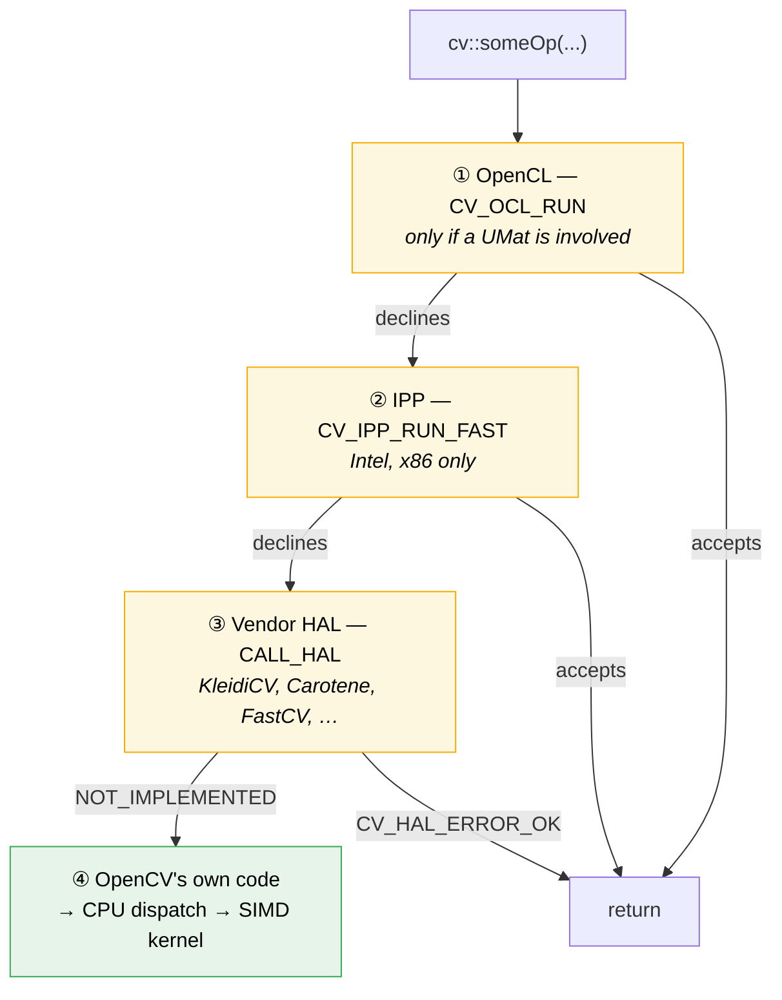
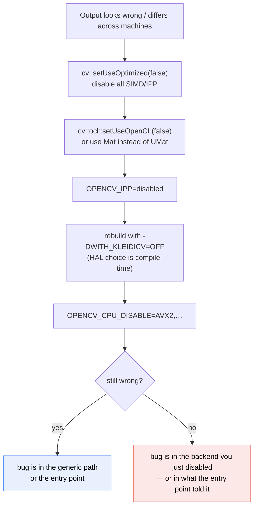

# 03 — The HAL and the Backend Cascade

[← SIMD & Dispatch](02-core-simd-dispatch.md) · [features index](README.md) · [Next: Parallelism →](04-core-parallel-for.md)

**Module:** `core` (mechanism), `hal/` (implementations) · **Key files:**
`modules/core/src/hal_replacement.hpp`, `modules/core/src/hal_internal.cpp`,
`modules/*/src/opencl/*.cl`

---

## 1. Two kinds of acceleration

[Document 02](02-core-simd-dispatch.md) covered acceleration *inside* OpenCV: the same kernel
compiled for several instruction sets. This document covers acceleration by **replacing**
OpenCV's kernel with somebody else's implementation of the whole operation.



The governing principle: **an optimisation may decline; the generic path may not.** Every
accelerated path is allowed to say "not me", and something correct is always behind it.

---

## 2. The HAL contract

The Hardware Abstraction Layer is a **C ABI** that a third party can implement without
touching OpenCV's sources. Its declarations live in `modules/core/src/hal_replacement.hpp`
(and per-module equivalents such as `modules/imgproc/src/hal_replacement.hpp`), and each hook
has a default that politely declines (`hal_replacement.hpp:1193`):

```cpp
/**
   @param src_type source and destination image type
   @param src_data source image data
   ...
   @param flip_mode 0 flips around x-axis, positive around y-axis, negative both
 */
inline int hal_ni_flip(int src_type, const uchar* src_data, size_t src_step,
                       int src_width, int src_height,
                       uchar* dst_data, size_t dst_step, int flip_mode)
{ return CV_HAL_ERROR_NOT_IMPLEMENTED; }

//! @cond IGNORED
#define cv_hal_flip hal_ni_flip
```

A vendor supplies a header that re-`#define`s `cv_hal_flip` to its own symbol, and the call
site binds to it at compile time.

### The three-way protocol

`hal_replacement.hpp:1320`:

```cpp
#define CALL_HAL_RET2(name, fun, retval, ...)                                  \
{                                                                              \
    int res = __CV_EXPAND(fun(__VA_ARGS__));                                   \
    if (res == CV_HAL_ERROR_OK)                                                \
        return retval;                                                         \
    else if (res != CV_HAL_ERROR_NOT_IMPLEMENTED)                              \
        CV_Error_(cv::Error::StsInternal,                                      \
        ("HAL implementation " CVAUX_STR(name) " ==> " CVAUX_STR(fun)          \
         " returned %d (0x%08x)", res, res));                                  \
}

#define CALL_HAL_RET(name, fun, retval, ...) CALL_HAL_RET2(name, fun, retval, __VA_ARGS__, &retval)
#define CALL_HAL(name, fun, ...)             CALL_HAL_RET2(name, fun, ,__VA_ARGS__)
```

| Return code | Meaning | Effect |
|-------------|---------|--------|
| `CV_HAL_ERROR_OK` | Handled | `return` immediately — OpenCV's code never runs |
| `CV_HAL_ERROR_NOT_IMPLEMENTED` | Declined | Fall through to the next backend |
| anything else | Failed | `CV_Error` — throw, do **not** silently retry |

Note the asymmetry in the third row: a HAL that *fails* is a hard error, not a fallback. A HAL
that cannot handle an input must say `NOT_IMPLEMENTED`, not return an error code.

### A call site

`modules/core/src/matrix_transform.cpp:1041`:

```cpp
CALL_HAL(flip, cv_hal_flip, type, src.ptr(), src.step, src.cols, src.rows,
         dst.ptr(), dst.step, flip_mode);
```

Everything crossing the boundary is primitive: pointers, byte steps, dimensions, a type code,
a mode integer. No `Mat`, no templates, no exceptions. That is what makes the HAL
independently compilable — and what makes it dangerous.

> ### ⚠️ The HAL's structural bug class
>
> Because only primitives cross the boundary, **a HAL and OpenCV can disagree about what a
> parameter means, and nothing detects it.** Both sides compile, neither crashes, and the
> outputs differ.
>
> `cv::resize` passes *both* an output size and a scale factor. If rounding has made them
> inconsistent, a HAL deriving coordinates from `dst_size / src_size` and an OpenCV kernel
> using the passed-in `inv_scale` sample different source pixels. KleidiCV did the former,
> OpenCV's scalar path the latter, and the resulting mismatch — up to 104 grey levels —
> is [#29985](../issue-studies/hard-29985-resize-realized-scale.md).
>
> The bug was *only visible with a HAL enabled*. Without one, both sides were wrong in the
> same way and the tests passed. **A second implementation is a correctness oracle**: when
> two backends disagree, at least one is wrong, even if neither looks it.

---

## 3. The shipped HAL implementations

`hal/` contains seven, selected at configure time:

| Directory | Vendor / target | Typical flag |
|-----------|-----------------|--------------|
| `carotene` | Arm NEON (long-standing, bundled) | `-DWITH_CAROTENE=ON` |
| `kleidicv` | Arm's newer optimised kernels | `-DWITH_KLEIDICV=ON` |
| `armpl` | Arm Performance Libraries (BLAS/LAPACK) | `-DWITH_ARMPL=ON` |
| `fastcv` | Qualcomm FastCV (Snapdragon) | `-DWITH_FASTCV=ON` |
| `ipp` | Intel IPP | `-DWITH_IPP=ON` |
| `ndsrvp` | Andes RISC-V DSP extensions | `-DWITH_NDSRVP=ON` |
| `riscv-rvv` | RISC-V Vector extension | `-DWITH_RVV=ON` |

Each contributes a header of `#define cv_hal_* my_impl` lines plus its implementations. A HAL
typically covers a few dozen high-value operations (resize, filters, colour conversion,
arithmetic) and declines everything else.

There is also a **BLAS/LAPACK HAL** for linear algebra (`hal_internal.cpp`), which routes
`cv::solve`, `cv::SVD`, `cv::invert` and friends to a system LAPACK when one is configured.

---

## 4. OpenCL and the Transparent API

### The user-facing contract

The backend is selected by *container type*, not by function name:

```cpp
cv::Mat  src, dst;  cv::resize(src, dst, sz);   // CPU
cv::UMat src, dst;  cv::resize(src, dst, sz);   // OpenCL, if a device is available
```

Internally, every OpenCL-capable function carries a guarded branch
(`modules/imgproc/src/resize.cpp:3601`):

```cpp
CV_OCL_RUN(_src.dims() <= 2 && _dst.isUMat() && _src.cols() > 10 && _src.rows() > 10,
           ocl_resize(_src, _dst, dsize, inv_scale_x, inv_scale_y, interpolation))
```

The condition is as interesting as the call: GPU dispatch is refused for tiny images, because
kernel launch overhead would dominate. `CV_OCL_RUN` expands to "call it; if it returns true,
`return`" — so an OpenCL implementation also declines simply by returning `false`.

### Kernels

OpenCL sources live in `modules/<m>/src/opencl/*.cl` and are embedded into the binary as
strings at build time, then compiled on the device at first use and cached. The host side
looks like (`count_non_zero.dispatch.cpp:25`):

```cpp
ocl::Kernel k("reduce", ocl::core::reduce_oclsrc,
              format("-D srcT=%s -D cn=1 -D OP_COUNT_NON_ZERO -D WGS=%d ...",
                     ocl::typeToStr(CV_MAKE_TYPE(depth, kercn)), (int)wgs, ...));
if (k.empty())
    return false;                       // build failed → decline, CPU path takes over
```

Type specialisation happens through **preprocessor defines passed as build options** — one
`.cl` file serves every type by being compiled with different `-D srcT=...`. This is the GPU
analogue of the `.simd.hpp`-compiled-N-times trick, and it has the same consequence: a single
source file represents many programs.

### Useful controls

```bash
OPENCV_OPENCL_DEVICE=:GPU:0     # choose a device
OPENCV_OPENCL_RUNTIME=disabled  # disable OpenCL entirely
OPENCV_OPENCL_TRACE=1           # log kernel launches
```

`cv::ocl::setUseOpenCL(false)` does the same at runtime — the fastest way to tell whether a
discrepancy is GPU-related.

---

## 5. IPP

Intel's IPP is wired in through `CV_IPP_RUN_FAST(fn, retval)` and isolated in
`#if defined HAVE_IPP` blocks. Two habits recur in these wrappers, both visible in
`count_non_zero.dispatch.cpp:60`:

```cpp
#if IPP_VERSION_X100 < 201801
    if (cv::ipp::getIppTopFeatures() == ippCPUID_SSE42)
        return false;       // this IPP version is slower than our own SSE4.2 kernel
#endif
    ...
    if (depth == CV_8U)       status = CV_INSTRUMENT_FUN_IPP(ippiCountInRange_8u_C1R, ...);
    else if (depth == CV_32F) status = CV_INSTRUMENT_FUN_IPP(ippiCountInRange_32f_C1R, ...);
    else return false;        // unsupported type → decline
```

1. **Version- and CPU-conditional refusal.** A backend declining because it would be *slower*
   is normal.
2. **Narrow type coverage.** IPP handles the common depths and declines the rest.

`cv::ipp::setUseIPP(false)` or `OPENCV_IPP=disabled` turns it off for A/B testing.

---

## 6. CUDA

CUDA is the one backend that is *not* transparent. It has explicit types
(`cv::cuda::GpuMat`) and explicit namespaced functions:

```cpp
cv::cuda::GpuMat d_src, d_dst;
d_src.upload(h_src);
cv::cuda::resize(d_src, d_dst, sz);     // explicit, not cv::resize
d_dst.download(h_dst);
```

`InputArray` does know about `CUDA_GPU_MAT` and `CUDA_GPU_MATND` kinds, so a `GpuMat` can be
passed to generic code, but the compute path is chosen by the caller. The `dnn` module is the
exception — `DNN_BACKEND_CUDA` is selected by configuration, not by container type.

---

## 7. Deciding which backend ran



`cv::getBuildInformation()` prints which backends were compiled in — the first thing to check
when a result cannot be reproduced on another machine.

Note the wording of the last node. When disabling a HAL makes a discrepancy disappear, the
HAL is the *obvious* suspect but not always the guilty party: in #29985 the HAL was computing
the *more* defensible answer, and the real defect was that the entry point handed the two
backends inconsistent parameters. "Which backend differs" and "which backend is wrong" are
different questions.

---

## 8. Related studies

- [#29985 — `resize` realized scale](../issue-studies/hard-29985-resize-realized-scale.md):
  two backends deriving the same ratio differently; only visible with a HAL enabled.
- [#26498 — `cv::flip` on N-D arrays](../issue-studies/hard-26498-flip-nd-arrays.md):
  how the N-D branch was added *above* the OpenCL and HAL hooks so neither had to change.
