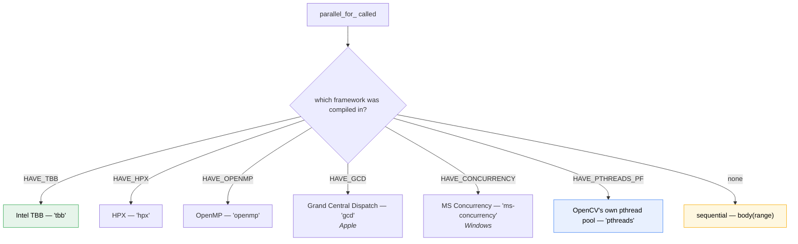
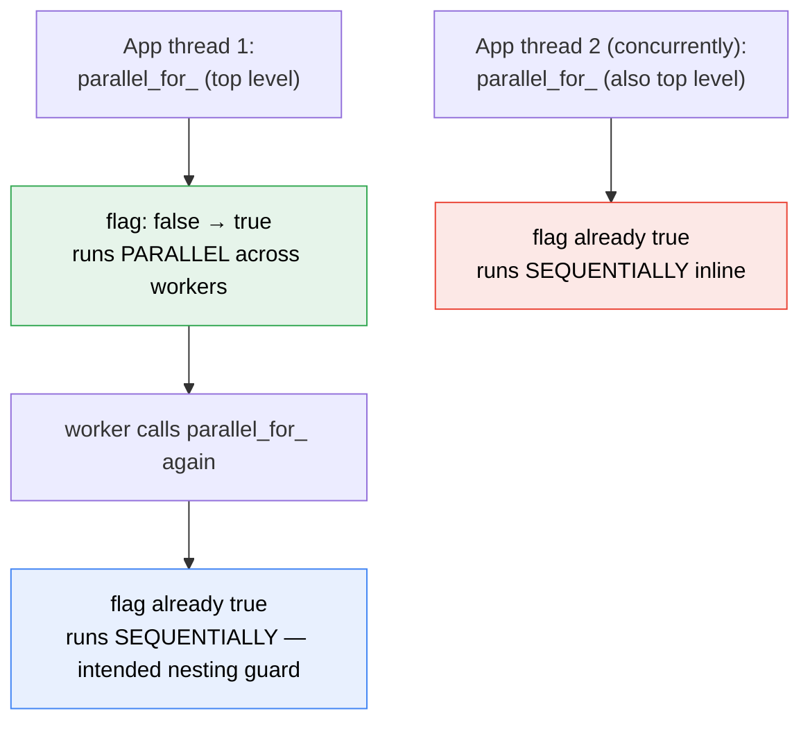
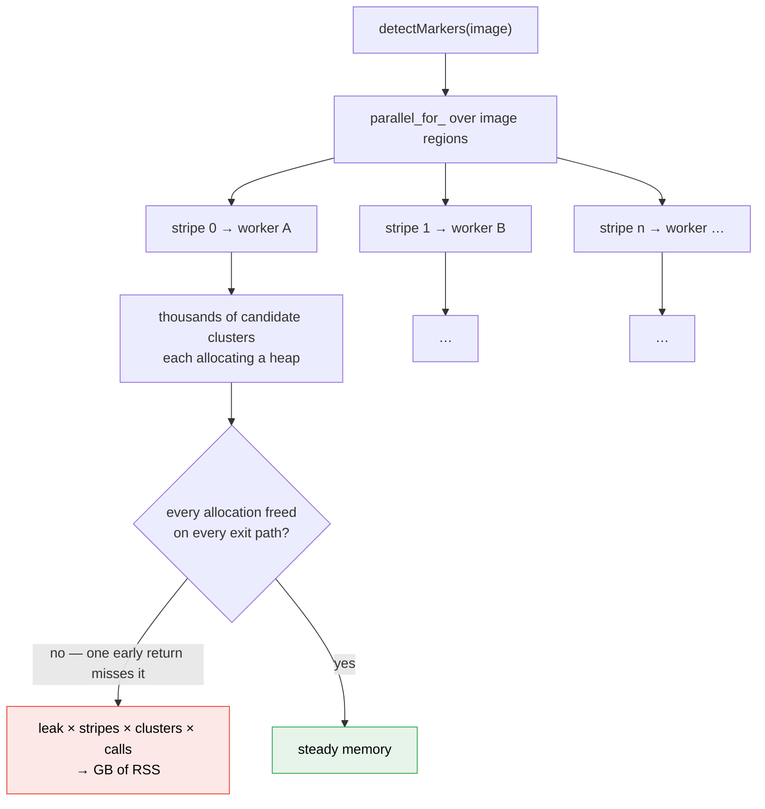

# 04 — Parallelism: `parallel_for_`

[← HAL & Backends](03-core-hal-backends.md) · [features index](README.md) · [Next: Geometric Transforms →](05-imgproc-geometric-transforms.md)

**Module:** `core` · **Key files:** `modules/core/src/parallel.cpp`,
`modules/core/src/parallel_impl.cpp`, `modules/core/src/parallel/`,
`modules/core/include/opencv2/core/utility.hpp`

---

## 1. The abstraction

Data parallelism in OpenCV is expressed one way — `cv::parallel_for_` — regardless of which
threading library the build uses:

```cpp
cv::parallel_for_(cv::Range(0, rows), [&](const cv::Range& r) {
    for (int y = r.start; y < r.end; y++) {
        /* process row y */
    }
}, nstripes);
```

The callable receives a **sub-range**, not an index, so the body keeps its own inner loop.
That shape lets a single invocation cover many rows, which is what makes the abstraction cheap
enough to use inside kernels.

The classic (pre-lambda) form implements `cv::ParallelLoopBody`:

```cpp
class MyLoop : public cv::ParallelLoopBody {
public:
    void operator()(const cv::Range& r) const override { /* ... */ }
};
cv::parallel_for_(cv::Range(0, rows), MyLoop());
```

---

## 2. Backend selection

The threading backend is chosen **at build time**, in a fixed priority order
(`modules/core/src/parallel.cpp:105`):



`CV_PARALLEL_FRAMEWORK` holds the winner's name and appears in
`cv::getBuildInformation()`. There is also a **plugin** mechanism
(`modules/core/src/parallel/plugin_parallel_api.hpp`) allowing a backend to be loaded at run
time rather than compiled in.

`HAVE_PTHREADS_PF` is OpenCV's own worker pool (`parallel_impl.cpp`) — the default on Linux
builds without TBB, and the reason OpenCV is multithreaded out of the box with no external
dependency.

### Runtime controls

| Call / variable | Effect |
|-----------------|--------|
| `cv::setNumThreads(n)` | Use `n` threads |
| `cv::setNumThreads(0)` | **Disable threading** — run everything inline |
| `cv::setNumThreads(-1)` | Reset to the default |
| `cv::getNumThreads()` | Current limit |
| `cv::getNumberOfCPUs()` | Detected CPU count |
| `OPENCV_FOR_THREADS_NUM=n` | Same as `setNumThreads` via environment |

`getNumberOfCPUs()` is more careful than it looks: on Linux it consults cgroup v1 and v2
quotas (`cpuset.cpus`, CFS quota/period) before `/sys/devices/system/cpu/online`
(`parallel.cpp:983-1035`), so a container with a 2-CPU quota on a 64-core host gets 2 — not
64.

---

## 3. Stripes

`nstripes` controls how the range is divided:

```cpp
ctx.nstripes = cvRound(_nstripes <= 0 ? len : MIN(MAX(_nstripes, 1.), len));
```

(`parallel.cpp:209`), and a stripe index maps back to a sub-range by proportional division
(`parallel.cpp:345`):

```cpp
r.start = wholeRange.start + ((uint64)sr.start*(wholeRange.end - wholeRange.start) + nstripes/2)/nstripes;
r.end   = sr.end >= nstripes ? wholeRange.end
        : wholeRange.start + ((uint64)sr.end*(wholeRange.end - wholeRange.start) + nstripes/2)/nstripes;
```

| `nstripes` | Behaviour |
|-----------|-----------|
| omitted / `≤ 0` | One stripe per range element — maximum scheduling flexibility |
| `n > 0` | Exactly `min(n, len)` stripes |

More stripes means better load balancing and more per-stripe overhead. Image kernels commonly
pass something proportional to total work, e.g. `(double)total/(1 << 16)`, so that small
images are not split at all.

---

## 4. ⚠️ Nesting: the global flag

`parallel_for_` refuses to nest (`parallel.cpp:527`):

```cpp
static std::atomic<bool> flagNestedParallelFor(false);
bool isNotNestedRegion = !flagNestedParallelFor.load();
if (isNotNestedRegion)
  isNotNestedRegion = !flagNestedParallelFor.exchange(true);
if (isNotNestedRegion)
{
    try { parallel_for_impl(range, body, nstripes); flagNestedParallelFor = false; }
    catch (...) { flagNestedParallelFor = false; throw; }
}
else // nested parallel_for_() calls are not parallelized
{
    CV_UNUSED(nstripes);
    body(range);          // run inline, in the calling thread
}
```

This prevents thread-count explosion when a parallelised algorithm calls a parallelised
primitive. But note what the flag actually is: **a single global `std::atomic<bool>`, not a
thread-local**. The consequence is easy to miss and sometimes surprising:



So in a multithreaded *application*, only one `parallel_for_` region is parallelised at a
time; concurrent ones from other user threads execute inline. That is usually the right
outcome for total throughput — the cores are already busy — but it means **"OpenCV is slow
when I call it from my own threads" and "OpenCV ignores `setNumThreads` in my thread pool" are
expected behaviours, not bugs.** (Read from the code above; not measured here.)

---

## 5. Allocation and resource lifetime under threads

This is where parallelism intersects with the bug studies.

A `parallel_for_` body runs **once per stripe, on an arbitrary worker thread**. Anything it
allocates and fails to release leaks once per stripe, per call. Threading does not create such
a bug, but it multiplies its rate and relocates the symptom.



That is the shape of [#27714](../issue-studies/hard-27714-apriltag-heap-leak.md): a raw
`calloc`'d heap inside the AprilTag quad fitter was not released on one early-return path. The
reporter observed gigabytes of growth **only** in multithreaded runs and reasonably filed it
as a threading bug — but the defect is a plain missing `free` on an error path, independent of
threads. Concurrency only changed how often the path was taken and how visible the result was.

The lessons generalise:

1. **Prefer RAII over manual release**, especially inside parallel bodies. OpenCV provides
   `cv::AutoBuffer<T, N>` (stack storage for small N, heap above it) and `cv::Ptr<T>`. The
   very function in #27714 used `AutoBuffer` for two of its three allocations — and leaked
   only the third, the one managed by hand.
2. **Per-thread scratch belongs in the body**, not in shared state. A buffer hoisted out of
   the body for "efficiency" becomes a data race.
3. **An exception propagates out of `parallel_for_`** — the wrapper captures it and rethrows
   on the calling thread (`parallel.cpp:248`). Code between an allocation and its release must
   therefore be exception-safe, not merely return-safe. Even after the #27714 fix, a throwing
   `CV_Assert` on the line above still leaks that heap.

---

## 6. Other concurrency facilities

| Facility | Purpose |
|----------|---------|
| `cv::AutoLock` / `cv::Mutex` | Simple mutual exclusion |
| `cv::TLSData<T>` | Per-thread data with automatic cleanup |
| `cv::theRNG()` | **Thread-local** RNG — each worker has its own stream |
| `cv::utils::lock_guard` | RAII locking |

The RNG is worth a note because `parallel.cpp:232` documents a real caveat: since nested jobs
may run in the main thread, the framework restores the RNG state after a parallel region and
advances it by one step, so **randomised algorithms are not bit-reproducible between
single- and multi-threaded runs**. Tests that depend on exact random sequences must fix the
seed *and* the thread count.

---

## 7. Related studies

- [#27714 — AprilTag heap leak](../issue-studies/hard-27714-apriltag-heap-leak.md):
  a manual allocation among RAII buffers, leaked on an early return, surfaced by threading.
