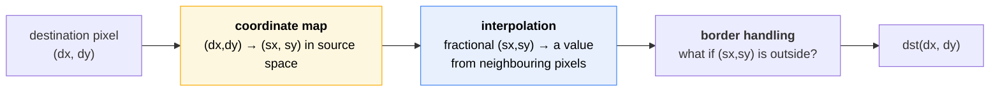
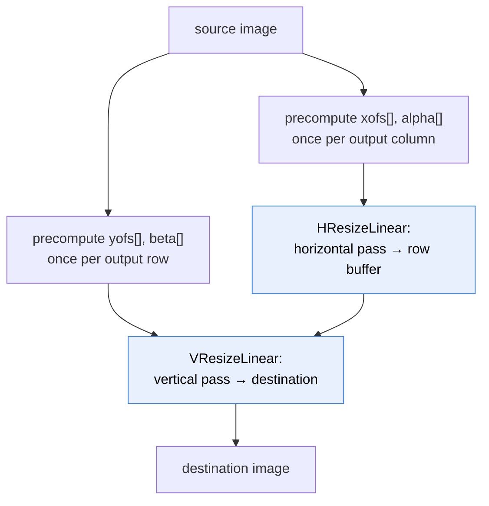
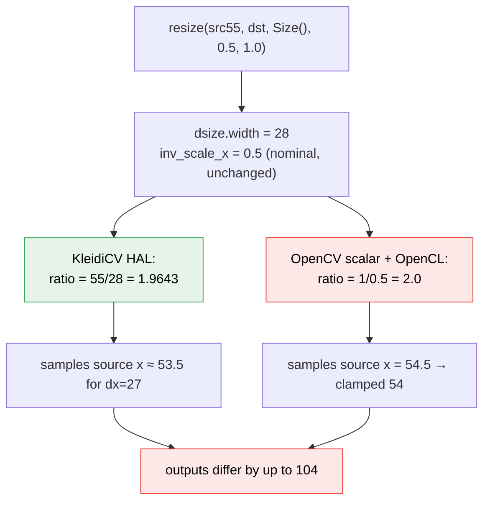

# 05 — Geometric Transforms: `resize`, `warpAffine`, `remap`

[← Parallelism](04-core-parallel-for.md) · [features index](README.md) · [Next: Pose Estimation →](06-geometry-pose-estimation.md)

**Module:** `imgproc` · **Key files:** `modules/imgproc/src/resize.cpp`,
`modules/imgproc/src/imgwarp.cpp`, `modules/imgproc/src/opencl/resize.cl`

---

## 1. One idea behind all of them

Every geometric transform answers the same question for each output pixel:

> **Which source coordinate does this destination pixel come from, and how do I turn the
> (generally fractional) answer into a value?**



What differs between functions is only the first box:

| Function | Coordinate map |
|----------|----------------|
| `resize` | `sx = dx·scale_x`, `sy = dy·scale_y` — separable, axis-aligned |
| `warpAffine` | `(sx,sy) = M · (dx,dy,1)`, M a 2×3 matrix |
| `warpPerspective` | `(sx,sy) = homogeneous divide of M · (dx,dy,1)`, M 3×3 |
| `remap` | `(sx,sy) = map1(dx,dy), map2(dx,dy)` — arbitrary, user-supplied |
| `undistort` | `remap` with maps from the lens model |

All transforms are **backward maps**: they iterate over *destination* pixels and pull from the
source. A forward map would leave holes.

---

## 2. Interpolation and border modes

| Flag | Taps | Notes |
|------|------|-------|
| `INTER_NEAREST` | 1 | Fastest; use for label/mask images |
| `INTER_LINEAR` | 2×2 | Default; fixed-point on integer types |
| `INTER_CUBIC` | 4×4 | Sharper, can overshoot |
| `INTER_LANCZOS4` | 8×8 | Highest quality, slowest |
| `INTER_AREA` | varies | **Downscaling only** — averages a source box, avoids aliasing |
| `INTER_LINEAR_EXACT` | 2×2 | Bit-exact integer linear; reproducible across backends |
| `INTER_NEAREST_EXACT` | 1 | Bit-exact nearest, matching Pillow's rounding |

The `*_EXACT` variants exist precisely because ordinary `INTER_LINEAR` is *not* guaranteed
identical across backends — which is the subject of §5.

Border modes (`BORDER_CONSTANT`, `REPLICATE`, `REFLECT`, `REFLECT_101`, `WRAP`,
`TRANSPARENT`) decide what happens outside the source. `resize` does not take one: it clamps
internally, because its map never leaves the image by more than a fraction of a pixel.

**`INTER_AREA` is the usual right answer for downscaling.** `INTER_LINEAR` samples only 2×2
source pixels regardless of the scale factor, so reducing an image 10× discards 96% of the
input and aliases badly.

---

## 3. Fixed-point interpolation

For integer images, `resize` precomputes the coordinate map and interpolation weights once,
in fixed point:

```cpp
#define INTER_RESIZE_COEF_BITS   5
#define INTER_RESIZE_COEF_SCALE  (1 << INTER_RESIZE_COEF_BITS)   // 32
```

so a weight in [0,1] becomes an integer in [0,32] and the inner loop is integer multiply-add
with a final shift (`FixedPtCast<int, uchar, INTER_RESIZE_COEF_BITS*2>`). Three benefits:
the coordinate map is computed once per axis rather than per pixel, the kernel vectorises
over 16-bit lanes, and the result is deterministic.

The precomputation is visible in the function tables in `hal::resize`
(`resize.cpp:3227`), where each depth gets a `resizeGeneric_<HResizeLinear<...>,
VResizeLinear<...>>` pair — the transform is **separable**: resize horizontally into a row
buffer, then vertically.



---

## 4. `cv::resize`'s two calling conventions

```cpp
void resize(InputArray src, OutputArray dst, Size dsize,
            double fx = 0, double fy = 0, int interpolation = INTER_LINEAR);
```

```cpp
cv::resize(src, dst, cv::Size(800, 600));          // ① explicit output size
cv::resize(src, dst, cv::Size(), 0.5, 0.5);        // ② scale factors
```

Both are converted into *both* representations at the entry point
(`resize.cpp:3579`):

```cpp
Size ssize = _src.size();
CV_Assert( !ssize.empty() );
if( dsize.empty() )
{
    CV_Assert(inv_scale_x > 0); CV_Assert(inv_scale_y > 0);
    dsize = Size(saturate_cast<int>(ssize.width*inv_scale_x),
                 saturate_cast<int>(ssize.height*inv_scale_y));
    CV_Assert( !dsize.empty() );
}
else
{
    inv_scale_x = (double)dsize.width/ssize.width;      // realized ratio
    inv_scale_y = (double)dsize.height/ssize.height;
    CV_Assert(inv_scale_x > 0); CV_Assert(inv_scale_y > 0);
}
```

and **both** are then passed downstream:

```cpp
CV_OCL_RUN(..., ocl_resize(_src, _dst, dsize, inv_scale_x, inv_scale_y, interpolation))
...
hal::resize(_src.type(), src.data, src.step, src.cols, src.rows,
            dst.data, dst.step, dst.cols, dst.rows,
            inv_scale_x, inv_scale_y, interpolation);
```

---

## 5. ⚠️ Nominal vs. realized scale

Here is the defect that follows from the code above. Output size must be an integer, so
convention ② rounds:

```
src width 55, fx = 0.5
  dsize.width = saturate_cast<int>(55 × 0.5) = saturate_cast<int>(27.5) = 28
  nominal  scale ratio = 1/fx         = 0.5       → scale_x = 2.0
  realized scale ratio = 28/55        ≈ 0.50909   → scale_x ≈ 1.9643
```

After rounding, `inv_scale_x` (0.5) and `dsize/ssize` (0.50909) **disagree**. In convention ①
the `else` branch derives `inv_scale` from `dsize`, so they always agree. In convention ② the
original code left `inv_scale_x` at its nominal value.

Downstream, different consumers pick different sources of truth. `hal::resize`
(`resize.cpp:3207`) trusts the passed scale unless it is ~zero:

```cpp
if (inv_scale_x < DBL_EPSILON || inv_scale_y < DBL_EPSILON)
{
    inv_scale_x = static_cast<double>(dst_width) / src_width;   // derive from sizes
    inv_scale_y = static_cast<double>(dst_height) / src_height;
}
CALL_HAL(resize, cv_hal_resize, src_type, src_data, ..., dst_width, dst_height,
         inv_scale_x, inv_scale_y, interpolation);
...
double scale_x = 1./inv_scale_x, scale_y = 1./inv_scale_y;   // ← used for all sampling
```

A HAL receives `dst_width`, `dst_height` **and** `inv_scale_x` — and may legitimately use
either. KleidiCV derived the ratio from the sizes (realized); OpenCV's own kernels used
`1/inv_scale_x` (nominal). For the last output columns this selects different source pixels,
and the reported discrepancy reached **104 grey levels**.



Note which side is green: the HAL's interpretation is the defensible one, since the output
really does have 28 columns. The entry point, not the HAL, is where the inconsistency was
introduced. Full analysis, including why the obvious two-line fix is *not* obviously safe:
[issue study #29985](../issue-studies/hard-29985-resize-realized-scale.md).

### The non-obvious coupling

`hal::resize` also uses the scale to decide *which algorithm* to run
(`resize.cpp:3344`):

```cpp
double scale_x = 1./inv_scale_x, scale_y = 1./inv_scale_y;
int iscale_x = saturate_cast<int>(scale_x);
int iscale_y = saturate_cast<int>(scale_y);
bool is_area_fast = std::abs(scale_x - iscale_x) < DBL_EPSILON &&
                    std::abs(scale_y - iscale_y) < DBL_EPSILON;

if (interpolation == INTER_LINEAR_EXACT)
{
    if (is_area_fast && iscale_x == 2 && iscale_y == 2 && cn != 2)
        interpolation = INTER_AREA;        // bit-exact shortcut for exact 2× downscale
    ...
}
```

`is_area_fast` tests whether the scale is an exact integer. With the *nominal* 2.0 it is
true; with the *realized* 1.9643 it is false. So changing `inv_scale_x` does not merely shift
sample positions — **it changes which interpolation algorithm executes** for
`INTER_LINEAR_EXACT` and for `INTER_AREA`'s fast path. That coupling is why the upstream
reporter found the fix broke eight other test cases, and why the issue is still open.

---

## 6. `warpAffine` and `remap`

```cpp
void warpAffine(InputArray src, OutputArray dst, InputArray M, Size dsize,
                int flags = INTER_LINEAR, int borderMode = BORDER_CONSTANT,
                const Scalar& borderValue = Scalar());
```

M is 2×3 and, by default, maps **destination → source** (the backward map). Passing
`WARP_INVERSE_MAP` in `flags` means "M is a forward map, invert it for me". Getting this
backwards is the single most common `warpAffine` mistake; the helpers
`getRotationMatrix2D`, `getAffineTransform` and `estimateAffine2D` all return forward maps,
so they usually need `WARP_INVERSE_MAP` **not** to be set, because `warpAffine` inverts
internally.

`remap` is the general case and the mechanism underneath `undistort`:

```cpp
void remap(InputArray src, OutputArray dst, InputArray map1, InputArray map2,
           int interpolation, int borderMode = BORDER_CONSTANT, ...);
```

Map formats, from most to least precise:

| `map1` / `map2` | Meaning |
|-----------------|---------|
| `CV_32FC1` + `CV_32FC1` | x and y maps, full float precision |
| `CV_32FC2` + empty | interleaved (x,y) — one array, better locality |
| `CV_16SC2` + `CV_16UC1` | fixed-point map + sub-pixel table; fastest |

`convertMaps` converts between them. For repeated warps with the same geometry — video
undistortion, stereo rectification — building `CV_16SC2` maps once with
`initUndistortRectifyMap` and calling `remap` per frame is substantially faster than
`undistort` per frame, which rebuilds the maps every call.

---

## 7. Empty and degenerate inputs

Geometric transforms are a common place for degenerate input to arrive, because sizes are
frequently computed rather than literal. `resize` guards at the top:

```cpp
CV_Assert( !ssize.empty() );
...
CV_Assert( !dsize.empty() );
```

Not every `imgproc` entry point was so careful. `cv::connectedComponents` had no such check,
and a zero-row `Mat` — easily produced by a NumPy slice that clips to nothing — reached a
labeling algorithm that dereferenced a null `data` pointer, killing the process with
`SIGSEGV` instead of raising `cv2.error`. See
[issue study #29854](../issue-studies/medium-29854-connectedcomponents-empty.md).

The convention this illustrates: **`imgproc` entry points validate size and type before
allocating output or dispatching**, and an empty image is a caller error, not a special case
to be handled gracefully.

---

## 8. Practical notes

| Goal | Do this |
|------|---------|
| Downscale an image | `INTER_AREA` |
| Upscale an image | `INTER_LINEAR` (or `INTER_CUBIC` for quality) |
| Resize a label/mask | `INTER_NEAREST` — never interpolate label values |
| Reproducible across backends | `INTER_LINEAR_EXACT` / `INTER_NEAREST_EXACT` |
| Exact output size matters | Pass `dsize` explicitly — avoids the §5 inconsistency entirely |
| Repeated identical warp | Precompute maps, use `remap` with `CV_16SC2` |
| GPU | Use `UMat` for both arguments |

The "pass `dsize` explicitly" row is worth emphasising: it is both better-defined and
unaffected by the nominal/realized divergence, since the `else` branch always derives the
realized ratio.

---

## 9. Related studies

- [#29985 — `resize` realized scale](../issue-studies/hard-29985-resize-realized-scale.md)
- [#29854 — `connectedComponents` on empty input](../issue-studies/medium-29854-connectedcomponents-empty.md)
