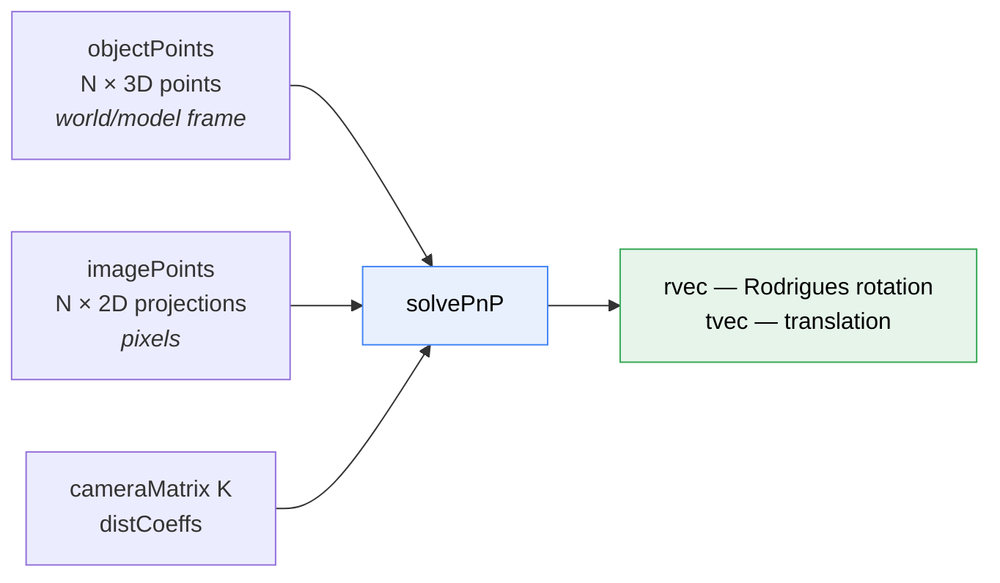
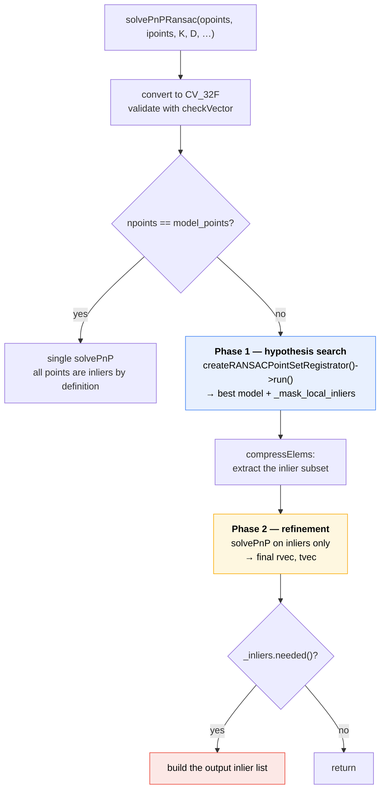

# 06 — Pose Estimation: `solvePnP` and the RANSAC Framework

[← Geometric Transforms](05-imgproc-geometric-transforms.md) · [features index](README.md) · [Next: Camera Calibration →](07-calib-camera-calibration.md)

**Module:** `geometry` (was part of `calib3d` in 4.x) · **Key files:**
`modules/geometry/src/solvepnp.cpp`, `modules/geometry/src/ptsetreg.cpp`,
`modules/geometry/include/opencv2/geometry/3d.hpp`

---

## 1. The problem

**Perspective-n-Point:** given N known 3D points, their 2D projections in an image, and the
camera intrinsics, find the camera pose — a rotation and a translation.



```cpp
bool solvePnP(InputArray objectPoints, InputArray imagePoints,
              InputArray cameraMatrix, InputArray distCoeffs,
              OutputArray rvec, OutputArray tvec,
              bool useExtrinsicGuess = false, int flags = SOLVEPNP_ITERATIVE);
```

`rvec` is a **Rodrigues vector**: direction = rotation axis, magnitude = angle in radians.
`cv::Rodrigues` converts to and from a 3×3 matrix. The projection model is

```
s · [u v 1]ᵀ = K · [R | t] · [X Y Z 1]ᵀ
```

with lens distortion applied to the normalised coordinates before `K`.

---

## 2. The solver menu

`SolvePnPMethod` (`3d.hpp:385`) — the choice matters more than most users realise:

| Flag | Min points | Character |
|------|-----------|-----------|
| `SOLVEPNP_ITERATIVE` (0) | 4 (3 with a guess) | Levenberg–Marquardt on reprojection error. **Default.** Needs a decent initial estimate; iterative, not closed-form. |
| `SOLVEPNP_EPNP` (1) | 4 | Efficient PnP — closed-form, fast, good general default for initialisation |
| `SOLVEPNP_P3P` (2) | 4 | Classic 3-point solution (+1 to disambiguate) |
| `SOLVEPNP_AP3P` (3) | 4 | Algebraic P3P, more numerically stable than P3P |
| `SOLVEPNP_IPPE` (4) | 4 | **Planar objects only** — object points must be coplanar |
| `SOLVEPNP_IPPE_SQUARE` (5) | 4 | Specialised for square markers (ArUco) |
| `SOLVEPNP_SQPNP` (6) | 3 | Globally optimal, consistently fast — the strongest modern general-purpose choice |

Practical guidance: use `SOLVEPNP_IPPE_SQUARE` for square markers, `SOLVEPNP_SQPNP` or
`SOLVEPNP_EPNP` for general point sets, and `SOLVEPNP_ITERATIVE` only to *refine* an estimate
you already have. The default being `ITERATIVE` is historical.

`solvePnPGeneric` returns **all** solutions when a method is ambiguous — useful for planar
targets viewed near-degenerately, where two poses can explain the same image.

---

## 3. The RANSAC framework

Real correspondences contain gross errors. `solvePnPRansac` wraps the solver in
Random Sample Consensus:

```cpp
bool solvePnPRansac(InputArray objectPoints, InputArray imagePoints,
                    InputArray cameraMatrix, InputArray distCoeffs,
                    OutputArray rvec, OutputArray tvec,
                    bool useExtrinsicGuess = false, int iterationsCount = 100,
                    float reprojectionError = 8.0, double confidence = 0.99,
                    OutputArray inliers = noArray(), int flags = SOLVEPNP_ITERATIVE);
```

The generic machinery lives in `modules/geometry/src/ptsetreg.cpp` and is shared with
`findHomography`, `estimateAffine2D` and friends via a `PointSetRegistrator::Callback`
interface (`runKernel`, `computeError`).

### The consensus loop

`RANSACPointSetRegistrator::run` (`ptsetreg.cpp:201`):

```cpp
for( iter = 0; iter < niters; iter++ )
{
    bool found = getSubset( m1, m2, ms1, ms2, rng, 10000 );   // random minimal sample
    if( !found ) { if( iter == 0 ) return false; break; }

    nmodels = cb->runKernel( ms1, ms2, model );               // fit to the minimal sample
    if( nmodels <= 0 ) continue;

    for( i = 0; i < nmodels; i++ )
    {
        Mat model_i = model.rowRange( i*modelSize.height, (i+1)*modelSize.height );
        int goodCount = findInliers( m1, m2, model_i, err, mask, threshold );

        if( goodCount > MAX(maxGoodCount, modelPoints-1) )
        {
            std::swap(mask, bestMask);        // keep the best consensus set so far
            model_i.copyTo(bestModel);
            maxGoodCount = goodCount;
            niters = RANSACUpdateNumIters( confidence,
                         (double)(count - goodCount)/count, modelPoints, niters );
        }
    }
}
```

Two details worth absorbing:

**Adaptive iteration count.** `RANSACUpdateNumIters` *lowers* `niters` as better models are
found: once a model explaining 95% of the points exists, far fewer samples are needed to be
99% confident of finding it. `iterationsCount` is therefore an upper bound, not a fixed cost.

**The inlier test** (`ptsetreg.cpp:84`):

```cpp
int findInliers( const Mat& m1, const Mat& m2, const Mat& model, Mat& err, Mat& mask, double thresh ) const
{
    cb->computeError( m1, m2, model, err );
    ...
    float t = (float)(thresh*thresh);          // compare SQUARED distances — no sqrt
    for( i = 0; i < n; i++ )
    {
        int f = errptr[i] <= t;                // note: inclusive
        maskptr[i] = (uchar)f;
        nz += f;
    }
    return nz;
}
```

Squared comparison with an inclusive `<=`. Any code elsewhere that re-derives an inlier set
must match both choices or it will disagree on boundary points.

---

## 4. `solvePnPRansac`'s two phases



Phase 2 exists because a model fitted to a *minimal* sample (5 points for EPnP) is
statistically poor even when its consensus set is correct. Refitting over the whole consensus
set with LM materially improves accuracy. The code (`solvepnp.cpp:282`):

```cpp
std::vector<Point3d> opoints_inliers;
std::vector<Point2d> ipoints_inliers;
opoints = opoints.reshape(3);
ipoints = ipoints.reshape(2);
opoints.convertTo(opoints_inliers, CV_64F);
ipoints.convertTo(ipoints_inliers, CV_64F);

const uchar* mask = _mask_local_inliers.ptr<uchar>();
int npoints1 = compressElems(&opoints_inliers[0], mask, 1, npoints);
compressElems(&ipoints_inliers[0], mask, 1, npoints);

opoints_inliers.resize(npoints1);
ipoints_inliers.resize(npoints1);

result = solvePnP(opoints_inliers, ipoints_inliers, cameraMatrix, distCoeffs,
                  rvec, tvec, useExtrinsicGuess,
                  (flags == SOLVEPNP_P3P || flags == SOLVEPNP_AP3P) ? SOLVEPNP_EPNP : flags) ? 1 : -1;
```

Note that P3P/AP3P are swapped for EPnP in the refinement stage: a minimal solver cannot
consume a consensus set of arbitrary size.

### ⚠️ The phase-boundary defect

The pose returned to the user comes from **Phase 2**. The inlier list, before the fix, came
from **Phase 1**:

```cpp
if(_inliers.needed())
{
    Mat _local_inliers;
    for (int i = 0; i < npoints; ++i)
    {
        if((int)_mask_local_inliers.at<uchar>(i) != 0)   // ← Phase 1 consensus mask
            _local_inliers.push_back(i);
    }
    _local_inliers.copyTo(_inliers);
}
```

Since refinement moves the pose, points near the threshold change category. The returned
inliers therefore described a model the caller never receives — and a point could be excluded
from `inliers` while having a reprojection error *below* `reprojectionError` under the
returned `rvec`/`tvec`. That is
[issue #29573](../issue-studies/hard-29573-solvepnp-ransac-inliers.md), and it is a
specification bug as much as a code bug: the documentation never said which model the mask
refers to.

There is also a defensible counter-argument — the consensus mask is what RANSAC *selected*,
and recomputing it can admit points the robust estimator deliberately rejected. The issue
study works through both readings.

---

## 5. The USAC alternative

5.x also exposes the newer USAC family through an overload taking `UsacParams`:

```cpp
bool solvePnPRansac(InputArray objectPoints, InputArray imagePoints,
                    InputOutputArray cameraMatrix, InputArray distCoeffs,
                    OutputArray rvec, OutputArray tvec, OutputArray inliers,
                    const UsacParams &params);
```

USAC (`modules/geometry/src/usac/`) adds degeneracy checks, local optimisation (LO-RANSAC),
PROSAC-style guided sampling and MAGSAC++ scoring. It is generally more accurate for the same
iteration budget, and selected via `UsacParams::score`/`sampler`/`loMethod` rather than a
single flag. For new code with difficult correspondences it is worth preferring.

---

## 6. Related functions

| Function | Purpose |
|----------|---------|
| `projectPoints` | Forward model: 3D + pose + intrinsics → 2D (+ Jacobian) |
| `Rodrigues` | Rotation vector ⇄ rotation matrix |
| `findHomography` | Plane-to-plane transform, same RANSAC framework |
| `recoverPose` / `findEssentialMat` | Relative pose between two views |
| `triangulatePoints` | Two views + poses → 3D points |
| `solvePnPRefineLM` / `solvePnPRefineVVS` | Refine an existing pose |

`projectPoints` is the inverse of the whole problem and therefore the right tool for
*verifying* a pose — reproject and measure. Both the #29573 fix and its regression test use
it that way.

---

## 7. Practical notes

1. **Check `reprojectionError` units.** Pixels. The 8.0 default is loose for a
   well-calibrated camera; 1–3 is typical when intrinsics are good.
2. **Coplanar object points are a special case.** Use `SOLVEPNP_IPPE`; general solvers
   degrade on planar configurations.
3. **Verify the returned pose by reprojecting.** Cheap, and it catches both ambiguous
   solutions and correspondence errors.
4. **Point layouts are flexible but not free.** `solvePnPRansac` converts to `CV_32F` and
   validates with `checkVector` (`solvepnp.cpp:187-204`); other functions in the family are
   less thorough — see [#29692](../issue-studies/medium-29692-fisheye-point-shape.md).
5. **`inliers` is an index list**, not a mask — a `std::vector<int>` of positions into the
   input arrays.

---

## 8. Related studies

- [#29573 — `solvePnPRansac` inlier set](../issue-studies/hard-29573-solvepnp-ransac-inliers.md):
  which model the reported inliers belong to.
