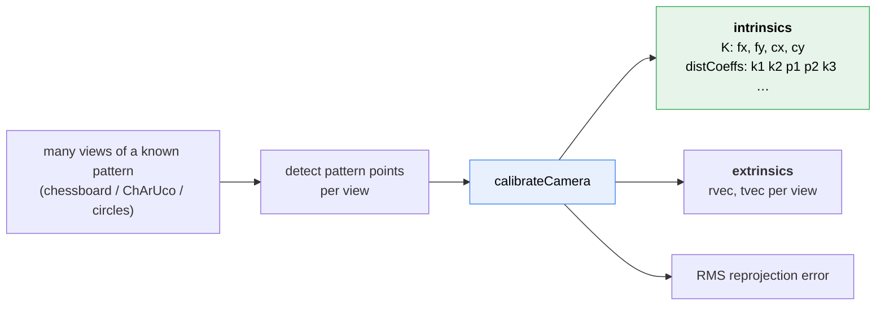
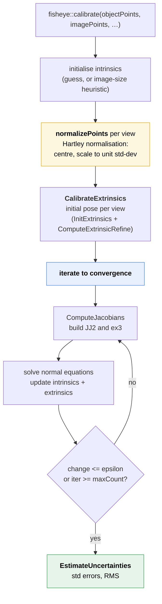
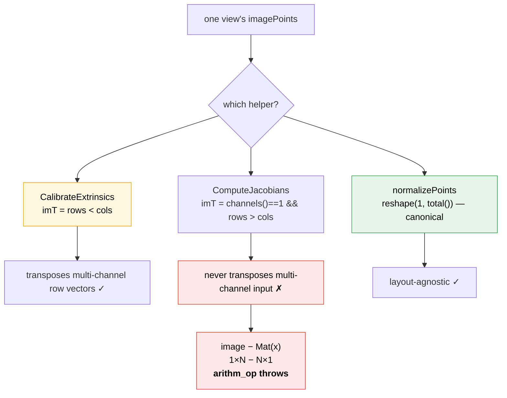

# 07 — Camera Calibration: Pinhole and Fisheye

[← Pose Estimation](06-geometry-pose-estimation.md) · [features index](README.md) · [Next: ArUco & AprilTag →](08-objdetect-aruco.md)

**Module:** `calib` (was part of `calib3d` in 4.x) · **Key files:**
`modules/calib/src/calibration.cpp`, `modules/calib/src/fisheye.cpp`,
`modules/calib/include/opencv2/calib.hpp`

---

## 1. What calibration computes

Pose estimation ([document 06](06-geometry-pose-estimation.md)) assumes the intrinsics are
known. Calibration is the inverse problem: observe a known pattern from many viewpoints and
solve for the camera's *own* parameters.



```cpp
double calibrateCamera(InputArrayOfArrays objectPoints,   // per view: N × 3D points
                       InputArrayOfArrays imagePoints,    // per view: N × 2D points
                       Size imageSize,
                       InputOutputArray cameraMatrix, InputOutputArray distCoeffs,
                       OutputArrayOfArrays rvecs, OutputArrayOfArrays tvecs,
                       int flags = 0, TermCriteria criteria = ...);
```

`InputArrayOfArrays` is the distinguishing feature: calibration consumes a *sequence* of point
sets, one per view. Each element is itself an array whose layout the user chooses — the source
of the problems in §5.

---

## 2. Two camera models

| | Pinhole (`calibrateCamera`) | Fisheye (`fisheye::calibrate`) |
|---|---|---|
| Valid FoV | up to ~120° | up to and beyond 180° |
| Distortion | `k1 k2 p1 p2 [k3 k4 k5 k6 s1..s4 τx τy]` — radial + tangential (+ thin prism) | `k1 k2 k3 k4` — 4 coefficients on θ |
| Projection | `r = r_d(1 + k1r² + k2r⁴ + …)` | `θ_d = θ(1 + k1θ² + k2θ⁴ + k3θ⁶ + k4θ⁸)` |
| Namespace | `cv::` | `cv::fisheye::` |

The fisheye model is parameterised by the **angle** θ from the optical axis rather than the
radius, which is what lets it represent points at or past 90°, where the pinhole model's
`tan θ` diverges. Using the pinhole model on a 180° lens does not merely fit badly — it cannot
represent the geometry at all.

Both models share the overall algorithm but have **entirely separate implementations**:
`calibration.cpp` and `fisheye.cpp` share no point-handling code. That separation is the
structural cause of [#29692](../issue-studies/medium-29692-fisheye-point-shape.md).

---

## 3. The calibration pipeline



Three observations about this structure:

**Initialisation matters.** Without `CALIB_USE_INTRINSIC_GUESS`, `fisheye::calibrate` starts
from a crude heuristic (`fisheye.cpp:254`):

```cpp
finalParam.Init(Vec2d(max(image_size.width, image_size.height) / 2.,
                      max(image_size.width, image_size.height) / 2.),
                Vec2d(image_size.width / 2.0 - 0.5, image_size.height / 2.0 - 0.5));
```

i.e. focal length ≈ half the larger image dimension, principal point at the image centre. Good
enough to start Gauss–Newton, not good enough to report.

**Normalisation is numerical hygiene.** `normalizePoints` (`fisheye.cpp:97`) applies Hartley
normalisation per view — centre the points, divide by the max coordinate, then by the standard
deviation:

```cpp
const Mat pointCoordinates = points.reshape(1, static_cast<int>(points.total()));
reduce(pointCoordinates, pointMean, 0, REDUCE_AVG);
Mat centeredPoints = pointCoordinates - Mat::ones(pointCoordinates.rows, 1, CV_64F) * pointMean;
// Apply Hartley normalization. The maximum coordinate is an intermediate
// preconditioner that prevents the squared norm from underflowing.
double maximumCoordinate = norm(centeredPoints, NORM_INF);
...
normalizedPoints = scaledPoints.reshape(points.channels(), points.rows);
```

Without it, object coordinates in millimetres versus metres change the conditioning of the
Jacobian by six orders of magnitude. Note the first and last lines: this helper
*canonicalises internally* with `reshape(1, total())` but then *restores the caller's
layout* with `reshape(channels(), rows)` — it is layout-agnostic in, layout-preserving out.
Helpers downstream are not.

**Convergence is not guaranteed.** The loop runs to `std::numeric_limits<int>::max()` bounded
only by `TermCriteria`. `CALIB_CHECK_COND` adds SVD conditioning checks that raise
`StsBadArg` on a degenerate view rather than returning silently wrong parameters.

---

## 4. Flags worth knowing

| Flag | Effect |
|------|--------|
| `CALIB_USE_INTRINSIC_GUESS` | Start from the supplied `K`/`D` instead of the heuristic |
| `CALIB_FIX_PRINCIPAL_POINT` | Hold `cx, cy` fixed |
| `CALIB_FIX_ASPECT_RATIO` | Hold `fx/fy` fixed |
| `CALIB_ZERO_TANGENT_DIST` | Force `p1 = p2 = 0` (pinhole) |
| `CALIB_FIX_K1..K4` | Hold individual distortion coefficients |
| `CALIB_RATIONAL_MODEL` | Enable `k4 k5 k6` (pinhole, wide lenses) |
| `CALIB_RECOMPUTE_EXTRINSIC` | Re-estimate extrinsics every iteration (fisheye) |
| `CALIB_CHECK_COND` | Raise on ill-conditioned views (fisheye) |

**Fix what you cannot observe.** Few views, a nearly planar target, or a small field of view
leave some parameters unconstrained; the optimiser will then fit noise. Fixing the principal
point is the usual first remedy.

---

## 5. ⚠️ The point-array layout contract

Each element of `objectPoints` / `imagePoints` may arrive in any of the layouts described in
[features/01 §5](01-core-mat-and-inputarray.md#5-point-array-layouts--the-other-ambiguity):
`(N,1,C)`, `(1,N,C)`, `(N,C)`, or a `std::vector<Point3f>`. All encode the same N points.

The robust idiom — used by `cv::calibrateCamera` — is to canonicalise immediately:

```cpp
Mat object = objectPoints.getMat(i);
object = object.reshape(3, (int)object.total());    // → always (N, 1, 3)
```

`fisheye.cpp` instead grew **three mutually inconsistent heuristics** for guessing the layout.
Compare:

```cpp
// CalibrateExtrinsics (fisheye.cpp:1012) — ignores channels
bool imT = image.rows < image.cols;
bool obT = object.rows < object.cols;
if (!InitExtrinsics(imT ? image.t() : image, obT ? object.t() : object, param, omckk, Tckk))
```

```cpp
// ComputeJacobians (fisheye.cpp:1053) and EstimateUncertainties (fisheye.cpp:1120)
//   — requires single-channel, and the comparison is REVERSED
bool imT = image.channels() == 1 && image.rows > image.cols;
...
std::vector<Point2d> x;
projectPoints(object, x, om, T, param, jacobians);
Mat exkk = (imT ? image.t() : image) - Mat(x);     // ← the fragile line
```

The last line is where the reported exception comes from. `projectPoints` writes into a
`std::vector<Point2d>`, so `Mat(x)` is **always N×1 `CV_64FC2`**. The subtraction therefore
requires `image` to also be N×1 after the heuristic has had its say. For a multi-channel
array the condition `channels() == 1` is false, `imT` stays false, and `image` is used
as-is — so any view that arrives as 1×N multi-channel reaches

```
1×N CV_64FC2  −  N×1 CV_64FC2
```

which `arithm_op` rejects with exactly the error in the issue report:

```
error: (-209:Sizes of input arguments do not match) The operation is neither
'array op array' (where arrays have the same size and the same number of channels),
nor 'array op scalar', nor 'scalar op array' in function 'arithm_op'
```



The defect is not any single heuristic — it is that **three parts of one algorithm guess the
layout three different ways**, so no single input layout satisfies all of them. The fix
replaces guessing with canonicalisation at every `getMat()` site; full discussion, including
which layout fails in which version, is in
[issue study #29692](../issue-studies/medium-29692-fisheye-point-shape.md).

---

## 6. Multi-camera and stereo calibration

| Function | Purpose |
|----------|---------|
| `stereoCalibrate` | Two cameras: intrinsics + the rigid transform between them |
| `fisheye::stereoCalibrate` | Fisheye equivalent |
| `stereoRectify` | Rectification transforms for epipolar-aligned images |
| `calibrateMultiview` | N-camera rig calibration (5.x) |
| `registerCameras` | Relative pose between two already-calibrated cameras |

`fisheye::stereoCalibrate` suffers from the same layout issue and received the same fix —
three `reshape` calls, one each for `object`, `imageLeft` and `imageRight`
(`fisheye.cpp:528`).

`apps/multiview-calibration/` and `apps/interactive-calibration/` are working reference
applications, and the most useful documentation for the practical workflow.

---

## 7. Practical notes

1. **15–25 views**, pattern filling much of the frame, varied orientations including tilt.
   Pure translation leaves focal length and distance ambiguous.
2. **ChArUco beats plain chessboards** — it tolerates partial occlusion and identifies corners
   uniquely, so views where the board is partly out of frame remain usable.
3. **RMS error is necessary but not sufficient.** Under-constrained parameters can give a low
   RMS with nonsense intrinsics. Inspect `cx, cy` (should be near the image centre) and the
   per-view errors.
4. **Pick the model from the lens**, not from convenience: beyond ~120° FoV, use
   `cv::fisheye`.
5. **Prefer `std::vector<std::vector<Point3f>>`** for point input. It is unambiguous, and it
   sidesteps the layout hazards of §5 entirely.

---

## 8. Related studies

- [#29692 — fisheye point-array shapes](../issue-studies/medium-29692-fisheye-point-shape.md):
  three inconsistent layout heuristics in one algorithm.
