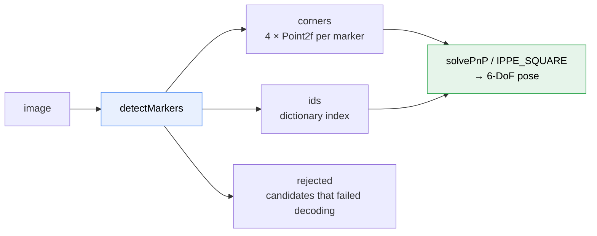
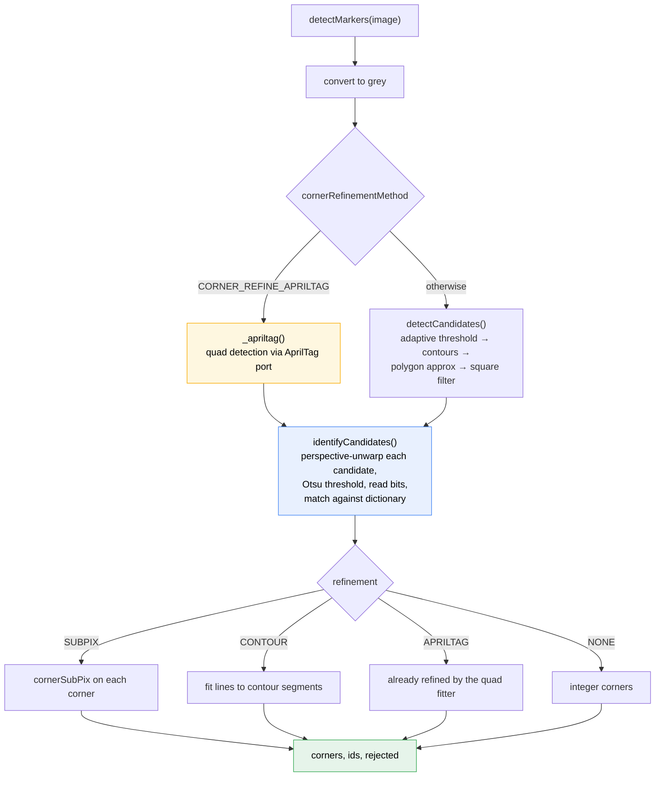
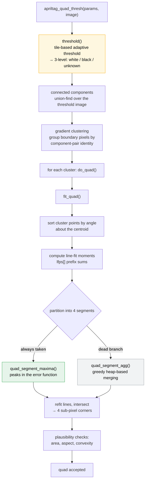

# 08 — ArUco Markers and the AprilTag Quad Pipeline

[← Camera Calibration](07-calib-camera-calibration.md) · [features index](README.md) · [Next: Object Tracking →](09-video-tracking.md)

**Module:** `objdetect` · **Key files:**
`modules/objdetect/src/aruco/aruco_detector.cpp`,
`modules/objdetect/src/aruco/apriltag/apriltag_quad_thresh.cpp`,
`modules/objdetect/include/opencv2/objdetect/aruco_detector.hpp`

---

## 1. What ArUco solves

An ArUco marker is a square with a black border and a binary grid inside. Detecting one gives
four image points of known relative 3D geometry, which is enough for a full 6-DoF pose — so a
single printed square becomes a pose anchor for robotics, AR and camera calibration.



```cpp
aruco::Dictionary dict = aruco::getPredefinedDictionary(aruco::DICT_4X4_50);
aruco::DetectorParameters params;
aruco::ArucoDetector detector(dict, params);

std::vector<int> ids;
std::vector<std::vector<cv::Point2f>> corners, rejected;
detector.detectMarkers(image, corners, ids, rejected);
```

`ArucoDetector` is a stateful object holding a dictionary and parameters — the 4.x free
functions (`aruco::detectMarkers(...)`) are gone in 5.x.

### Dictionaries

`DICT_4X4_50`, `DICT_5X5_100`, `DICT_6X6_250`, `DICT_7X7_1000`, `DICT_ARUCO_ORIGINAL`, and the
AprilTag families `DICT_APRILTAG_16h5`, `25h9`, `36h10`, `36h11`. The naming is
*grid size* × *dictionary size*. The trade-off is direct: a 4×4 grid is readable from further
away but has fewer bits of Hamming distance, so it misidentifies more readily. **Use the
smallest dictionary you need** — `DICT_4X4_50` with 50 markers is far more robust than
`DICT_4X4_1000`, because the unused code space becomes error-correction margin.

---

## 2. The detection pipeline



Two candidate-generation strategies exist, chosen by `cornerRefinementMethod`
(`aruco_detector.cpp:789`):

```cpp
if(detectorParams.cornerRefinementMethod == (int)CORNER_REFINE_APRILTAG){
    _apriltag(grey, detectorParams, candidates, contours);
}
else {
    detectCandidates(grey, candidates, contours);
}
```

The default path uses adaptive thresholding and contour analysis. The AprilTag path replaces
candidate detection entirely with a port of the AprilTag 3 quad detector, which fits
quadrilaterals to clustered edge points and yields sub-pixel corners directly.

### Threading

`detectMarkers` parallelises several stages with `parallel_for_`
(`aruco_detector.cpp:285`, `892`, `1077`, `1150`) — over pyramid scales and over candidates.
This is relevant context for [#27714](../issue-studies/hard-27714-apriltag-heap-leak.md),
which was reported as a *multithreaded* memory leak.

Note, however, that the AprilTag quad stage is **not** one of the parallelised ones
(`apriltag_quad_thresh.cpp:1481`):

```cpp
int chunksize = std::max(1, h / (10 * getNumThreads()));
int sz = _zarray_size(clusters);

// TODO PARALLELIZE
for (int i = 0; i < sz; i += chunksize) {
    int min = sz < (i+chunksize)? sz: (i+chunksize);
    do_quad(i, min, *clusters, w, h, quads, parameters, mImg);
}
```

The chunk size is still computed from `getNumThreads()`, but the loop is sequential — the
parallelisation was never finished. So a leak *inside* the quad stage scales with the number
of clusters per image and the number of user threads calling `detectMarkers`, not with
OpenCV's internal worker count.

---

## 3. The AprilTag quad detector

This is the most intricate code in the module, and a C-style island inside a C++ codebase: it
uses `calloc`/`free`, custom containers (`zarray_t`, `zmaxheap_t`, union-find) and `goto`
cleanup.



### The two segmentation strategies

A cluster is an unordered set of boundary pixels; turning it into a quadrilateral means
choosing which four points are the corners. The AprilTag original offers two algorithms, and
OpenCV's port keeps both (`apriltag_quad_thresh.cpp:809`):

```cpp
int indices[4];
if (1) {
    if (!quad_segment_maxima(_params, _zarray_size(cluster), lfps, indices))
        goto finish;
} else {
    if (!quad_segment_agg(sz, lfps, indices))
        goto finish;
}
```

> ### ⚠️ `quad_segment_agg` is unreachable
>
> `if (1) { ... } else { ... }` — the `else` branch can never execute. A repository-wide
> search finds exactly three references to `quad_segment_agg`: its definition
> (`apriltag_quad_thresh.cpp:460`), its declaration (`apriltag_quad_thresh.hpp:97`), and this
> single dead call site.
>
> In upstream AprilTag this was a compile-time switch between algorithms; the OpenCV port
> hard-coded the choice but kept the alternative compiled in. It is therefore **dead code
> that the compiler still type-checks** — and a bug fixed inside it changes no runtime
> behaviour at all.
>
> This matters a great deal for the leak reported in
> [#27714](../issue-studies/hard-27714-apriltag-heap-leak.md): the leak is real, the fix is
> correct, and **neither can be the cause of the reporter's 8 GB of RSS growth**, because the
> function never runs.

### `quad_segment_agg` and its heap

For completeness, the dead function's algorithm: greedily remove the boundary vertex whose
deletion costs the least line-fitting error, using a max-heap as a priority queue, until four
remain.

```cpp
int quad_segment_agg(int sz, struct line_fit_pt *lfps, int indices[4]){
    zmaxheap_t *heap = zmaxheap_create(sizeof(struct remove_vertex*));   // ← raw calloc

    int rvalloc_size = 3*sz;
    cv::AutoBuffer<struct remove_vertex, 0> rvalloc_(std::max(1, rvalloc_size));   // ← RAII
    ...
    cv::AutoBuffer<struct segment, 0> segs_(std::max(1, sz));                      // ← RAII
    ...
    while (nvertices > 4) {
        CV_Assert(rvalloc_pos < rvalloc_size);          // ← can throw
        int res = zmaxheap_remove_max(heap, &rv, &err);
        if (!res)
            return 0;                                   // ← leaked the heap (the bug)
        ...
    }
    zmaxheap_destroy(heap);                             // ← only on the success path
    ...
    return 1;
}
```

The mixture is the lesson: **two of the three allocations are RAII (`cv::AutoBuffer`), the
third is manual** — and the manual one is the one that leaked. `zmaxheap_create` does
`calloc(1, sizeof(zmaxheap_t))` (`zmaxheap.cpp:70`) and grows two internal buffers
(`values`, `data`) on demand; `zmaxheap_destroy` frees all three
(`zmaxheap.cpp:83`).

Note also the `CV_Assert` on the line above the early return: even with the early return
fixed, an exception there still leaks the heap. The structurally correct fix is RAII, not a
second `destroy` call.

---

## 4. Tuning `DetectorParameters`

| Parameter | Effect |
|-----------|--------|
| `adaptiveThreshWinSizeMin/Max/Step` | Threshold window sweep — the main detection-range control |
| `adaptiveThreshConstant` | Threshold offset |
| `minMarkerPerimeterRate` / `maxMarkerPerimeterRate` | Candidate size filter, relative to image dimension |
| `polygonalApproxAccuracyRate` | How square a contour must be |
| `cornerRefinementMethod` | `NONE`, `SUBPIX`, `CONTOUR`, `APRILTAG` |
| `cornerRefinementWinSize` / `MaxIterations` / `MinAccuracy` | Sub-pixel refinement budget |
| `errorCorrectionRate` | Bit errors tolerated when decoding |
| `perspectiveRemovePixelPerCell` | Resolution of the unwarped marker used for bit reading |
| `useAruco3Detection` | Faster pyramid-based detection (forces `SUBPIX` refinement) |

Practical starting points:

- **Markers not detected at range** → raise `adaptiveThreshWinSizeMax`, lower
  `minMarkerPerimeterRate`.
- **Pose jitter** → `CORNER_REFINE_SUBPIX` or `CORNER_REFINE_APRILTAG`; corner accuracy
  dominates pose accuracy.
- **Too slow** → `useAruco3Detection = true`, narrow the threshold window sweep.
- **Wrong IDs** → use a smaller dictionary and lower `errorCorrectionRate`.

Note that `useAruco3Detection` silently overrides the refinement method
(`aruco_detector.cpp:749`), because only `SUBPIX` is implemented correctly for the pyramid
path.

---

## 5. Boards, ChArUco and pose

| Class | Purpose |
|-------|---------|
| `aruco::Board` | Arbitrary 3D arrangement of markers |
| `aruco::GridBoard` | Planar grid of markers |
| `aruco::CharucoBoard` | Chessboard with ArUco markers in the white squares |
| `aruco::CharucoDetector` | Detects a ChArUco board, interpolating chessboard corners |

ChArUco is the preferred calibration target: the markers identify corners unambiguously (so
partial views are usable), while the chessboard corners themselves localise far more precisely
than marker corners.

For pose from a single marker, prefer `SOLVEPNP_IPPE_SQUARE` — it is built for exactly this
configuration of four coplanar points in a square.

---

## 6. Related studies

- [#27714 — AprilTag heap leak](../issue-studies/hard-27714-apriltag-heap-leak.md):
  a genuine leak in an unreachable function, and what that means for the reported symptom.
