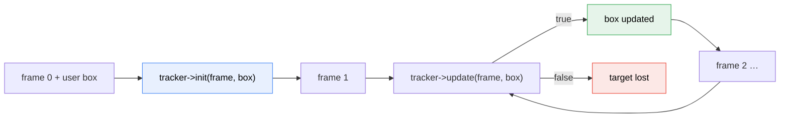
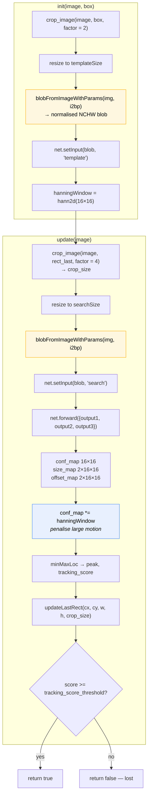

# 09 — Object Tracking

[← ArUco & AprilTag](08-objdetect-aruco.md) · [features index](README.md) · [Next: DNN Engine →](10-dnn-engine.md)

**Module:** `video` · **Key files:**
`modules/video/include/opencv2/video/tracking.hpp`,
`modules/video/src/tracking/tracker_vit.cpp`,
`modules/video/src/tracking/tracker_mil.cpp`

---

## 1. The `Tracker` interface

Tracking is *not* repeated detection. A tracker is initialised once with a bounding box and
then follows that specific object, exploiting temporal continuity — which makes it both
cheaper than detection and able to follow objects no detector was trained for.

The interface (`tracking.hpp:913`) is deliberately tiny:

```cpp
class CV_EXPORTS_W Tracker
{
public:
    virtual ~Tracker();
    /** @brief Initialize the tracker with a known bounding box that surrounded the target */
    CV_WRAP virtual void init(InputArray image, const Rect& boundingBox) = 0;
    /** @brief Update the tracker, find the new most likely bounding box for the target */
    CV_WRAP virtual bool update(InputArray image, CV_OUT Rect& boundingBox) = 0;
};
```



`update` returning `false` means "I lost it" — most commonly because the confidence score fell
below a threshold. Trackers hold **mutable internal state**, so one instance follows one
object, and recovery after occlusion generally requires re-initialisation.

---

## 2. The tracker family in 5.x

| Class | Mechanism | Needs a model file? |
|-------|-----------|---------------------|
| `TrackerMIL` | Multiple-instance learning on Haar-like features | No |
| `TrackerDaSiamRPN` | Siamese region-proposal network | Yes (3 nets) |
| `TrackerNano` | NanoTrack — lightweight Siamese, backbone + neck/head | Yes (2 nets) |
| `TrackerVit` | Vision-transformer tracker | Yes (1 ONNX) |

All DNN-based trackers are compiled only `#ifdef HAVE_OPENCV_DNN` — `video` declares `dnn` as
an *optional* dependency (`modules/video/CMakeLists.txt`), so a build without `dnn` still has
`TrackerMIL`.

Practical selection: `TrackerVit` for accuracy, `TrackerNano` for speed on embedded targets,
`TrackerMIL` only when no model file can be shipped. The KCF/CSRT/Boosting/TLD trackers live
in `opencv_contrib`, not here.

---

## 3. `TrackerVit` in detail

A transformer tracker takes two crops — a **template** (the target, from the init frame) and a
**search region** (a larger crop around the last known position) — and regresses the target's
position inside the search region.



Three design details worth noting:

**The crop factors differ** (`tracker_vit.cpp:165`, `178`): the template uses `factor = 2`
(tight around the target), the search region `factor = 4` (room for motion). `crop_image`
handles boxes extending past the image edge with `copyMakeBorder(..., BORDER_CONSTANT)` rather
than clamping, so the target stays centred in the crop.

**The Hanning window is a motion prior.** `conf_map` is multiplied element-wise by a 16×16
Hanning window before taking the peak (`tracker_vit.cpp:190`), which down-weights responses
far from the centre — a cheap way to express "the object probably did not move much".

**`tracking_score_threshold` defaults to 0.20**, documented in the source as a "safe threshold
to filter out black frames".

---

## 4. ⚠️ Preprocessing: `Scalar` arithmetic is not elementwise

The network expects ImageNet-normalised input. `TrackerVit::Params` stores the standard
normalisation constants *already divided by 255* (`tracker_vit.cpp:26`):

```cpp
meanvalue = Scalar{0.485, 0.456, 0.406}; // normalized mean (already divided by 255)
stdvalue  = Scalar{0.229, 0.224, 0.225}; // normalized std (already divided by 255)
```

`blobFromImageWithParams` applies `(input − mean) × scalefactor` with raw 0–255 pixels, so the
constructor must scale both back up (`tracker_vit.cpp:52`):

```cpp
i2bp.mean = parameters.meanvalue * 255.0;                 // ✓ Scalar × double — elementwise
i2bp.scalefactor = (1.0 / parameters.stdvalue) * (1 / 255.0);   // ✗ double / Scalar — NOT elementwise
```

The `mean` line is fine: `Scalar * double` is defined elementwise. The `scalefactor` line is
not, because `cv::Scalar` inherits an `operator/` that treats a `Scalar` as a **quaternion**
(`modules/core/include/opencv2/core/types.hpp:2441`):

```cpp
template<typename _Tp> inline
Scalar_<_Tp> operator / (_Tp a, const Scalar_<_Tp>& b)
{
    _Tp s = a / (b[0]*b[0] + b[1]*b[1] + b[2]*b[2] + b[3]*b[3]);
    return b.conj() * s;        // quaternion inverse: conj / |b|²
}
```

and `Scalar_::conj()` negates components 1–3 (`types.hpp:2283`). So `1.0 / stdvalue` returns

```
(s0, −s1, −s2, 0) / (s0² + s1² + s2²)
```

With the default values that is a ~3× error **and a sign flip on two of three channels**:

| Channel | Intended `1/(255·std)` | Actually applied | Ratio |
|---------|------------------------|------------------|-------|
| R | 0.01712475 | 0.00586027 | 2.92× |
| G | 0.01750700 | −0.00573231 | −3.05× |
| B | 0.01742919 | −0.00575791 | −3.03× |

Two of three channels enter the transformer **negated and three times too small**. The fix
spells the reciprocal out per channel. Full analysis:
[issue study #30164](../issue-studies/medium-30164-trackervit-scalefactor.md).

> **The general rule:** `cv::Scalar` is a `Vec<double,4>` with quaternion semantics bolted on.
> `Scalar × double` and `Scalar ± Scalar` are elementwise; **`double / Scalar`,
> `Scalar / Scalar` and `Scalar * Scalar` are quaternion operations.** For elementwise
> products use `Scalar::mul()`; for elementwise reciprocals, write the components out.

---

## 5. Optical flow — the other half of `video`

| Function | Purpose |
|----------|---------|
| `calcOpticalFlowPyrLK` | Sparse Lucas–Kanade on feature points (pyramidal) |
| `calcOpticalFlowFarneback` | Dense flow, polynomial expansion |
| `DISOpticalFlow` | Dense inverse search — the best speed/quality trade-off |
| `VariationalRefinement` | Refines an existing dense flow field |
| `findTransformECC` | Image alignment by maximising correlation coefficient |
| `CamShift` / `meanShift` | Histogram back-projection tracking |
| `KalmanFilter` | Linear state estimation — pairs well with any detector |
| `BackgroundSubtractorMOG2` / `KNN` | Foreground masks from static cameras |

`calcOpticalFlowPyrLK` is the workhorse behind most feature-tracking pipelines and is one of
the dispatched files — `modules/video/CMakeLists.txt` declares
`ocv_add_dispatched_file(lkpyramid SSE2 SSE4_1 AVX2 AVX512_SKX AVX512_ICL)`, so it is
compiled once per instruction set as described in
[features/02](02-core-simd-dispatch.md).

A `KalmanFilter` wrapped around a detector is often a better "tracker" than any of the
`Tracker` classes when a detector already runs every frame: it smooths jitter and bridges
missed detections without the drift that accumulates in appearance-based trackers.

---

## 6. Practical notes

1. **One tracker instance per object.** Trackers are stateful; do not share them.
2. **Re-initialise after occlusion.** When `update` returns `false`, re-detect rather than
   hoping for recovery.
3. **Check the model file first.** `TrackerVit::Params::net` defaults to
   `"vitTracker.onnx"` in the working directory; `readNet` failing surfaces as
   `CV_Assert(!net.empty())`.
4. **Trackers drift.** Appearance models update from their own predictions, so errors
   compound. For long sequences, re-detect periodically.
5. **Scale changes are the hard case.** `TrackerVit` and `TrackerNano` regress size
   explicitly; `TrackerMIL` does not handle scale well.

---

## 7. Related studies

- [#30164 — `TrackerVit` scalefactor](../issue-studies/medium-30164-trackervit-scalefactor.md):
  quaternion division in an input-normalisation expression.
