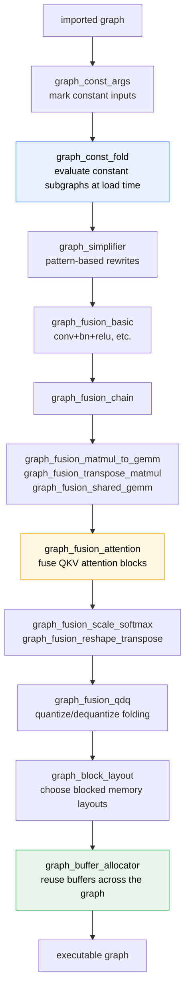

# 10 — The DNN Inference Engine

[← Object Tracking](09-video-tracking.md) · [features index](README.md) · [Next: Language Bindings →](11-bindings.md)

**Module:** `dnn` · **Key files:** `modules/dnn/src/dnn.cpp`,
`modules/dnn/src/graph_*.cpp`, `modules/dnn/src/onnx/`,
`modules/dnn/include/opencv2/dnn/dnn.hpp`

---

## 1. Scope

`dnn` is an **inference-only** engine: it imports a trained model, optimises its graph and
runs forward passes. There is no training, no autograd, no optimiser. The design goal is to
remove the framework dependency from deployment — ship OpenCV, not PyTorch.


Minimal usage:

```cpp
cv::dnn::Net net = cv::dnn::readNetFromONNX("model.onnx");
net.setPreferableBackend(cv::dnn::DNN_BACKEND_OPENCV);
net.setPreferableTarget(cv::dnn::DNN_TARGET_CPU);

cv::Mat blob = cv::dnn::blobFromImage(image, 1/255.0, cv::Size(640, 640),
                                      cv::Scalar(), /*swapRB=*/true, /*crop=*/false);
net.setInput(blob);
cv::Mat out = net.forward();
```

---

## 2. Importers and model formats

| Reader | Format | Notes |
|--------|--------|-------|
| `readNetFromONNX` | ONNX | The recommended path — best operator coverage |
| `readNetFromTFLite` | TFLite | FlatBuffers-based |
| `readNetFromTensorflow` | TF frozen graph | `.pb` + optional `.pbtxt` |
| `readNetFromCaffe` | Caffe | Legacy |
| `readNetFromDarknet` | Darknet | YOLO v2/v3/v4 configs |
| `readNet` | auto-detect | Dispatches on file extension |

`ModelFormat` (`dnn.hpp:124`) records which format a `Net` came from, because some
optimisations and layout conventions are format-specific.

**Prefer ONNX.** The tree carries two ONNX importers — `onnx_importer.cpp` (the classic,
layer-by-layer path) and `onnx_importer2.cpp` (the newer graph-oriented path) — and ONNX gets
by far the most operator coverage and test attention.

### Engine selection — new in 5.x

`dnn.hpp:1106` adds a choice of *engine*, orthogonal to backend and target:

```cpp
enum Engine {
    ENGINE_AUTO   = 0,  //!< Automatically select. Currently resolves to ENGINE_OPENCV.
    ENGINE_OPENCV = 1,  //!< OpenCV's built-in engine. No non-CPU back-ends for now.
    ENGINE_ORT    = 2   //!< ONNX Runtime wrapper (ONNX only, needs WITH_ONNXRUNTIME=ON)
};

Net readNetFromONNX(const String& onnxFile, int engine = ENGINE_AUTO, ...);
```

So 5.x can delegate the entire graph to ONNX Runtime rather than interpreting it itself — a
pragmatic answer to the endless chase for operator coverage. Note the documented caveat that
`ENGINE_OPENCV` "does not support non-CPU back-ends for now".

---

## 3. Graph optimisation

This is where most of 5.x's new engineering sits. After import, the graph passes through a
pipeline of rewrite passes, one file each (`modules/dnn/src/graph_*.cpp`):



The high-value passes, and why they exist:

**Constant folding** (`graph_const_fold.cpp`). Exported graphs are full of subgraphs computing
fixed values — shape arithmetic, reshape targets, normalisation constants. Evaluating them once
at load time removes them from every forward pass.

**Layer fusion** (`graph_fusion_*.cpp`). `Conv → BatchNorm → ReLU` becomes one operation. The
arithmetic is identical; what disappears is two full passes over the activation tensor. On
memory-bandwidth-bound hardware this is usually the single largest win.

**Attention fusion** (`graph_fusion_attention.cpp`). Recognises the multi-head attention
pattern — three matmuls, a scale, a softmax, another matmul — and replaces it with one fused
operator. This is what makes transformer models (including the `TrackerVit` of
[features/09](09-video-tracking.md)) practical on CPU.

**GEMM canonicalisation** (`graph_fusion_matmul_to_gemm.cpp`,
`graph_fusion_transpose_matmul.cpp`, `graph_fusion_shared_gemm.cpp`). Rewrites matmul variants
into the GEMM form that has the best-optimised kernels, absorbing transposes into GEMM flags
rather than materialising transposed tensors. This is the same `cv::gemm` machinery discussed
in [#30151](../issue-studies/hard-30151-gemm-cv64f-simd-guard.md), reached from a different
direction.

**Buffer allocation** (`graph_buffer_allocator.cpp`). Intermediate tensors have disjoint
lifetimes, so one pool can serve many of them. This decides peak memory, which for large
models matters more than speed.

**KV-cache management** (`kv_cache_manager.cpp`). Autoregressive transformer decoding reuses
past keys and values; 5.x has explicit support, which is a clear signal of the module's
current direction.

---

## 4. Backends and targets

Two orthogonal axes: *who executes* (backend) and *on what* (target).

```cpp
net.setPreferableBackend(DNN_BACKEND_OPENCV);
net.setPreferableTarget(DNN_TARGET_CPU);
```

| Backend (`dnn.hpp:71`) | Executor |
|------------------------|----------|
| `DNN_BACKEND_DEFAULT` | Build-time configured default |
| `DNN_BACKEND_OPENCV` | OpenCV's own layer implementations |
| `DNN_BACKEND_INFERENCE_ENGINE` | Intel OpenVINO |
| `DNN_BACKEND_CUDA` | cuDNN / custom CUDA kernels |
| `DNN_BACKEND_VKCOM` | Vulkan compute |
| `DNN_BACKEND_WEBNN` | WebNN (browser) |
| `DNN_BACKEND_TIMVX` | Verisilicon NPU |
| `DNN_BACKEND_CANN` | Huawei Ascend |

| Target (`dnn.hpp:95`) | Device |
|-----------------------|--------|
| `DNN_TARGET_CPU` / `DNN_TARGET_CPU_FP16` | CPU (FP16 on Arm) |
| `DNN_TARGET_OPENCL` / `_OPENCL_FP16` | GPU via OpenCL |
| `DNN_TARGET_CUDA` / `_CUDA_FP16` | NVIDIA GPU |
| `DNN_TARGET_VULKAN` | Vulkan device |
| `DNN_TARGET_MYRIAD` / `_HDDL` / `_NPU` | VPUs and NPUs |
| `DNN_TARGET_FPGA` | FPGA via OpenVINO |

Not every pair is valid. `getAvailableBackends()` and `getAvailableTargets(backend)`
enumerate what the current build actually supports — worth calling before assuming a
configuration works. The setters are "preferable" precisely because a layer the backend
cannot handle falls back, and a graph can end up split across backends.

---

## 5. Layers

`modules/dnn/src/layers/` holds 127 layer implementations. Each derives from `cv::dnn::Layer`
and implements:

| Method | Responsibility |
|--------|----------------|
| `getMemoryShapes` | Output shapes from input shapes — runs before allocation |
| `finalize` | One-time setup once shapes are known |
| `forward` | The computation |
| `supportBackend` | Which backends this layer can run on |
| `tryFuse` / `fuseLayers` | Participate in fusion |

Custom layers register through `LayerFactory`:

```cpp
CV_DNN_REGISTER_LAYER_CLASS(MyOp, MyOpLayer);
```

which is the escape hatch when an importer reports an unsupported operator — implement it in
C++ and register it before calling `readNet`.

---

## 6. Blobs: the NCHW convention

A DNN blob is a 4-D `Mat` in **NCHW** order — batch, channels, height, width — whereas an
OpenCV image is HWC with interleaved channels. `blobFromImage` performs the conversion,
together with resizing and normalisation:

```cpp
Mat blobFromImage(InputArray image, double scalefactor = 1.0, const Size& size = Size(),
                  const Scalar& mean = Scalar(), bool swapRB = false, bool crop = false,
                  int ddepth = CV_32F);
```

The order of operations is documented at `dnn.hpp:1306` and is easy to get backwards:

```
output = (input − mean) × scalefactor
```

`Image2BlobParams` + `blobFromImageWithParams` is the structured form, allowing a per-channel
`Scalar` scalefactor instead of a single `double` — which is what `TrackerVit` uses, and where
the quaternion-division bug of
[#30164](../issue-studies/medium-30164-trackervit-scalefactor.md) lives.

Typical preprocessing mistakes, in rough order of frequency:

1. **Wrong channel order.** OpenCV loads BGR; most models expect RGB → `swapRB = true`.
2. **Mean/scale applied in the wrong order or at the wrong magnitude** — e.g. mixing
   normalised (0–1) constants with raw (0–255) pixels.
3. **Non-elementwise `Scalar` arithmetic** when computing those constants (#30164).
4. **Letterboxing ignored.** `crop = false` stretches the aspect ratio; detectors trained with
   letterboxing need matching preprocessing, and the boxes need un-letterboxing afterwards.

`imagesFromBlob` reverses the transform, which is the quickest way to confirm that what the
network received is what you intended — and is how the #30164 reporter measured the error.

---

## 7. The high-level `Model` API

For common tasks, wrappers bundle preprocessing and postprocessing:

| Class | Task |
|-------|------|
| `ClassificationModel` | Top-k classification |
| `DetectionModel` | Boxes + confidences + class ids |
| `SegmentationModel` | Per-pixel class masks |
| `KeypointsModel` | Pose keypoints |
| `TextRecognitionModel` / `TextDetectionModel_DB` / `_EAST` | OCR |

```cpp
cv::dnn::DetectionModel model("yolo.onnx");
model.setInputParams(1/255.0, cv::Size(640, 640), cv::Scalar(), true);
std::vector<int> classIds; std::vector<float> confidences; std::vector<cv::Rect> boxes;
model.detect(image, classIds, confidences, boxes, 0.5f, 0.4f);
```

These remove exactly the preprocessing errors listed in §6, and are the right default for
anything other than a bespoke architecture.

---

## 8. Practical notes

1. **Validate the import first.** `net.getLayerNames()`, `net.getUnconnectedOutLayersNames()`
   and the `opencv_model_diagnostics` tool in `apps/model-diagnostics/` report unsupported
   operators before you debug numerics.
2. **Profile with `net.getPerfProfile()`** — returns per-layer times. Fusion makes the layer
   list differ from the original graph, which is itself informative.
3. **FP16 targets change results.** `DNN_TARGET_*_FP16` is a different numeric domain; expect
   small differences and validate accuracy, not just shape.
4. **Set backend and target before the first `forward()`** — `dnn.hpp:786` notes that
   `setInput` must follow them.
5. **Pin the preprocessing to the training recipe.** Most "the model works in PyTorch but not
   OpenCV" reports are preprocessing mismatches, not engine bugs.

---

## 9. Related studies

No issue study in this set targets `dnn` directly, but two touch it:
[#30164](../issue-studies/medium-30164-trackervit-scalefactor.md) is a blob-preprocessing bug
in a `dnn` consumer, and
[#30151](../issue-studies/hard-30151-gemm-cv64f-simd-guard.md) concerns the GEMM kernels that
`dnn`'s matmul fusion targets.
