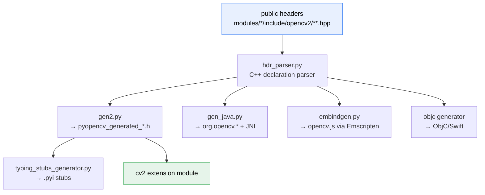
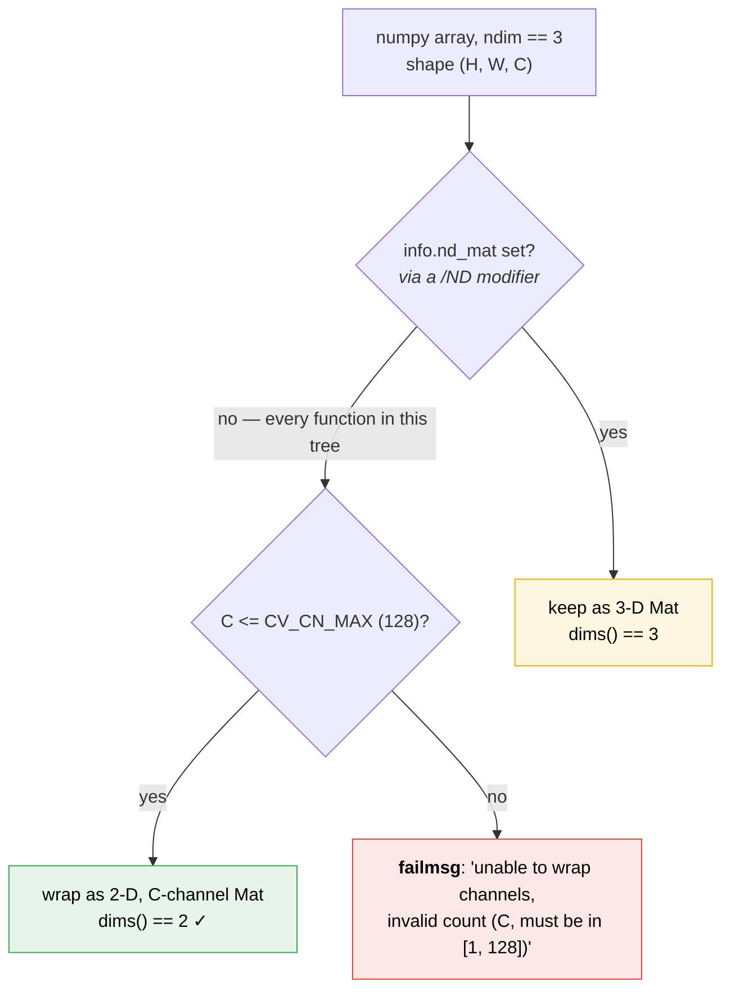

# 11 — Language Bindings and the NumPy Bridge

[← DNN Engine](10-dnn-engine.md) · [features index](README.md) · [Issue studies →](../issue-studies/README.md)

**Modules:** `python`, `java`, `js`, `objc` · **Key files:**
`modules/python/src2/hdr_parser.py`, `modules/python/src2/gen2.py`,
`modules/python/src2/cv2_convert.cpp`, `modules/js/generator/embindgen.py`,
`modules/java/generator/gen_java.py`

---

## 1. Nothing is written by hand

OpenCV exposes roughly 2 400 annotated declarations to four languages. None of the binding
code is maintained by hand: the public C++ headers *are* the specification, and generators
parse them at build time.



A module opts in via its `CMakeLists.txt`:

```cmake
ocv_define_module(imgproc opencv_core opencv_geometry WRAP java objc python js)
```

Drop `python` from that list and `cv2.cvtColor` ceases to exist.

---

## 2. The annotation macros

All of them compile to nothing (`modules/core/include/opencv2/core/cvdef.h:457`):

```cpp
#define CV_EXPORTS_W        CV_EXPORTS   // export AND wrap
#define CV_EXPORTS_W_SIMPLE CV_EXPORTS   // wrap as a value-semantics struct
#define CV_WRAP                          // wrap this method
#define CV_PROP_RW                       // wrap this field, read-write
#define CV_IN_OUT                        // parameter is both input and output
#define CV_OUT                           // parameter is an output
```

They exist purely as markers for `hdr_parser.py`. Counts in this tree:

| Macro | Occurrences |
|-------|-------------|
| `CV_WRAP` | 1 471 |
| `CV_EXPORTS_W` | 709 |
| `CV_PROP_RW` | 250 |

So a C++ change becomes a Python change automatically — and a C++ signature change silently
becomes a Python API break. This is why the public headers are reviewed more conservatively
than `src/`.

### How outputs become return values

```cpp
CV_EXPORTS_W void minMaxLoc(InputArray src, CV_OUT double* minVal,
                            CV_OUT double* maxVal = 0, CV_OUT Point* minLoc = 0, ...);
```

`CV_OUT` parameters are hoisted into the Python return tuple:

```python
minVal, maxVal, minLoc, maxLoc = cv2.minMaxLoc(src)
```

`OutputArray` parameters are handled the same way, which is why `cv2.flip(img, 0)` returns the
result rather than requiring a preallocated destination. Optional outputs appear in the tuple
only when the generator can prove they are always produced — otherwise `misc/python/`
overrides step in.

### Per-language overrides

`modules/<m>/misc/python/` holds corrections applied *after* generation — `pyopencv_*.hpp`
fragments, `package/` extra Python code, and `plugins/`. The principle: fix the binding in
`misc/`, do not distort the C++ API to suit the generator.

---

## 3. The NumPy bridge

`cv2_numpy.cpp` and `cv2_convert.cpp` convert between `numpy.ndarray` and `cv::Mat`. The
conversion is **zero-copy whenever possible** — the `Mat` header points at NumPy's buffer, so
OpenCV and NumPy share pixels.

A copy becomes necessary when the layout is incompatible (`cv2_convert.cpp:205`):

```cpp
for( int i = ndims-1; i >= 0 && !needcopy; i-- )
{
    // these checks handle cases of
    //  a) multi-dimensional (ndims > 2) arrays, as well as simpler 1- and 2-dimensional cases
    //  b) transposed arrays, where _strides[] elements go in non-descending order
    //  c) flipped arrays, where some of _strides[] elements are negative
    if( (i == ndims-1 && _sizes[i] > 1 && (size_t)_strides[i] != elemsize) ||
        (i < ndims-1 && _sizes[i] > 1 && _strides[i] < _strides[i+1]) )
        needcopy = true;
}

if (needcopy)
{
    if (info.outputarg)
    {
        failmsg("Layout of the output array %s is incompatible with cv::Mat", info.name);
        return false;
    }
    ...
}
```

Two consequences users meet regularly:

- **A transposed or sliced array may be copied silently** on input — `arr.T` and `arr[::-1]`
  have non-descending or negative strides.
- **An incompatible array cannot be an output at all.** The error "Layout of the output array
  is incompatible with cv::Mat" means: pass a contiguous array, or let OpenCV allocate one.
  `np.ascontiguousarray` is the fix.

---

## 4. ⚠️ Channels or dimensions? The 128-channel cliff

The bridge must decide whether a 3-D NumPy array is a 2-D multi-channel image or a 3-D
single-channel array. The rule (`cv2_convert.cpp:188`):

```cpp
bool ismultichannel = ndims == 3 && !info.nd_mat;
```

and then (`cv2_convert.cpp:217`):

```cpp
if (ismultichannel)
{
    int channels = ndims >= 1 ? (int)_sizes[ndims - 1] : 1;
    if (channels < 1 || channels > CV_CN_MAX)
    {
        failmsg("%s unable to wrap channels, invalid count (%d, must be in [1, %d])",
                info.name, (int)channels, (int)CV_CN_MAX);
        return false;
    }
    ndims--;
    type |= CV_MAKETYPE(0, channels);
    ...
}
```



Three findings from reading this code, each of which contradicts a common description of
issue [#26498](../issue-studies/hard-26498-flip-nd-arrays.md):

1. **`CV_CN_MAX` is 128 in 5.x, not 512.** See
   [features/01 §3](01-core-mat-and-inputarray.md#3-type-encoding--and-what-changed-in-5x).
   The threshold moved when `CV_CN_SHIFT` went from 3 to 5.
2. **`info.nd_mat` is never set in this tree.** It comes from a `/ND` modifier on the
   declaration (`gen2.py:495`):

   ```python
   @property
   def nd_mat(self):
       return '/ND' in self._modifiers
   ```

   A repository-wide search for `/ND` in `modules/*/include/opencv2` finds **zero**
   occurrences. So `ismultichannel` reduces to `ndims == 3` for every wrapped function.
3. **Exceeding the channel limit is a conversion *failure*, not a fallback to 3-D.** The code
   calls `failmsg` and returns `false`; it does not reinterpret the array as `dims() == 3`.

Together these mean that in *this* tree, `cv2.flip(np.zeros((256, 256, 513), np.uint8), 0)`
fails inside the argument conversion with "unable to wrap channels" and **never reaches
`cv::flip`** — a different failure from the `dims() <= 2` assertion reported in #26498 against
4.10. The N-D path added by that fix is still reachable, but from C++ with a genuinely 3-D
`Mat`, or from Python via `cv.Mat` with `wrap_channels = False`
(`cv2_convert.cpp:189-203`). *(Read from the source; not verified by running a 5.x Python
build.)*

### The `cv.Mat` escape hatch

```cpp
if (pyopencv_Mat_TypePtr && PyObject_TypeCheck(o, pyopencv_Mat_TypePtr))
{
    bool wrapChannels = false;
    PyObject* pyobj_wrap_channels = PyObject_GetAttrString(o, "wrap_channels");
    ...
    ismultichannel = wrapChannels && ndims >= 1;
}
```

`cv.Mat` is OpenCV's own `ndarray` subclass carrying a `wrap_channels` attribute, letting a
caller state explicitly how the trailing axis should be interpreted. It is the supported way
to pass a 3-D array to an N-D-aware function from Python.

---

## 5. Type mapping

| C++ | Python |
|-----|--------|
| `Mat`, `UMat`, `InputArray` | `numpy.ndarray` |
| `Point`, `Point2f` | `tuple` (x, y) |
| `Size` | `tuple` (w, h) |
| `Rect` | `tuple` (x, y, w, h) |
| `Scalar` | `tuple` of up to 4 floats |
| `std::vector<T>` | `list` / `ndarray` |
| `Ptr<T>` | wrapped object |
| `String` | `str` |
| enums | `int` constants (also exposed as enum types in stubs) |

`Scalar` mapping to a plain tuple is worth flagging: Python users never see that `cv::Scalar`
carries quaternion operator semantics, which is part of why
[#30164](../issue-studies/medium-30164-trackervit-scalefactor.md) survived from 4.11 to 5.x
unnoticed — the bug is invisible from the language most users write.

### Typing stubs

`typing_stubs_generator.py` emits `.pyi` files so editors and type checkers understand `cv2`.
`copy_typings_stubs_on_success.py` installs them only if generation succeeded, so a stub
failure cannot break the build.

---

## 6. The other three generators

| Target | Generator | Mechanism |
|--------|-----------|-----------|
| Java / Android | `modules/java/generator/gen_java.py` | JNI glue + `org.opencv.*` classes; `templates/`, `android-21/`, `android-24/` variants |
| JavaScript | `modules/js/generator/embindgen.py` | Emscripten `embind`; a *whitelist* selects the exposed subset |
| Objective-C / Swift | objc generator | Native classes with Swift-friendly naming |

The JS generator is whitelist-driven rather than annotation-driven, because `opencv.js`
download size matters — only explicitly listed functions are compiled in. This is why a
function present in Python is often missing from `opencv.js`, and the whitelist is the first
place to look.

---

## 7. Practical notes

1. **Errors surface as `cv2.error`.** `CV_Assert`/`CV_Error` throw `cv::Exception`, which the
   bindings translate. A **segfault instead of an exception is always a library bug** — the
   entire point of [#29854](../issue-studies/medium-29854-connectedcomponents-empty.md).
2. **`dtype` matters.** `np.float64` arrays become `CV_64F`; many functions only accept
   `CV_8U` or `CV_32F`. Convert explicitly.
3. **Pass contiguous arrays** for outputs; use `np.ascontiguousarray` after slicing or
   transposing.
4. **Shape conventions differ.** NumPy is `(rows, cols)`; OpenCV's `Size` is `(width, height)`.
5. **To add a binding**, annotate the C++ declaration — do not edit generated code. To fix a
   *wrong* binding, use `modules/<m>/misc/python/`.

---

## 8. Related studies

- [#26498 — `cv::flip` on N-D arrays](../issue-studies/hard-26498-flip-nd-arrays.md):
  the channel/dimension decision and the 128-channel cliff.
- [#29854 — `connectedComponents` on empty input](../issue-studies/medium-29854-connectedcomponents-empty.md):
  why a missing `CV_Assert` is worse in Python than in C++.
