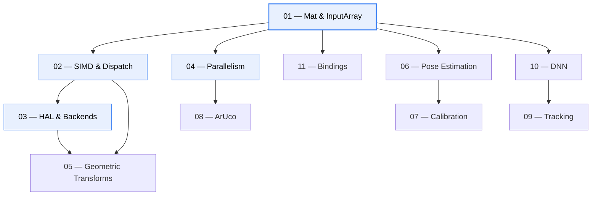

# Feature Documentation

[← Lifecycle of a Call](../03-call-lifecycle.md) · [Index](../README.md) · [Issue studies →](../issue-studies/README.md)

---

One document per major OpenCV subsystem. Each covers the subsystem's purpose, its public API,
its internal structure, and — where one exists — the bug study that exposed how it really
works.

## Foundations (`core`)

These four are prerequisites for everything else. Read them in order if you are new to the
codebase.

| Document | Covers | Related study |
|----------|--------|---------------|
| [01 — Mat & InputArray](01-core-mat-and-inputarray.md) | The data model: `Mat`, `UMat`, N-D arrays, reference counting, the `InputArray` adapter, type encoding | [#26498](../issue-studies/hard-26498-flip-nd-arrays.md), [#29692](../issue-studies/medium-29692-fisheye-point-shape.md) |
| [02 — SIMD & CPU Dispatch](02-core-simd-dispatch.md) | Universal intrinsics, baseline vs. dispatched builds, `CV_CPU_DISPATCH`, the SIMD/tail split | [#30151](../issue-studies/hard-30151-gemm-cv64f-simd-guard.md), [#29893](../issue-studies/hard-29893-multiply-16u-work-type.md) |
| [03 — HAL & Backends](03-core-hal-backends.md) | The HAL C ABI, vendor implementations, OpenCL T-API, IPP, CUDA | [#29985](../issue-studies/hard-29985-resize-realized-scale.md) |
| [04 — Parallelism](04-core-parallel-for.md) | `parallel_for_`, backend selection, nesting rules, allocation under threads | [#27714](../issue-studies/hard-27714-apriltag-heap-leak.md) |

## Algorithm modules

| Document | Module | Related study |
|----------|--------|---------------|
| [05 — Geometric Transforms](05-imgproc-geometric-transforms.md) | `imgproc` — `resize`, `warpAffine`, `remap` | [#29985](../issue-studies/hard-29985-resize-realized-scale.md), [#29854](../issue-studies/medium-29854-connectedcomponents-empty.md) |
| [06 — Pose Estimation](06-geometry-pose-estimation.md) | `geometry` — `solvePnP`, RANSAC framework | [#29573](../issue-studies/hard-29573-solvepnp-ransac-inliers.md) |
| [07 — Camera Calibration](07-calib-camera-calibration.md) | `calib` — pinhole & fisheye calibration | [#29692](../issue-studies/medium-29692-fisheye-point-shape.md) |
| [08 — ArUco & AprilTag](08-objdetect-aruco.md) | `objdetect` — marker detection, quad fitting | [#27714](../issue-studies/hard-27714-apriltag-heap-leak.md) |
| [09 — Object Tracking](09-video-tracking.md) | `video` — the `Tracker` interface, `TrackerVit` | [#30164](../issue-studies/medium-30164-trackervit-scalefactor.md) |
| [10 — DNN Engine](10-dnn-engine.md) | `dnn` — the 5.x graph engine, fusion, backends | — |
| [11 — Language Bindings](11-bindings.md) | `python`, `java`, `js`, `objc` — generation and the NumPy bridge | [#26498](../issue-studies/hard-26498-flip-nd-arrays.md) |

---

## Dependency reading order

