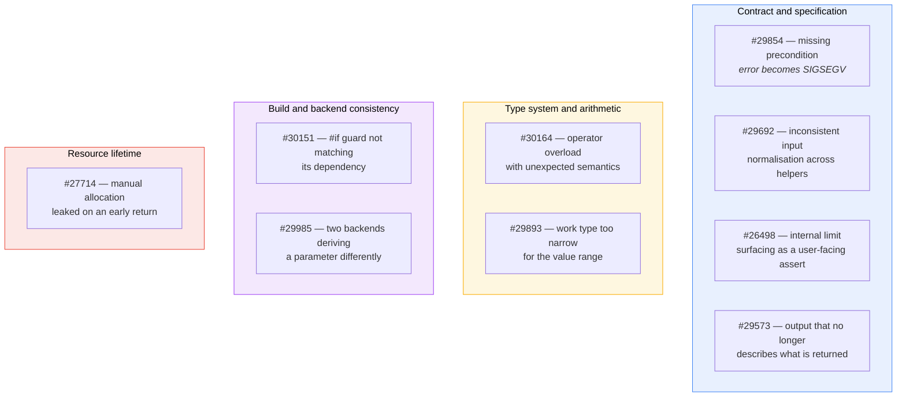

# Issue Studies — Medium and Hard Bugs, Dissected

[← features/](../features/README.md) · [Index](../README.md)

---

This folder contains nine detailed autopsies of bugs that were reported upstream against
OpenCV and fixed on branches in this fork. Each study covers:

1. **The report** — what the user observed, with their reproducer.
2. **The implementation background** — the code you need to understand before the bug makes
   sense.
3. **Root cause** — the precise mechanism, with flowcharts and the real code.
4. **The fix** — the actual diff, annotated.
5. **The test** — what it proves, and what it does not.
6. **Assessment** — limits, risks and open questions, stated plainly.

Section 6 is the part that distinguishes these from release notes. Three of these fixes are
**not** complete solutions, and saying so is more useful than claiming otherwise.

---

## Selection

The fork carries eleven fix branches. Two are one-line documentation corrections
(`#29870`, a NumPy array-shape example in a tutorial; `#29818`, a CDN URL with an extra
version digit). They are correct and useful, but there is nothing to analyse — no code path,
no trade-off. They are excluded.

The remaining nine are included, graded by what it takes to *find* the bug rather than how
many lines it takes to fix:

| Study | Issue | Module | Difficulty | Diff size |
|-------|-------|--------|------------|-----------|
| [connectedComponents on empty input](medium-29854-connectedcomponents-empty.md) | [#29854](https://github.com/opencv/opencv/issues/29854) | imgproc | Medium | +2 / +15 test |
| [fisheye point-array shapes](medium-29692-fisheye-point-shape.md) | [#29692](https://github.com/opencv/opencv/issues/29692) | calib | Medium | +10 / +74 test |
| [TrackerVit scalefactor](medium-30164-trackervit-scalefactor.md) | [#30164](https://github.com/opencv/opencv/issues/30164) | video | Medium | +9 −2 |
| [cv::flip on N-D arrays](hard-26498-flip-nd-arrays.md) | [#26498](https://github.com/opencv/opencv/issues/26498) | core | Hard | +19 / +31 test |
| [AprilTag heap leak](hard-27714-apriltag-heap-leak.md) | [#27714](https://github.com/opencv/opencv/issues/27714) | objdetect | Hard | +3 −1 / +34 test |
| [solvePnPRansac inlier set](hard-29573-solvepnp-ransac-inliers.md) | [#29573](https://github.com/opencv/opencv/issues/29573) | geometry | Hard | +10 −2 / +83 test |
| [multiply 16U work type](hard-29893-multiply-16u-work-type.md) | [#29893](https://github.com/opencv/opencv/issues/29893) | core | Hard | +2 −1 |
| [resize realized scale](hard-29985-resize-realized-scale.md) | [#29985](https://github.com/opencv/opencv/issues/29985) | imgproc | Hard | +3 / +26 test |
| [GEMM CV_64F SIMD guard](hard-30151-gemm-cv64f-simd-guard.md) | [#30151](https://github.com/opencv/opencv/issues/30151) | core | Hard | +1 −1 / +24 test |

Note how weakly diff size correlates with difficulty. `#29893` is a one-token change
(`float` → `uint32_t`) and is among the hardest in the set: the symptom appears only for
arrays shorter than one SIMD register, differs between NEON and AVX2, and depends on a
template parameter four arguments deep.

---

## Reading by bug class

Grouped by *mechanism*, these nine cover most of the ways a mature C++ library breaks:

If you read only three, read:

- **[#30164](medium-30164-trackervit-scalefactor.md)** — the most instructive. A plausible
  one-line expression computing something entirely different from what it reads as, with
  measurable consequences.
- **[#29573](hard-29573-solvepnp-ransac-inliers.md)** — the deepest. A specification
  question (which model do the reported inliers belong to?) with a defensible argument on
  each side.
- **[#27714](hard-27714-apriltag-heap-leak.md)** — the best cautionary tale. A real leak,
  a correct fix, and a conclusion that the fix cannot explain the reported symptom, because
  the function is unreachable.

---

## Recurring lessons

Patterns that show up more than once across these nine:

1. **Validate before you allocate.** `#29854`. Entry points should establish preconditions
   before `_dst.create()` and before dispatch.
2. **Canonicalise input, don't guess it.** `#29692`, `#26498`. `reshape(cn, total())` after
   `getMat()` beats heuristics on `rows`/`cols`, and three helpers guessing three different
   ways is a defect in itself.
3. **Make the `#if` name the thing it protects.** `#30151`. A guard testing a *related*
   capability compiles until the day the two diverge.
4. **The SIMD body and the scalar tail are two implementations.** `#29893`. They must agree
   over the whole input domain, including saturation edges.
5. **One parameter, one source of truth.** `#29985`. Passing both a size and a ratio invites
   two backends to disagree.
6. **Prefer RAII to a second `free`.** `#27714`. Fixing one early return still leaves the
   exception path leaking.
7. **Beware overloaded operators on vector-like types.** `#30164`. `cv::Scalar` has
   quaternion semantics for `/` and `*`.
8. **Say which model an output describes.** `#29573`. The bug was partly in the
   documentation's silence.

---

## What was *not* done

Stated plainly, because it bounds how much these studies should be trusted:

- **Nothing was built or run.** OpenCV was not compiled, no test was executed, no reproducer
  was run. Every claim comes from reading source at commit `1e21d6ed7`, and inferences that
  were not verified against a running build are marked **(unverified)** in the text.
- **The fixes were not reviewed by OpenCV maintainers.** Where a study says a fix is risky
  (`#29985`) or cannot explain the reported symptom (`#27714`), that is this documentation's
  reading of the code, not an upstream verdict.
- **Upstream state as of 2026-11-22.** `#29854`, `#30164`, `#30151` and `#29893` are closed
  upstream; `#26498`, `#27714`, `#29573`, `#29692` and `#29985` were still open. A fix on a
  branch here does not mean it was accepted upstream.
- **Issue bodies were read via the GitHub API** and are quoted in excerpt. Follow the links
  for the full discussion, which in several cases contains maintainer objections the studies
  summarise but do not reproduce in full.

### Corrections to earlier documentation in this fork

The branches `docs/fixes-documentation` and `docs/all-fixes-replica` carry an earlier
`FIXES_DOCUMENTATION.md` describing the same eleven fixes. Reading the source turned up four
places where it is wrong; each is corrected in the relevant study:

| Claim in `FIXES_DOCUMENTATION.md` | What the source shows |
|-----------------------------------|------------------------|
| `CV_CN_MAX` is 512, so N-D arrays start at 513 channels | `CV_CN_MAX` is **128** in 5.x (`interface.h:50`); 512 was 4.x |
| `#29893` added `TEST(Core_Multiply, multiply_16u_saturation_29893)` | That commit (`66b1c5210`) is **empty**; no test exists |
| `#30151` fixes NaN output on ARMv7 in 5.x | The 5.x call sites are already `CV_SIMD_64F`-guarded; the patch hardens a **latent** hazard |
| `#29692` is caused by a missing `reshape` in five functions | Also true, but the operative defect is **three mutually inconsistent layout heuristics** |

A fifth, more consequential finding has no counterpart in that document: `quad_segment_agg`,
the function fixed for `#27714`, is **unreachable dead code**.
