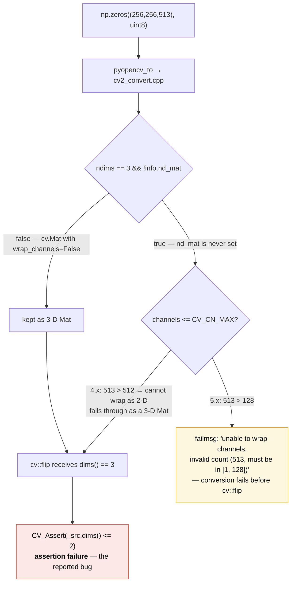

# #26498 — `cv::flip` Asserts on N-D Arrays

[← issue-studies index](README.md) · **Difficulty:** Hard · **Module:** `core`

| | |
|---|---|
| **Upstream issue** | [opencv/opencv#26498](https://github.com/opencv/opencv/issues/26498) — *"Assertion error when flipping arrays with more than 512 channels"* |
| **Labels** | `bug`, `category: python bindings` |
| **Upstream state** | **Open** (as of 2026-11-22) |
| **Branch** | `fix/issue-26498-flip-ndim` |
| **Files** | `modules/core/src/matrix_transform.cpp` (+19), `modules/core/test/test_nd_transform.cpp` (+31) |

---

## 1. The report

```python
import cv2
import numpy as np

# Works
arr1 = np.zeros((256, 256, 512), dtype=np.uint8)
cv2.flip(arr1, 0)

# Throws error
arr2 = np.zeros((256, 256, 513), dtype=np.uint8)
cv2.flip(arr2, 0)
```

```
cv2.error: OpenCV(4.10.0) .../modules/core/src/matrix_transform.cpp:784:
error: (-215:Assertion failed) _src.dims() <= 2 in function 'flip'
```

A single channel more, and the function stops existing. Reported on OpenCV-Python 4.10.0,
macOS, Python 3.12.

The label is the first clue to why this is hard: `category: python bindings`, not
`category: core`. The assertion fires in `core`, but the *reason* an innocuous NumPy array
reached a 2-D-only function lives in the binding layer. Fixing it requires understanding both.

---

## 2. Implementation background

### The channel/dimension decision

A `(H, W, C)` NumPy buffer can be wrapped two ways
([features/01 §4](../features/01-core-mat-and-inputarray.md#4-channels-vs-dimensions--the-ambiguity-that-breaks-functions)):

- **2-D, C channels** — `dims() == 2`, `rows = H`, `cols = W`, `type = CV_8UC(C)`
- **3-D, 1 channel** — `dims() == 3`, `size = [H, W, C]`

The binding layer picks for the user (`modules/python/src2/cv2_convert.cpp:188`):

```cpp
bool ismultichannel = ndims == 3 && !info.nd_mat;
```

and the channel count is bounded by the type encoding
(`modules/core/include/opencv2/core/hal/interface.h:50`):

```c
#define CV_CN_MAX     128
#define CV_CN_SHIFT   5
#define CV_MAKETYPE(depth,cn) (CV_MAT_DEPTH(depth) + (((cn)-1) << CV_CN_SHIFT))
```

> ### ⚠️ The limit is 128 in 5.x, not 512
>
> | | 4.x | 5.x (this tree) |
> |---|---|---|
> | `CV_CN_SHIFT` | 3 | **5** |
> | `CV_CN_MAX` | 512 | **128** |
>
> 5.x spends two more bits on depth for the new element types (`CV_16BF`, `CV_Bool`,
> `CV_32U`, `CV_64U`, `CV_64S`) and pays with a lower channel ceiling. The issue title's
> "512" describes 4.x. Any 5.x discussion of this bug that says 512 is repeating a stale
> number — the cliff is at **129 channels** here.

### Why `flip` is 2-D only

`cv::flip` dispatches to SIMD kernels that assume a 2-D row/column layout, selected by
element size with alignment checks
([03 — Lifecycle of a Call §4](../03-call-lifecycle.md#step-4--layers-45-selecting-and-running-the-kernel)).
`CV_Assert(_src.dims() <= 2)` is a correct guard for that machinery, not an oversight.

Meanwhile `cv::flipND` already existed and handles arbitrary dimensionality
(`matrix_transform.cpp:1069`) by reversing a stride rather than moving data:

```cpp
nd::View v = nd::viewOf(src);
nd::flip(v, axis);              // O(1): negate a stride, offset the base pointer
nd::copy(v, nd::viewOf(dst));   // one strided copy
```

So both halves of the solution were present. What was missing was the connection.

---

## 3. Root cause



The defect is an **implementation limit leaking into the public API**. From the user's
viewpoint, `cv2.flip` works on `(256,256,512)` and not on `(256,256,513)`. Nothing in the
signature, the documentation or the data suggests a channel ceiling; the number 512 (or 128)
is an artefact of how `Mat` packs a type into an `int`. The user did not ask for channels at
all — they have a 3-D array.

And the capability already existed: `flipND(src, dst, 0)` does exactly what
`cv2.flip(arr, 0)` should do for this input.

### ⚠️ What happens in *this* tree

Reading `cv2_convert.cpp:217` changes the picture for 5.x:

```cpp
if (ismultichannel)
{
    int channels = ndims >= 1 ? (int)_sizes[ndims - 1] : 1;
    if (channels < 1 || channels > CV_CN_MAX)
    {
        failmsg("%s unable to wrap channels, invalid count (%d, must be in [1, %d])",
                info.name, (int)channels, (int)CV_CN_MAX);
        return false;
    }
    ...
}
```

Exceeding the limit is a **conversion failure**, not a fallback to a 3-D `Mat`. Together with
`info.nd_mat` never being set — it requires a `/ND` modifier on the declaration
(`gen2.py:495`), and a repository-wide search finds **zero** uses of `/ND` in
`modules/*/include/opencv2` — this means:

**In this 5.x tree, the issue's exact Python reproducer fails inside argument conversion with
a different message and never reaches `cv::flip`.** *(Read from source; not verified against a
built 5.x Python module.)*

The fix is therefore still valuable but reachable by different routes:

| Caller | Reaches the new N-D path? |
|--------|---------------------------|
| C++ with a genuinely 3-D `Mat` | **Yes** — this is what the regression test does |
| Python, `cv.Mat(arr, wrap_channels=False)` | **Yes** (`cv2_convert.cpp:189-203`) |
| Python, plain `ndarray` with C > 128 | **No** — conversion fails first |
| Python, plain `ndarray` with C ≤ 128 | **No** — becomes a 2-D multi-channel `Mat` |

A complete fix for the *reported user experience* in 5.x would also need the binding layer to
wrap over-wide arrays as N-D `Mat`s instead of refusing them. That is a separate change in
`cv2_convert.cpp`, and this patch does not make it.

---

## 4. The fix

```diff
--- a/modules/core/src/matrix_transform.cpp
+++ b/modules/core/src/matrix_transform.cpp
@@ -1014,6 +1014,25 @@ void flip( InputArray _src, OutputArray _dst, int flip_mode )
 {
     CV_INSTRUMENT_REGION();
 
+    if( _src.dims() > 2 )
+    {
+        if (flip_mode == 0)
+        {
+            flipND(_src, _dst, 0);
+        }
+        else if (flip_mode > 0)
+        {
+            flipND(_src, _dst, 1);
+        }
+        else
+        {
+            Mat tmp;
+            flipND(_src, tmp, 0);
+            flipND(tmp, _dst, 1);
+        }
+        return;
+    }
+
     CV_Assert( _src.dims() <= 2 );
     Size size = _src.size();
```

19 lines, inserted *above* everything else. Four reasons this is the right shape:

**1. The axis mapping preserves 2-D semantics exactly.** This is the crux of the correctness
argument:

| `flip_mode` | 2-D meaning | N-D equivalent | Why they match |
|-------------|-------------|----------------|----------------|
| `0` | flip vertically (reverse rows) | `flipND(axis=0)` | axis 0 **is** rows in `[H, W, C]` |
| `> 0` | flip horizontally (reverse columns) | `flipND(axis=1)` | axis 1 **is** columns |
| `< 0` | both | `axis=0` then `axis=1` | composition, as the 2-D path also does |

For a `(H, W, C)` array, channels occupy the *last* axis in both representations. So flipping
axis 0 or 1 touches exactly the same data as flipping a 2-D C-channel image — the result is
**identical to what the 2-D path produces for C ≤ 128**, which is precisely the continuity a
user crossing the threshold expects.

**2. Placement above the assert and above every backend.** Nothing downstream — the
degenerate-shape shortcuts, `CV_OCL_RUN`, `CALL_HAL`, `flipVert`, `flipHoriz` — needs to know
N-D arrays exist. No optimised kernel changes, so no performance or correctness risk for the
2-D case. This is the "route at the top, don't edit the kernels" pattern from
[03 §5](../03-call-lifecycle.md#what-this-call-teaches-about-the-codebase).

**3. The temporary in the `flip_mode < 0` branch is necessary.**

```cpp
Mat tmp;
flipND(_src, tmp, 0);
flipND(tmp, _dst, 1);
```

Chaining through `tmp` rather than `flipND(_src, _dst, 0); flipND(_dst, _dst, 1);` matters
because `flipND` has an aliasing fast path (`matrix_transform.cpp:1083`):

```cpp
if (dst.data == src.data && src.isContinuous() && dst.isContinuous())
{
    flipNDInplace(dst, axis);
    return;
}
```

With a two-step chain writing into `_dst`, the second call could take the in-place branch —
correct here, but it also means the second call's behaviour depends on whether `_dst` happened
to alias `_src`, which is exactly the kind of state-dependent path that breaks later. The
temporary makes both steps unconditionally out-of-place. The cost is one extra buffer and one
extra pass; for an operation already bounded by memory bandwidth, accepting that for
predictability is a reasonable trade. (A sharper version could use `flipNDInplace` on `_dst`
deliberately, saving the temporary — but it would need to prove continuity first.)

**4. `CV_Assert(_src.dims() <= 2)` is deliberately left in place.** It is now unreachable, and
that is good: it documents the 2-D contract of the code below it, and it will catch a future
edit that accidentally lets N-D input through.

### What the fix does not handle

- **`dims() == 1`.** The branch is `dims() > 2`, so 1-D arrays still go to the 2-D path.
  OpenCV 5.x supports 1-D `Mat`s; whether `flip` handles one correctly was not checked.
  **(unverified)**
- **Axes beyond 1.** `flip_mode` has no encoding for "flip axis 2", so flipping the channel
  axis of a 3-D array is still only reachable through `flipND` directly. This is a limitation
  of `flip`'s integer-mode API, not of the fix.
- **`UMat` input with `dims() > 2`.** The new branch precedes `CV_OCL_RUN`, so N-D `UMat`s go
  through `flipND`, which calls `getMat()` — forcing a device→host transfer. Correct, but
  silently non-accelerated.

---

## 5. The test

```cpp
TEST(Core_Flip, ndim_26498)
{
    // Arrays with more than CV_CN_MAX channels arrive as dims() > 2 from Python/numpy.
    // cv::flip must handle them via flipND rather than asserting.
    const int sz[] = {4, 6, 513};
    Mat src(3, sz, CV_8U);
    cv::randu(src, 0, 256);

    // Flip along axis 0 (rows)
    Mat dst0;
    EXPECT_NO_THROW(cv::flip(src, dst0, 0));
    EXPECT_EQ(dst0.dims, 3);
    EXPECT_EQ(dst0.size[0], 4);
    EXPECT_EQ(dst0.size[1], 6);
    EXPECT_EQ(dst0.size[2], 513);
    // First slice of dst0 should equal last slice of src along axis 0
    Mat src_slice0(2, sz+1, CV_8U, src.ptr());
    Mat dst_slice0(2, sz+1, CV_8U, dst0.ptr() + (sz[0]-1)*src.step[0]);
    EXPECT_EQ(0, cv::norm(src_slice0, dst_slice0, NORM_INF));

    // Flip along axis 1 (cols)
    Mat dst1;
    EXPECT_NO_THROW(cv::flip(src, dst1, 1));
    EXPECT_EQ(dst1.dims, 3);

    // Flip both axes
    Mat dstm1;
    EXPECT_NO_THROW(cv::flip(src, dstm1, -1));
    EXPECT_EQ(dstm1.dims, 3);
}
```

Strengths: it builds the 3-D `Mat` in C++, so it tests the fixed code path independently of
the binding question in §3. It checks all three modes, asserts shape preservation, and for
`mode 0` verifies **actual data movement** by comparing src slice 0 against dst slice 3 using
`Mat` headers over raw pointers with explicit strides.

Weaknesses, in order of importance:

- **Only `mode 0` is verified numerically.** `mode 1` and `mode -1` check
  `EXPECT_NO_THROW` and `dims == 3` only. A `flipND(axis=1)` that did nothing at all would
  pass. Given that the axis mapping is the core correctness claim, this is the significant gap.
- **No round-trip check.** `flip(flip(x, -1), -1) == x` is one line, needs no stride
  arithmetic, and would cover `mode -1` properly:
  ```cpp
  Mat roundtrip; cv::flip(dstm1, roundtrip, -1);
  EXPECT_EQ(0, cv::norm(src, roundtrip, NORM_INF));
  ```
- **No cross-check against the 2-D path.** The strongest available test: build a `(4, 6, 64)`
  array (64 ≤ 128, so it also works as 2-D multi-channel), flip it both ways, and assert the
  results are identical. That directly validates the semantic-equivalence claim of §4.1.
- **The comment says `CV_CN_MAX` channels while using 513**, which is stale for 5.x where the
  limit is 128. The test still exercises `dims == 3` correctly; only the rationale is dated.
- **No `dims() == 4` case**, and no aliasing case (`flip(a, a, -1)`).

---

## 6. Assessment

**Is the fix correct?** For the code it changes, yes. The axis mapping is right, the 2-D path
is untouched, and `flipND` is a tested existing function.

**Does it fix the reported bug?** In 4.x, yes — that is where `dims() > 2` arrays actually
reached `flip`. In **this 5.x tree, probably not as experienced by the reporter**, because the
NumPy conversion now refuses over-wide arrays before `cv::flip` is called (§3). The fix makes
`cv::flip` N-D-capable, which is necessary; it is not sufficient for the Python reproducer
here. That the upstream issue remains open is consistent with this.

**Is the design right?** Yes, and it is the most reusable thing in this study. Three
alternatives and why they are worse:

| Alternative | Problem |
|-------------|---------|
| Teach `flipVert`/`flipHoriz` about N-D | Touches hot SIMD kernels for a rare input |
| Raise `CV_CN_MAX` | Costs depth bits; 5.x went the other way deliberately |
| Document the limit and reject | Capability already existed in `flipND` |

Routing at the entry point gets the behaviour for 19 lines and zero risk to the optimised
paths.

**Why "hard".** The assertion is a one-line symptom of an interaction between three
subsystems: the type-encoding bit budget, the NumPy bridge's channel/dimension decision, and
`flip`'s 2-D kernel contract. Diagnosing it means knowing why 512 (or 128) is special — which
is not in `flip`'s source, its documentation, or the user's code. The fix is then easy; the
understanding is not. The 4.x-vs-5.x divergence in §3 makes it harder still, since the obvious
reproducer now fails for a different reason.

---

## 7. Lessons

1. **Implementation limits must not become API cliffs.** If an internal encoding caps
   channels, functions should degrade to a general path, not assert.
2. **Route new capability at the entry point.** Adding a branch above the existing code is
   safer than generalising optimised kernels, and keeps the fast path untouched.
3. **Check whether the capability already exists.** `flipND` had done this all along; the fix
   is three calls.
4. **Verify the semantic mapping, not just the absence of a throw.** The claim worth testing
   is "`flip(mode=1)` on a 3-D array equals `flip(mode=1)` on the equivalent 2-D array".
5. **Re-reproduce before fixing an old issue.** Reported against 4.10; by 5.1.0-dev the
   failure mode had moved to a different layer.
6. **Prefer unconditional out-of-place staging over paths whose behaviour depends on
   aliasing.** The temporary in `flip_mode < 0` costs a buffer and removes a class of
   surprise.

---

## 8. Related

- [features/01 — Mat & InputArray §3–4](../features/01-core-mat-and-inputarray.md#3-type-encoding--and-what-changed-in-5x) — type encoding and the channel/dimension ambiguity.
- [features/11 — Bindings §4](../features/11-bindings.md#4--channels-or-dimensions-the-128-channel-cliff) — the NumPy bridge's decision, in full.
- [03 — Lifecycle of a Call](../03-call-lifecycle.md) — `cv::flip` traced end-to-end, including this branch.
- [#29692](medium-29692-fisheye-point-shape.md) — the other shape-contract bug.
