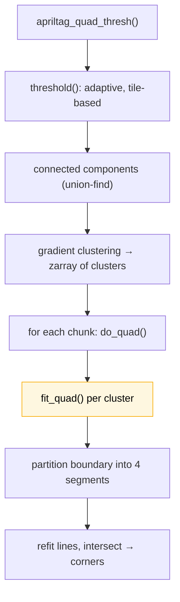
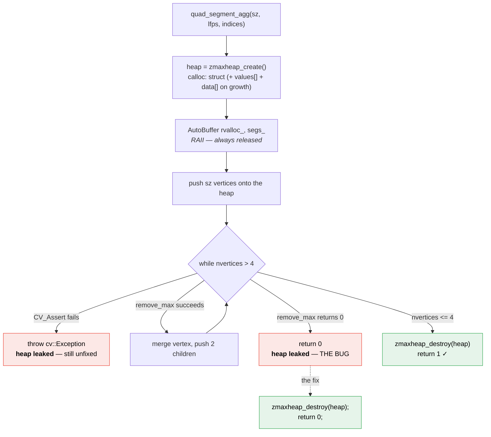
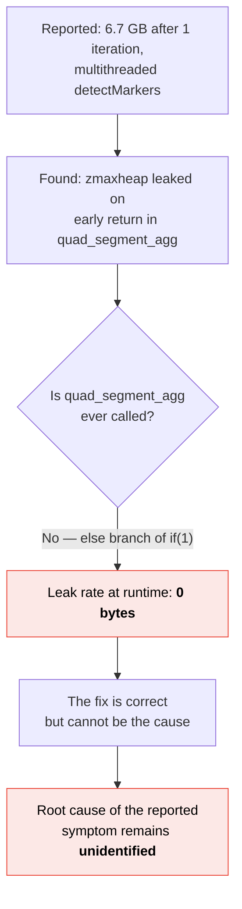

# #27714 — Memory Leak in Multithreaded ArUco Detection

[← issue-studies index](README.md) · **Difficulty:** Hard · **Module:** `objdetect`

| | |
|---|---|
| **Upstream issue** | [opencv/opencv#27714](https://github.com/opencv/opencv/issues/27714) — *"Memory leak in multithreaded ArUco detection"* |
| **Labels** | `bug`, `category: objdetect` |
| **Upstream state** | **Open** (as of 2026-11-22) |
| **Branch** | `fix/issue-27714-aruco-memory-leak` |
| **Files** | `modules/objdetect/src/aruco/apriltag/apriltag_quad_thresh.cpp` (+3 −1), `modules/objdetect/test/test_arucodetection.cpp` (+34) |

---

## 1. The report

> When running ArUco marker detection (`cv::aruco::ArucoDetector`) in multithreaded contexts,
> memory usage increases significantly and is not released after threads complete.
>
> The leak does not occur in single-threaded execution. In multi-threaded runs, RSS grows with
> each iteration and remains high even after images go out of scope.

```
Initial memory [GB]: 0.07
After 1 iteration [GB]: 6.7
After 10 iterations [GB]: 8.1
Final memory [GB]: 7.7
```

OpenCV 4.12.0 (also 4.5.4), Ubuntu 22.04, g++ 11.4.0, i5-12600K.

**6.6 GB after a single iteration.** That number is the most important datum in the report, and
— as §6 argues — it is what ultimately shows the committed fix cannot be the whole story.

---

## 2. Implementation background

### Where the AprilTag code sits

When `cornerRefinementMethod == CORNER_REFINE_APRILTAG`, candidate detection is replaced by a
port of the AprilTag 3 quad detector (`aruco_detector.cpp:789`):

```cpp
if(detectorParams.cornerRefinementMethod == (int)CORNER_REFINE_APRILTAG){
    _apriltag(grey, detectorParams, candidates, contours);
}
else {
    detectCandidates(grey, candidates, contours);
}
```

This is a **C-style island** inside a C++ codebase: `calloc`/`free`, custom containers
(`zarray_t`, `zmaxheap_t`, union-find), and `goto` cleanup. Memory management is manual, which
is exactly the context in which leaks occur.

The pipeline:



### `zmaxheap`

`quad_segment_agg` uses a max-heap as a priority queue. Its allocation is raw
(`zmaxheap.cpp:70`):

```cpp
zmaxheap_t *zmaxheap_create(size_t el_sz)
{
    zmaxheap_t *heap = (zmaxheap_t*)calloc(1, sizeof(zmaxheap_t));
    heap->el_sz = el_sz;
    heap->swap = _swap_default;
    if (el_sz == sizeof(void*))
        heap->swap = _swap_pointer;
    return heap;
}

void zmaxheap_destroy(zmaxheap_t *heap)
{
    free(heap->values);
    free(heap->data);
    free(heap);
}
```

Three allocations in total: the struct, plus `values` (float array) and `data` (`el_sz` bytes
per entry), both grown on demand by `_zmaxheap_ensure_capacity` from `MIN_CAPACITY = 16` by
doubling. `zmaxheap_destroy` frees all three and **must be called on every exit path**.

---

## 3. The leak

`quad_segment_agg` (`apriltag_quad_thresh.cpp:460`) mixes RAII and manual management in one
function:

```cpp
int quad_segment_agg(int sz, struct line_fit_pt *lfps, int indices[4]){

    zmaxheap_t *heap = zmaxheap_create(sizeof(struct remove_vertex*));   // ← MANUAL

    int rvalloc_pos = 0;
    int rvalloc_size = 3*sz;
    cv::AutoBuffer<struct remove_vertex, 0> rvalloc_(std::max(1, rvalloc_size));   // ← RAII
    memset(rvalloc_.data(), 0, sizeof(rvalloc_[0]) * rvalloc_.size());
    struct remove_vertex *rvalloc = rvalloc_.data();
    cv::AutoBuffer<struct segment, 0> segs_(std::max(1, sz));                      // ← RAII
    memset(segs_.data(), 0, sizeof(segs_[0]) * segs_.size());
    struct segment *segs = segs_.data();

    // populate with initial entries
    for (int i = 0; i < sz; i++) {
        struct remove_vertex *rv = &rvalloc[rvalloc_pos++];
        ...
        zmaxheap_add(heap, &rv, (float)-rv->err);
        ...
    }

    int nvertices = sz;

    while (nvertices > 4) {
        CV_Assert(rvalloc_pos < rvalloc_size);          // ← can THROW: leaks the heap

        struct remove_vertex *rv;
        float err;

        int res = zmaxheap_remove_max(heap, &rv, &err);
        if (!res)
            return 0;                                   // ← LEAKS the heap (the bug)
        CV_Assert(res);
        ...
        nvertices--;
    }

    zmaxheap_destroy(heap);                             // ← only reached on success

    int idx = 0;
    for (int i = 0; i < sz; i++)
        if (segs[i].is_vertex)
            indices[idx++] = i;

    return 1;
}
```

There are exactly two `return` statements. One destroys the heap; the other does not.



**The lesson is in the mixture.** Two of the three allocations are `cv::AutoBuffer`, which
releases on *every* exit including exceptions. The third is a raw `calloc` requiring a manual
`destroy` — and it is the one that leaks. The author reached for RAII twice and not the third
time, because `zmaxheap_t` came from the upstream C code with its own create/destroy
convention.

### Leak size per occurrence

| Allocation | Size |
|------------|------|
| `zmaxheap_t` struct | ~40 bytes |
| `values[]` | 4 bytes × capacity |
| `data[]` | 8 bytes × capacity (`sizeof(remove_vertex*)`) |

Capacity grows by doubling from 16 toward the `sz` initial pushes plus 2 per removal (bounded
by `3*sz`). For a cluster of `sz = 100` boundary points: roughly 40 + 12 × 256 ≈ **3 KB** per
leaked call.

To reach 6.6 GB would require on the order of **2 million** leaked calls in one iteration.
Plausible only if the early-return path were taken for a large fraction of millions of
clusters. Hold that thought.

---

## 4. The fix

```diff
--- a/modules/objdetect/src/aruco/apriltag/apriltag_quad_thresh.cpp
+++ b/modules/objdetect/src/aruco/apriltag/apriltag_quad_thresh.cpp
@@ -509,8 +509,10 @@ int quad_segment_agg(int sz, struct line_fit_pt *lfps, int indices[4]){
         float err;
 
         int res = zmaxheap_remove_max(heap, &rv, &err);
-        if (!res)
+        if (!res) {
+            zmaxheap_destroy(heap);
             return 0;
+        }
         CV_Assert(res);
```

Minimal and correct for the path it addresses. But it is not the structurally right fix,
because the `CV_Assert` immediately above can still throw and leak. RAII would close both:

```cpp
// Illustrative — not in the branch.
struct ZMaxHeapDeleter {
    void operator()(zmaxheap_t* h) const { if (h) zmaxheap_destroy(h); }
};
std::unique_ptr<zmaxheap_t, ZMaxHeapDeleter> heap_guard(zmaxheap_create(sizeof(struct remove_vertex*)));
zmaxheap_t* heap = heap_guard.get();
// every return and every throw now releases the heap
```

That is 4 lines instead of 2, removes the entire leak class rather than one instance, and
matches the `cv::AutoBuffer` usage already in the same function. Against it: the file is a
vendored C port that upstream AprilTag maintains, and minimising divergence has real value.
A reviewer could legitimately prefer either; the one-line version does not *introduce* a
problem, it just leaves a smaller one behind.

---

## 5. ⚠️ The function is unreachable

Here is the finding that reframes everything. The only call site of `quad_segment_agg` is in
`fit_quad` (`apriltag_quad_thresh.cpp:809`):

```cpp
    int indices[4];
    if (1) {
        if (!quad_segment_maxima(_params, _zarray_size(cluster), lfps, indices))
            goto finish;
    } else {
        if (!quad_segment_agg(sz, lfps, indices))
            goto finish;
    }
```

`if (1) { ... } else { ... }` — **the `else` branch can never execute.**

A repository-wide search finds exactly three references:

```
apriltag_quad_thresh.cpp:460   int quad_segment_agg(int sz, ...){      ← definition
apriltag_quad_thresh.cpp:814       if (!quad_segment_agg(sz, lfps, indices))   ← dead call
apriltag_quad_thresh.hpp:97    int quad_segment_agg(int sz, ...);      ← declaration
```

In upstream AprilTag this was a compile-time switch between two segmentation strategies. The
OpenCV port hard-coded `if (1)` to always use `quad_segment_maxima` but kept the alternative
compiled in — dead code that the compiler still type-checks.

### Consequences

1. **The leak is real.** If the function ran and took that path, it would leak. The code
   defect is genuine and the patch is correct.
2. **The leak cannot occur at runtime.** The function is never called, so it leaks zero bytes
   in any build.
3. **Therefore this fix cannot explain the reported 8 GB.** The reporter's growth comes from
   somewhere else in the pipeline.



### Where the real leak more likely is

Not investigated here, but the same file is full of manual allocation that *is* reachable
(`apriltag_quad_thresh.cpp:1440-1485`):

```cpp
            free(entry);
            entry = tmp;
        }
    }
    free(clustermap);

    zarray_t *quads = _zarray_create(sizeof(struct sQuad));
```

`zarray_t` objects, `clustermap`, the cluster entry lists and the threshold images are all
hand-managed across `goto finish` paths. Any of them is a better candidate for a GB-scale
leak than an unreachable function. The reporter's "6.7 GB after **one** iteration" also hints
at something allocated proportionally to image area per call, rather than a small per-cluster
object.

A proper investigation would run the reporter's reproducer under Valgrind/massif or ASan with
`LSAN_OPTIONS=detect_leaks=1` and read the stacks — which is what the committed test gestures
at but cannot do (§6).

### Why "multithreaded"?

The report's framing deserves a note, because it is a diagnostic trap. Memory leaks are not
thread-specific; threading changed the *scale* and *visibility*:

- More concurrent calls → more allocations in flight → higher peak RSS.
- Per-thread arena fragmentation in glibc `malloc` means freed memory is often **not returned
  to the OS**, so RSS stays high even after correct frees. "Memory does not return to
  baseline after threads exit" is consistent with fragmentation, not only with leaks.

So part of the reported 8 GB may be allocator behaviour rather than leaked memory. Confirming
that needs `malloc_stats()` or `malloc_trim()` instrumentation, not source reading.
**(unverified)**

---

## 6. The test

```cpp
// Regression test for https://github.com/opencv/opencv/issues/27714
// quad_segment_agg leaked its zmaxheap when zmaxheap_remove_max returned zero.
// Run detectMarkers from multiple concurrent threads with CORNER_REFINE_APRILTAG
// to exercise the early-exit path; address/memory sanitizers in CI will catch leaks.
TEST(Objdetect_ArucoDetector, multithreaded_no_leak_27714)
{
    Mat image = Mat::zeros(200, 200, CV_8UC3);

    aruco::DetectorParameters params;
    params.cornerRefinementMethod = (int)aruco::CORNER_REFINE_APRILTAG;
    aruco::Dictionary dict = aruco::getPredefinedDictionary(aruco::DICT_4X4_50);
    aruco::ArucoDetector detector(dict, params);

    const int nthreads = 4;
    const int niters = 10;
    std::vector<std::thread> threads;
    for (int t = 0; t < nthreads; ++t)
    {
        threads.emplace_back([&]() {
            for (int i = 0; i < niters; ++i)
            {
                std::vector<int> ids;
                std::vector<std::vector<cv::Point2f>> corners, rejected;
                detector.detectMarkers(image, corners, ids, rejected);
            }
        });
    }
    for (auto& th : threads) th.join();
    SUCCEED();
}
```

This test cannot detect the bug it names, for four independent reasons:

1. **`SUCCEED()` asserts nothing.** It passes unconditionally. Any leak is invisible unless an
   external sanitizer is watching.
2. **The leaking function is never called** (§5). No configuration of this test reaches it.
3. **A blank image produces no clusters.** `Mat::zeros(200, 200, CV_8UC3)` has no gradients, so
   adaptive thresholding yields nothing to cluster and `fit_quad` is likely never invoked at
   all. Even if the dead branch were live, this input would not exercise it.
4. **It depends on CI configuration.** The comment says "address/memory sanitizers in CI will
   catch leaks" — so the test's value is entirely contingent on an ASan build existing and on
   the leak being large enough to notice.

It does have one legitimate function: as a **smoke test** that concurrent `detectMarkers` with
`CORNER_REFINE_APRILTAG` does not crash or deadlock. That is worth having. It is just not a
leak regression test, and the name claims otherwise.

### What a real test would look like

```cpp
// Illustrative.
TEST(Objdetect_ArucoDetector, apriltag_rss_stable_27714)
{
    // 1. Use an image that actually generates clusters — a rendered marker board,
    //    or at minimum cv::randu noise, so fit_quad runs.
    // 2. Warm up (first-call allocations, OpenCL/pool init) and record a baseline.
    // 3. Run N iterations.
    // 4. Assert RSS growth is bounded, e.g. < 50 MB over 100 iterations.
    //    Read RSS from /proc/self/statm on Linux; skip elsewhere.
}
```

Threshold-based memory tests are fragile and platform-specific, which is the honest reason
they are rare. The alternative is to make the leak path unit-testable — but it is `static`-ish
internal code behind a dead branch, so that would require exposing it.

---

## 7. Assessment

**Is the patch correct?** Yes. It releases a heap that the early-return path would otherwise
leak.

**Does it fix the reported issue?** **No.** The function is unreachable, so the runtime leak
rate it changes is zero. The reporter's 8 GB has a different cause, still unidentified. The
issue remaining open upstream is consistent with that.

**Is the patch worth keeping?** Yes, with honest framing. It corrects a real defect in code
that is compiled and maintained, and would matter immediately if anyone flipped `if (1)` to
select the other algorithm. It should be described as *"fix a leak on an early-return path in
`quad_segment_agg`"*, not as *"fix the multithreaded ArUco memory leak"* — and ideally in the
same patch as either deleting the dead branch or converting the heap to RAII.

**What should happen next:**

1. Run the reporter's reproducer under ASan/Valgrind and find the actual leak.
2. Either delete the `if (1) { } else { }` dead branch, or make the selection a real runtime
   or compile-time option.
3. Convert `zmaxheap_t` ownership to RAII so the `CV_Assert` path is covered too.
4. Replace `SUCCEED()` with a bounded-RSS assertion, or rename the test to a concurrency
   smoke test.

**Why "hard".** Not because the fix is difficult — it is three lines. Because the
*investigation* is: the symptom is multi-gigabyte RSS growth under threads, the file is 1 500
lines of ported C with manual memory management and `goto` cleanup, and the obvious-looking
culprit turns out to be unreachable. The hard skill here is the one the committed fix skipped:
**verifying that the defect you found is the defect that was reported.** Finding a real bug
while hunting a different real bug is a common and under-discussed failure mode.

---

## 8. Lessons

1. **Confirm the found bug explains the reported symptom.** Order-of-magnitude arithmetic —
   3 KB × N vs. 6.6 GB — is cheap and would have raised the question immediately.
2. **Check reachability before claiming a fix.** `grep` for call sites; `if (1) { } else { }`
   makes a branch dead without any compiler warning.
3. **Use RAII for every resource, especially amid other RAII.** One manual `calloc` beside two
   `AutoBuffer`s is the shape of this bug.
4. **A return-path fix is not an exception-path fix.** The `CV_Assert` above the patched line
   still leaks.
5. **`SUCCEED()` is not a leak test.** A test whose assertion is unconditional documents an
   intention, not a behaviour.
6. **"Only happens with threads" rarely means a threading bug.** Concurrency changes rates and
   allocator behaviour; glibc arena fragmentation alone can keep RSS high after correct frees.

---

## 9. Related

- [features/08 — ArUco & AprilTag §3](../features/08-objdetect-aruco.md#3-the-apriltag-quad-detector) — the quad pipeline and the dead branch.
- [features/04 — Parallelism §5](../features/04-core-parallel-for.md#5-allocation-and-resource-lifetime-under-threads) — why allocation under `parallel_for_` multiplies.
