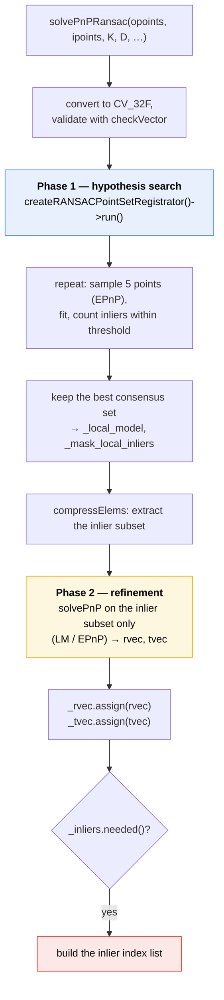
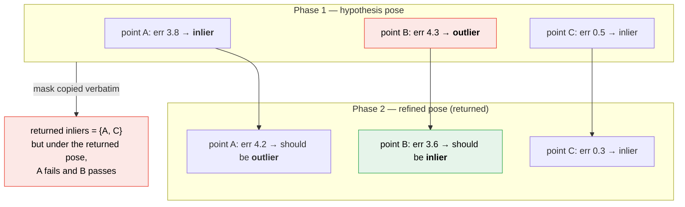

# #29573 — `solvePnPRansac` Reports Inliers of the Hypothesis, Not the Returned Pose

[← issue-studies index](README.md) · **Difficulty:** Hard · **Module:** `geometry`

| | |
|---|---|
| **Upstream issue** | [opencv/opencv#29573](https://github.com/opencv/opencv/issues/29573) — *"solvePnPRansac inliers are based on hypothesis model instead of final model"* |
| **Labels** | `bug` |
| **Upstream state** | **Open** (as of 2026-11-22) |
| **Branch** | `fix/issue-29573-solvepnp-inliers` |
| **Files** | `modules/geometry/src/solvepnp.cpp` (+10 −2), `modules/geometry/test/test_solvepnp_ransac.cpp` (+83) |

---

## 1. The report

> I expect `solvePnPRansac`'s inlier mask to be based on the final model, however it seems to
> be based on the inliers of the best hypothesis.
>
> This means that points can be marked as outliers, while having a reprojection error that is
> below the given threshold.
>
> This behavior doesn't make sense to me, and I also don't see any mention of it in the docs.

The reproducer uses 7 points, a known camera matrix and `threshold = 4.0`, then checks which
indices come back in `inliers` against the reprojection error computed from the *returned*
`rvec`/`tvec`.

This is the subtlest bug in the set, and the only one that is as much a **specification**
question as a code question. Nothing crashes. Nothing is numerically wrong. The pose returned
is correct. The dispute is about what the second output *means* — and the documentation does
not say.

---

## 2. Implementation background

### Two phases

`solvePnPRansac` runs a robust estimator and then refines its result
([features/06 §4](../features/06-geometry-pose-estimation.md#4-solvepnpransacs-two-phases)):



Phase 2 exists because a model fitted to a 5-point minimal sample is statistically poor even
when its consensus set is right. Refitting over the whole consensus set with
Levenberg–Marquardt materially improves accuracy — so the pose that leaves the function is
**not** the pose that selected the inliers.

### The RANSAC inlier criterion

`RANSACPointSetRegistrator::findInliers` (`ptsetreg.cpp:84`):

```cpp
int findInliers( const Mat& m1, const Mat& m2, const Mat& model, Mat& err, Mat& mask, double thresh ) const
{
    cb->computeError( m1, m2, model, err );
    ...
    float t = (float)(thresh*thresh);        // squared — avoids sqrt in the loop
    int i, n = (int)err.total(), nz = 0;
    for( i = 0; i < n; i++ )
    {
        int f = errptr[i] <= t;              // inclusive
        maskptr[i] = (uchar)f;
        nz += f;
    }
    return nz;
}
```

Squared distance, inclusive `<=`. Any code that re-derives an inlier set must match both
choices or it will disagree on boundary points.

### The buggy output block

`solvepnp.cpp:342`, before the fix:

```cpp
if(_inliers.needed())
{
    Mat _local_inliers;
    for (int i = 0; i < npoints; ++i)
    {
        if((int)_mask_local_inliers.at<uchar>(i) != 0) // inliers mask
            _local_inliers.push_back(i);    // output inliers vector
    }
    _local_inliers.copyTo(_inliers);
}
```

`_mask_local_inliers` was filled in **Phase 1**, by `findInliers` against the *hypothesis*
model. By the time this block runs, `rvec`/`tvec` have been overwritten by Phase 2.

---

## 3. Root cause

The function returns two outputs computed against **two different models**:

| Output | Which model it describes |
|--------|--------------------------|
| `rvec`, `tvec` | Phase 2 — the refined pose |
| `inliers` | Phase 1 — the minimal-sample hypothesis |

Refinement shifts the pose, so points near the threshold migrate across it in both directions:



So a user who does the natural verification — reproject with the returned pose and check the
error — finds points excluded from `inliers` whose error is *below* the threshold, and
possibly points included whose error is above it. Exactly the reporter's observation.

### Why this is genuinely hard

**1. Nothing is wrong by any local test.** The pose is good. The inlier count is the right
consensus size. Every intermediate value is what its own code intended. The defect exists only
in the *relationship* between two outputs.

**2. It requires knowing that refinement happens at all.** The documentation describes
`solvePnPRansac` as RANSAC over `solvePnP`. That Phase 2 re-fits on the consensus set, and
therefore moves the pose away from the one that defined the consensus, is visible only in the
source.

**3. There is a defensible argument for the old behaviour.** This is what makes it a
specification question rather than a plain bug:

> **For the old behaviour:** the consensus mask is what the robust estimator *selected*. RANSAC's
> guarantee is about that set. Recomputing against a pose fitted *to those very points* risks
> admitting points the estimator deliberately rejected — the refined pose is biased toward its
> own input, so a nearby outlier can be pulled inside the threshold. In the limit this is
> circular: fit to S, then redefine S by what fits.
>
> **For the new behaviour:** a user cannot act on a mask that does not describe the pose they
> were given. Every downstream use — filtering correspondences, computing a covariance,
> deciding whether to accept the solution — assumes the two agree. And "reproject with the
> returned pose and compare to the threshold" is the only interpretation a caller can
> independently reproduce.

The second argument is stronger, principally because the first describes a *statistical*
concern about an output whose *contract* is unstated. The deeper fix is to document which
model the mask refers to — and if it is the final one, compute it that way.

---

## 4. The fix

```diff
--- a/modules/geometry/src/solvepnp.cpp
+++ b/modules/geometry/src/solvepnp.cpp
@@ -342,11 +342,19 @@ bool solvePnPRansac(InputArray _opoints, InputArray _ipoints,
 
     if(_inliers.needed())
     {
+        // Recompute inliers based on the final refined pose, not the RANSAC consensus mask.
+        // The refinement step may shift the pose enough to include or exclude borderline points.
+        std::vector<cv::Point2f> projected;
+        cv::projectPoints(opoints.reshape(3, npoints), rvec, tvec, cameraMatrix, distCoeffs, projected);
         Mat _local_inliers;
+        const float thresh2 = reprojectionError * reprojectionError;
         for (int i = 0; i < npoints; ++i)
         {
-            if((int)_mask_local_inliers.at<uchar>(i) != 0) // inliers mask
-                _local_inliers.push_back(i);    // output inliers vector
+            const cv::Point2f ip = ipoints.reshape(2, npoints).at<cv::Point2f>(i);
+            float dx = ip.x - projected[i].x;
+            float dy = ip.y - projected[i].y;
+            if (dx*dx + dy*dy <= thresh2)
+                _local_inliers.push_back(i);
         }
         _local_inliers.copyTo(_inliers);
     }
```

Reproject **all** `npoints` original points with the final pose, and define an inlier as one
whose squared reprojection error is within the squared threshold.

### Correctness review

**Type safety — is `at<Point2f>` valid here?** Yes, and it is worth verifying rather than
assuming, since `at<T>` is unchecked in release builds. At function entry
(`solvepnp.cpp:187`):

```cpp
Mat opoints0 = _opoints.getMat(), ipoints0 = _ipoints.getMat();
Mat opoints, ipoints;
if( opoints0.depth() == CV_64F || !opoints0.isContinuous() )
    opoints0.convertTo(opoints, CV_32F);
else
    opoints = opoints0;
if( ipoints0.depth() == CV_64F || !ipoints0.isContinuous() )
    ipoints0.convertTo(ipoints, CV_32F);
else
    ipoints = ipoints0;
```

The asserts below restrict depth to `CV_32F` or `CV_64F`, and `CV_64F` input is converted. So
after this block `opoints`/`ipoints` are **always continuous `CV_32F`**, making
`at<cv::Point2f>` and a `std::vector<Point2f>` output from `projectPoints` type-correct.

**Threshold consistency.** `dx*dx + dy*dy <= thresh2` matches `findInliers`' squared
comparison and its inclusive `<=`. Good — a strict `<` would silently disagree with Phase 1 on
boundary points.

**Reshape validity.** `opoints` was already reshaped to `(N,1,3)` at `solvepnp.cpp:282`, so
`reshape(3, npoints)` is a no-op; `reshape` requires continuity, which holds per the above.

**Empty `distCoeffs`.** `projectPoints` accepts an empty `distCoeffs`, so the zero-distortion
case is fine.

### Two flaws

**1. `reshape` inside the loop** — `ipoints.reshape(2, npoints)` constructs a new `Mat` header
on every one of `N` iterations. Header construction is cheap but not free (refcount
manipulation), and it is pure waste:

```cpp
// Hoist it:
const Mat ipts = ipoints.reshape(2, npoints);
for (int i = 0; i < npoints; ++i)
{
    const cv::Point2f ip = ipts.at<cv::Point2f>(i);
    ...
}
```

Not a correctness bug, but the kind of thing a reviewer will flag, and trivially fixed.

**2. `_mask_local_inliers` becomes unused in this block**, while still being populated and
passed to `run()` above. That is fine — `compressElems` still needs it for Phase 2 — but a
reader now has to work out why a mask is computed and then ignored. A comment at the mask's
declaration would help.

### An unaddressed consequence

If refinement moves the pose enough, the recomputed set could in principle be **smaller than
the minimal sample** (or empty), while the function still returns `true`. The old code could
not do this: the consensus set was by construction at least `modelPoints` in size. The new code
has no floor. In practice a refined pose fits its own inliers better, so the set usually grows
— but nothing guarantees it, and a caller doing `inliers.size() >= 4` is now checking something
the function no longer implies. Worth a `CV_LOG_DEBUG` or a documented note.
**(unverified — no run was performed to see whether this occurs in practice.)**

---

## 5. The test

```cpp
// Regression test for issue #29573:
// solvePnPRansac was reporting inliers from the RANSAC consensus mask (pre-refinement)
// rather than re-evaluating inliers against the final refined pose.
TEST(Calib3d_SolvePnPRansac, inlier_refinement_29573)
{
    const int N_INLIERS = 20;
    const float REPROJ_THRESH = 3.0f;   // pixels

    Mat K = (Mat_<double>(3,3) << 800.0, 0.0, 320.0,  0.0, 800.0, 240.0,  0.0, 0.0, 1.0);
    Mat distCoeffs = Mat::zeros(1, 5, CV_64F);
    Mat rvec_gt = (Mat_<double>(3,1) << 0.1, 0.2, 0.05);
    Mat tvec_gt = (Mat_<double>(3,1) << 0.0, 0.0, 5.0);

    // 4x5 grid of 3-D points, projected exactly → 20 perfect inliers
    std::vector<Point3f> obj_pts;
    for (int r = 0; r < 4; ++r)
        for (int c = 0; c < 5; ++c)
            obj_pts.push_back(Point3f((c - 2) * 0.1f, (r - 1) * 0.1f, 0.0f));
    std::vector<Point2f> projected;
    projectPoints(obj_pts, rvec_gt, tvec_gt, K, distCoeffs, projected);
    std::vector<Point2f> img_pts = projected;   // zero reprojection error

    // 2 outliers, displaced 5x the threshold
    const int IDX_OUTLIER_A = (int)obj_pts.size();
    obj_pts.push_back(Point3f( 0.05f,  0.05f, 0.0f));
    img_pts.push_back(Point2f(img_pts[0].x + REPROJ_THRESH * 5.0f,
                              img_pts[0].y + REPROJ_THRESH * 5.0f));
    const int IDX_OUTLIER_B = (int)obj_pts.size();
    /* … second outlier … */

    Mat rvec_out, tvec_out;
    std::vector<int> inliers;
    bool ok = solvePnPRansac(obj_pts, img_pts, K, distCoeffs, rvec_out, tvec_out,
                             false, 100, REPROJ_THRESH, 0.99, inliers);
    ASSERT_TRUE(ok);
    ASSERT_FALSE(inliers.empty());

    // outliers must be absent
    EXPECT_FALSE(std::find(inliers.begin(), inliers.end(), IDX_OUTLIER_A) != inliers.end());
    EXPECT_FALSE(std::find(inliers.begin(), inliers.end(), IDX_OUTLIER_B) != inliers.end());

    // every returned inlier must satisfy the criterion UNDER THE RETURNED POSE
    std::vector<Point2f> reproj;
    projectPoints(obj_pts, rvec_out, tvec_out, K, distCoeffs, reproj);
    for (int idx : inliers)
    {
        float dx = img_pts[idx].x - reproj[idx].x;
        float dy = img_pts[idx].y - reproj[idx].y;
        EXPECT_LE(std::sqrt(dx*dx + dy*dy), REPROJ_THRESH);
    }

    // all 20 true inliers must be present
    for (int i = 0; i < N_INLIERS; ++i)
        EXPECT_TRUE(std::find(inliers.begin(), inliers.end(), i) != inliers.end());
}
```

The third assertion block is the important one, and it is well designed: it states the
**invariant the issue is about** — *every returned inlier satisfies the reprojection criterion
under the returned pose* — rather than hard-coding an expected index list. That makes it robust
to RANSAC's randomness while still being exactly the property that was broken.

Limitations:

- **It does not prove the bug is fixed.** With 20 exact inliers and 2 gross outliers at 5×
  threshold, the hypothesis mask and the refined mask almost certainly agree, so the *old* code
  would likely pass too. Catching the regression needs a **borderline** point — one whose error
  straddles the threshold between the hypothesis and refined poses, e.g. placed at ~0.95–1.05×
  threshold. Constructing that reliably is genuinely fiddly, which is presumably why it was not
  done; the reporter's own 7-point dataset is a ready-made alternative and would have been the
  stronger choice.
- **The converse invariant is untested:** no excluded point should have error *below* the
  threshold under the returned pose. That is the exact wording of the complaint, it is one more
  loop, and it is the assertion that would actually fail on the old code.
- **`inliers` is not checked for sortedness or uniqueness**, though the implementation produces
  ascending indices and callers may rely on it.
- **No degenerate cases**: no all-outlier input, no `npoints == model_points` (which takes the
  separate early path at `solvepnp.cpp:228`), no `SOLVEPNP_P3P`/`AP3P` flags (which swap the
  refinement method), no non-zero `distCoeffs`.

---

## 6. Assessment

**Is the fix correct?** Yes, for the semantics it chooses. Types are sound, the threshold
comparison matches Phase 1, and the implementation is the obvious one.

**Are the chosen semantics right?** I believe so, for the reason in §3: an output a caller
cannot independently reproduce is not usable, and "reproject with the pose I was given" is the
only reproducible reading. But this is a **judgement about an unspecified contract**, and the
issue is still open upstream — so OpenCV has not ruled. A maintainer could reasonably require:

1. A documentation change stating which model the mask describes (needed either way).
2. Evidence that recomputation does not degrade accuracy on real datasets, given the
   circularity concern.
3. Consideration of whether the USAC path
   ([features/06 §5](../features/06-geometry-pose-estimation.md#5-the-usac-alternative)) should
   behave identically — it has its own inlier handling, and the two should not diverge.

Point 3 is the strongest objection to merging this as-is: fixing one of two `solvePnPRansac`
overloads leaves the library internally inconsistent.

**Performance.** One extra `projectPoints` over N points — O(N), against a RANSAC loop that
already projected N points up to `iterationsCount` times. Negligible.

**Backward compatibility.** This **changes output** for existing callers. Anyone who recorded
inlier sets, or whose thresholds were tuned against consensus-mask behaviour, sees different
results. The sets will usually be the same or slightly larger. It is a behaviour change that
needs release notes, not a silent bug fix.

**Why "hard".** It needs understanding of RANSAC's two-phase structure, awareness that the
returned pose is not the selecting pose, enough numerical sense to see that borderline points
migrate, and a judgement call about an unstated specification — with a legitimate argument on
the other side. Writing a test that genuinely distinguishes the two behaviours is harder than
the fix.

---

## 7. Lessons

1. **Outputs computed in different phases must describe the same model.** If a function
   refines its estimate, every derived output must be refreshed or explicitly documented as
   pre-refinement.
2. **An output a caller cannot reproduce is not usable.** "Reproject and compare" is the only
   interpretation of an inlier mask a user can verify.
3. **Document which model an auxiliary output refers to.** The absence of that sentence is
   half of this bug.
4. **Match the existing criterion exactly** — squared distance, inclusive comparison. A
   mismatched `<` vs `<=` creates a new, subtler disagreement.
5. **Regression tests need borderline cases.** Gross outliers at 5× threshold do not
   distinguish the hypothesis mask from the refined one; only a point near the boundary does.
6. **Fix all equivalent entry points.** The `UsacParams` overload has its own inlier logic.

---

## 8. Related

- [features/06 — Pose Estimation](../features/06-geometry-pose-estimation.md) — `solvePnP`, the RANSAC framework and the phase boundary.
- [#29985](hard-29985-resize-realized-scale.md) — the other study where two parts of one
  function disagree about a derived value.
