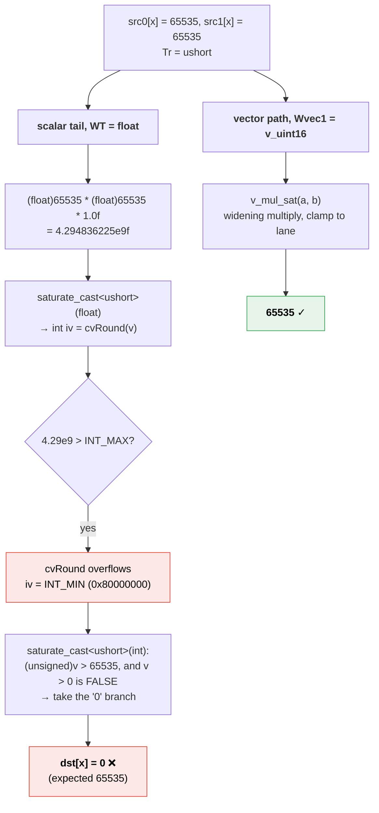

# #29893 — `cv::multiply` on `CV_16U` Returns 0 Instead of 65535

[← issue-studies index](README.md) · **Difficulty:** Hard · **Module:** `core`

| | |
|---|---|
| **Upstream issue** | [opencv/opencv#29893](https://github.com/opencv/opencv/issues/29893) — *"5.x: cv::multiply / cv::pow on 16U give 0 instead of the saturated 65535 for short arrays and for the tail of in-place calls; #28557 is back and its regression test is DISABLED_"* |
| **Labels** | `bug`, `test`, `category: core`, `priority: high` |
| **Upstream state** | **Closed** |
| **Branch** | `fix/issue-29893-multiply-16u-saturation` |
| **Files** | `modules/core/src/arithm.simd.hpp` (+2 −1) |

---

## 1. The report

> `cv::multiply(a, b, dst)` is documented as `dst(I) = saturate(scale * src1(I) * src2(I))`.
> On 5.x, for 16UC1 x 16UC1 with `65535 * 65535` (expected 65535; the same for `46341 * 46341`
> and `50000 * 50000`) **every element is 0 when the array has fewer than 32 elements on
> aarch64 (NEON) or fewer than 64 on x86 (AVX2)**; longer arrays are correct.
>
> […] A 7x9 16U matrix (63 elements) is correct on aarch64 and wrong on x86. 16SC1 x 16SC1 is
> correct (the product fits in `int`). On 4.x (415ba6a) the 16U results are correct at every
> length in all three builds.
>
> When the destination aliases an input (`cv::multiply(a, b, a)`, `cv::pow(a, 2, a)`), the
> length no longer helps: the last `n % 32` elements on aarch64 and the last `n % 64` on x86
> are 0 at every length (aarch64: 33 -> 1 wrong element, 100 -> 4, 1000 -> 8, 4097 -> 1;
> x86: 100 -> 36, 1000 -> 40).

This is an exceptionally good bug report, and its structure tells you the answer before you
read any code:

| Observation | What it implies |
|-------------|-----------------|
| Wrong below 32 (NEON) / 64 (AVX2) elements | The threshold **is** the SIMD register batch size |
| Correct for longer arrays | The vector path is right |
| Wrong in the last `n % 32` of in-place calls | The **scalar tail** is wrong |
| `CV_16S` correct, `CV_16U` wrong | The product fits `int` for `16S`, not for `16U` |
| 4.x correct, 5.x wrong | A 5.x refactor regressed it |
| `#28557` is back | This has happened before, and its test is `DISABLED_` |

Correct in the vector path, wrong in the scalar tail, specifically for the type whose product
exceeds `INT_MAX`. That is a diagnosis, not just a symptom list.

---

## 2. Implementation background

### The unified kernel

5.x consolidated element-wise arithmetic into one template
(`modules/core/src/arithm.simd.hpp:927`):

```cpp
// Unified binary kernel: T0 x T1 -> Tr (operands same depth for arithmetic; cast is separate).
//   Wvec     = work vector. Native (v_uint8/...) drives the same-type saturating path
//              (v_add saturates 8/16-bit, wraps 32-bit); v_float32 drives the widening hub.
//   WT       = scalar work type for the tail.
//   Op       = operation functor (vec()/scl()).
//   use_simd = compile-time switch; false => pure scalar (32/64-bit widened outputs, f64).
template<typename T, typename Tr, typename Wvec, typename WT, class Op,
         typename ST=WT, typename Wvec1=Wvec>
static int vecBinaryKernel(const void* src0_, size_t s0y, size_t s0x, ...)
```

Seven template parameters. The two that matter here are **`Wvec`** (the vector work type) and
**`WT`** (the *scalar* work type for the tail) — and the comment states outright that they are
independent. That independence is the bug's hiding place.

### The two paths

**Vector path**, for `scale == 1` (`arithm.simd.hpp:1006`):

```cpp
if (!Op::useScalar || scalar == ST(1)) {
    // this branch runs on Wvec1, which may be WIDER-laned than Wvec …
    const int VECSZ1 = VTraits<Wvec1>::vlanes();
    const bool tail_trick1 = width >= VECSZ1*4 && src0_ != dst_ && src1_ != dst_;
    for (; x < width; x += VECSZ1*4) {
        Wvec1 a0_, a1_, a2_, a3_, b0_, b1_, b2_, b3_;
        if (x + VECSZ1*4 > width) { if (!tail_trick1) break; x = width - VECSZ1*4; }
        ...
        auto c0 = Op::vec(a0_, b0_), ...
    }
}
```

with `Wvec1 = v_uint16` and (`arithm.simd.hpp:409`):

```cpp
static v_uint16 vec(const v_uint16& a, const v_uint16& b) { return v_mul_sat(a, b); }
```

`v_mul_sat` is a **widening multiply with saturation** — it computes the full 32-bit product
internally and clamps to the 16-bit lane. `65535 × 65535` → `65535`. Correct.

**Scalar tail** (`arithm.simd.hpp:1068`):

```cpp
for (; x < width; x++)
    dst[x] = saturate_cast<Tr>(Op::scl((WT)src0[x*s0x], (WT)src1[x*s1x], scalar));
```

with (`arithm.simd.hpp:418`):

```cpp
template<typename W, typename ST> static W scl(W a, W b, ST s) { return a * b * s; }
```

The whole computation happens in `WT`. So **`WT` must be able to hold the product of two
inputs**, and nothing in the type system enforces that.

### The registration, before the fix (`arithm.simd.hpp:1186`)

```cpp
case CV_16U:
    fptr =   // scale==1 fast path: whole u16 registers via v_mul_sat; Wvec=f32 for scale
        R == CV_16U ? vecBinaryKernel<ushort, ushort, v_float32, float, EwMul, float, v_uint16> :
        R == CV_32F ? vecBinaryKernel<ushort, float,  v_float32, float, EwMul> : nullptr;
    break;
```

Positionally: `T=ushort, Tr=ushort, Wvec=v_float32, ` **`WT=float`** `, Op=EwMul, ST=float,
Wvec1=v_uint16`.

`WT = float` is the defect — the fourth of seven template arguments.

### The `tail_trick`

One more mechanism explains the in-place half of the report:

```cpp
const bool tail_trick1 = width >= VECSZ1*4 && src0_ != dst_ && src1_ != dst_;
...
if (x + VECSZ1*4 > width) { if (!tail_trick1) break; x = width - VECSZ1*4; }
```

When the array is long enough **and does not alias the destination**, the final partial batch
is handled by *backing up* to `width - VECSZ1*4` and redoing a full vector batch — overlapping
work, but entirely in the vector path, so the scalar tail never runs. If `dst` aliases either
input, that overlap would corrupt already-written output, so `tail_trick1` is false and the
remainder falls to the scalar tail.

This is exactly the reporter's two cases:

- **Not aliased, length ≥ 4 registers** → tail trick absorbs the remainder → correct.
- **Not aliased, length < 4 registers** → `break` → whole array via scalar tail → all wrong.
- **Aliased, any length** → last `n % (VECSZ1*4)` elements via scalar tail → tail wrong.

---

## 3. Root cause

Four implicit conversions, with an overflow in the middle.

```cpp
dst[x] = saturate_cast<ushort>(EwMul::scl((float)65535, (float)65535, 1.0f));
//                             └─ (float)a * (float)b * s = 4.294836225e9f
```

Then `saturate_cast<ushort>(float)` (`modules/core/include/opencv2/core/saturate.hpp:129`):

```cpp
template<> inline ushort saturate_cast<ushort>(float v) { int iv = cvRound(v); return saturate_cast<ushort>(iv); }
```

`cvRound(4.294836225e9f)` must produce an `int`, but `4.29e9 > INT_MAX = 2 147 483 647`. On
x86 this compiles to `cvtss2si`, which returns the "integer indefinite" value `0x80000000` =
`INT_MIN` on overflow. Then (`saturate.hpp:127`):

```cpp
template<> inline ushort saturate_cast<ushort>(int v)
{ return (ushort)((unsigned)v <= (unsigned)USHRT_MAX ? v : v > 0 ? USHRT_MAX : 0); }
```

With `v = INT_MIN`: `(unsigned)v = 2147483648 > 65535`, and `v > 0` is **false** → returns
**`0`**.



Note the cruelty of the final step: the saturation logic is *correct*, and it saturates in the
wrong direction because the overflow turned a huge positive number negative. `0` is the
"correctly saturated" answer for a negative input. Every individual operation behaves as
documented; the composition is wrong.

### Why `CV_16S` is fine

`32767 × 32767 = 1 073 676 289 < INT_MAX`. `float` has a 24-bit mantissa so the product is
inexact, but `cvRound` does not overflow and `saturate_cast<short>` clamps correctly. The bug
needs a product above `INT_MAX`, which among 16-bit types only unsigned reaches.

### Why this is hard

1. **The defect is one template argument**, fourth of seven, in a positional list — visually
   indistinguishable from the `ST=float` that follows it and is *correct*.
2. **Length- and platform-dependent symptoms** look like a vectorisation bug, which is where
   anyone would start looking. The vector path is the part that works.
3. **Every operation is individually correct.** No UB sanitizer or compiler warning fires;
   float→int overflow in `cvtss2si` is not trapped.
4. **It is a regression of #28557**, whose regression test had been renamed `DISABLED_`. The
   mechanism was known, the test existed, and it was switched off — so the second occurrence
   went undetected.

---

## 4. The fix

```diff
--- a/modules/core/src/arithm.simd.hpp
+++ b/modules/core/src/arithm.simd.hpp
@@ -1186,7 +1186,8 @@ TKernel getMulFunc_(int T, int R)
         break;
     case CV_16U:
         fptr =   // scale==1 fast path: whole u16 registers via v_mul_sat; Wvec=f32 for scale
-            R == CV_16U ? vecBinaryKernel<ushort, ushort, v_float32, float, EwMul, float, v_uint16> :
+                 // scalar tail uses uint32_t to avoid float->int overflow for large products (#29893)
+            R == CV_16U ? vecBinaryKernel<ushort, ushort, v_float32, uint32_t, EwMul, float, v_uint16> :
             R == CV_32F ? vecBinaryKernel<ushort, float,  v_float32, float, EwMul> : nullptr;
         break;
```

One template argument: `WT` from `float` to `uint32_t`.

### Why `uint32_t` is correct

`65535² = 4 294 836 225`, and `UINT32_MAX = 4 294 967 295`. The largest possible product of
two `ushort`s fits with 131 070 to spare — the only unsigned integer width that works and is
not oversized.

The tail now evaluates:

```cpp
dst[x] = saturate_cast<ushort>(EwMul::scl((uint32_t)65535, (uint32_t)65535, 1.0f));
//   scl: a * b * s  with W = uint32_t, ST = float
//   (1) 65535u * 65535u = 4294836225u          — exact, no overflow
//   (2) 4294836225u * 1.0f                     — promotes to float, back to uint32_t on return
//   (3) saturate_cast<ushort>(unsigned)        — std::min(v, 65535u) → 65535 ✓
```

Step (3) selects a different overload (`saturate.hpp:128`):

```cpp
template<> inline ushort saturate_cast<ushort>(unsigned v) { return (ushort)std::min(v, (unsigned)USHRT_MAX); }
```

No `cvRound`, no signed intermediate, no overflow — a straight clamp. This is the key: changing
`WT` changes which `saturate_cast` overload the tail resolves to, from the one that rounds via
`int` to the one that clamps directly.

### A wrinkle worth noting

Step (2) still involves `float`, because `ST` remains `float` and `scl` is
`return a * b * s`. For `scale == 1` the integer product round-trips through `float`:
`4294836225u * 1.0f` is not exactly representable (24-bit mantissa), landing on ~4 294 836 224
before converting back to `uint32_t`.

This is harmless **only because** any product that loses precision is far above 65535 and gets
clamped anyway. Products ≤ 16 777 216 (2²⁴) are exact in `float`, and every product above that
saturates. So the result is correct for all inputs — but it is correct by a margin that is not
obvious from the code, and a comment saying so would be worth having. A cleaner `scl` for
integer work types would apply the scale only when it is not 1, or use `double` for `ST`.

### Scope

| Case | Affected by the fix? |
|------|---------------------|
| `CV_16U × CV_16U → CV_16U`, scale 1 | Yes — the registration changed |
| `CV_16U × CV_16U → CV_16U`, scale ≠ 1 | Yes, same kernel; the scaled path uses `Wvec=v_float32` for vectors and now `uint32_t` in the tail |
| `CV_16U × CV_16U → CV_32F` | No — `Tr = float`, no narrowing, `WT = float` is fine |
| `cv::pow(src, 2)` on `CV_16U` | Yes, indirectly — `mathfuncs.cpp` routes it to `multiply(src, src, dst)` |
| `CV_8U`, `CV_16S`, `CV_32S` multiply | No — their products fit `int` |

---

## 5. The test

**There is no test.** The branch has two commits:

```
66b1c5210 core/test: add regression test for CV_16U multiply saturation (issue #29893)
3d0985283 core: fix CV_16U multiply scalar tail saturating to 0 instead of 65535 (issue #29893)
```

but the cumulative diff is one file:

```
 modules/core/src/arithm.simd.hpp | 3 ++- 
 1 file changed, 2 insertions(+), 1 deletion(-)
```

`git show 66b1c5210` confirms it: the commit has a message describing
`TEST(Core_Multiply, multiply_16u_saturation_29893)` and **no file changes at all**. It is an
empty commit.

> ⚠️ Earlier documentation in this fork (`FIXES_DOCUMENTATION.md` on the
> `docs/fixes-documentation` branch) states that this test exists in
> `modules/core/test/test_arithm.cpp` and describes its contents. **It does not exist.** The
> message was written; the test was not.

This is the most serious gap in the set, for three reasons:

1. **The issue is explicitly a repeat.** Its title says *"#28557 is back and its regression
   test is `DISABLED_`"*. The single most important deliverable was a test that stays enabled.
2. **The fix is one token.** Nothing stops a future refactor of `getMulFunc_` from changing it
   back — this is precisely how #28557 returned.
3. **The report hands you the test case.** Lengths, platforms and expected values are all
   specified.

### What the test should be

```cpp
// Illustrative — NOT in the branch.
TEST(Core_Multiply, saturation_16u_29893)
{
    // Lengths below one SIMD batch (32 on NEON, 64 on AVX2) take the scalar tail;
    // longer non-aliased arrays take the vector tail-trick. Cover both, plus in-place.
    for (int n : {1, 3, 7, 31, 32, 33, 63, 64, 65, 100, 1000, 4097})
    {
        SCOPED_TRACE(cv::format("n = %d", n));
        for (ushort v : {(ushort)65535, (ushort)50000, (ushort)46341})
        {
            Mat a(1, n, CV_16UC1, Scalar(v)), b(1, n, CV_16UC1, Scalar(v));
            Mat expected(1, n, CV_16UC1, Scalar(65535));   // all three products exceed 65535

            Mat dst;
            cv::multiply(a, b, dst);
            EXPECT_EQ(0, cv::norm(dst, expected, NORM_INF)) << "out-of-place";

            Mat c = a.clone();
            cv::multiply(c, b, c);                          // in-place: forces the scalar tail
            EXPECT_EQ(0, cv::norm(c, expected, NORM_INF)) << "in-place";

            Mat p;
            cv::pow(a, 2, p);                               // routes to multiply
            EXPECT_EQ(0, cv::norm(p, expected, NORM_INF)) << "pow";
        }
    }
}
```

Also needed: find the `DISABLED_` test from #28557 and re-enable it, since a disabled
regression test is worse than no test — it implies coverage that does not exist.

---

## 6. Assessment

**Is the fix correct?** Yes. `uint32_t` holds every `ushort` product exactly, and it routes
`saturate_cast` to the clamping overload rather than the `cvRound`-via-`int` one. The float
round-trip in `scl` is harmless for the reasons in §4, though it deserves a comment.

**Is it complete?** The code change is. **The work is not** — the missing regression test is
the deliverable the issue specifically asked for, and without it the probability of a third
occurrence is material.

**Is the underlying design sound?** This is the real question, and the answer is no. The
template exposes `Wvec` and `WT` as independent parameters with no constraint tying `WT` to
"a type that can hold the product of two `T`s". The same class of bug is one registration
line away for any future type pairing. Options:

- A traits class: `MulWorkType<T>::type` yielding `uint32_t` for `ushort`, `int` for `short`,
  `uint64_t` for `unsigned`, and so on.
- A `static_assert` in `vecBinaryKernel` checking that `WT` can represent
  `std::numeric_limits<T>::max()` squared — for multiply specifically.
- Have `scl` do the work in a type derived from `T` rather than taking it as a parameter.

Any of these would make the bug unexpressible rather than merely fixed. Given that it has now
occurred twice, that is the proportionate response.

**Why "priority: high" upstream.** `cv::multiply` is a core primitive, the wrong value is `0`
(the maximum possible error for a saturating operation, and a plausible-looking value), and it
is silent — no exception, no warning. Code doing `multiply` on 16-bit images gets zeros in a
few pixels and may never notice.

**Why "hard".** Diagnosis requires connecting a length-dependent, platform-dependent symptom
to a scalar tail, understanding the `tail_trick` aliasing interaction, knowing that
`saturate_cast<ushort>(float)` rounds via `int`, and knowing that float→int overflow yields
`INT_MIN` rather than a clamp. The fix is one token, and finding it is not.

---

## 7. Lessons

1. **The SIMD body and the scalar tail are two implementations of one formula.** They must
   agree over the entire input domain, especially at saturation boundaries.
2. **A work type must provably hold its intermediate results.** `float` cannot hold
   `65535²` in a form `cvRound` can convert.
3. **`saturate_cast` saturates its input, not your intention.** Once an overflow has made a
   large positive value negative, saturating to `0` is "correct".
4. **Symptoms that scale with register width point at the tail.** "Wrong below 32 on NEON, 64
   on AVX2" names the batch size, and the surviving case is the vector path.
5. **Positional template parameters hide defects.** `<ushort, ushort, v_float32, float, EwMul,
   float, v_uint16>` has two `float`s; one is right, one is wrong. Named traits would have
   prevented it.
6. **A `DISABLED_` regression test is a liability.** It records that a bug was once fixed while
   guaranteeing nothing — and this bug came back through exactly that gap.
7. **Write the test before claiming the fix.** An empty commit with a message describing a test
   is worse than no commit, because the log asserts coverage that does not exist.

---

## 8. Related

- [features/02 — SIMD & Dispatch §4](../features/02-core-simd-dispatch.md#4-anatomy-of-a-kernel) — the SIMD-body/scalar-tail structure.
- [#30151](hard-30151-gemm-cv64f-simd-guard.md) — the other `core` SIMD study, also a mismatch
  between a declaration and what the code requires.
- [#30164](medium-30164-trackervit-scalefactor.md) — the other type-system bug: correct-looking
  arithmetic with the wrong semantics.
