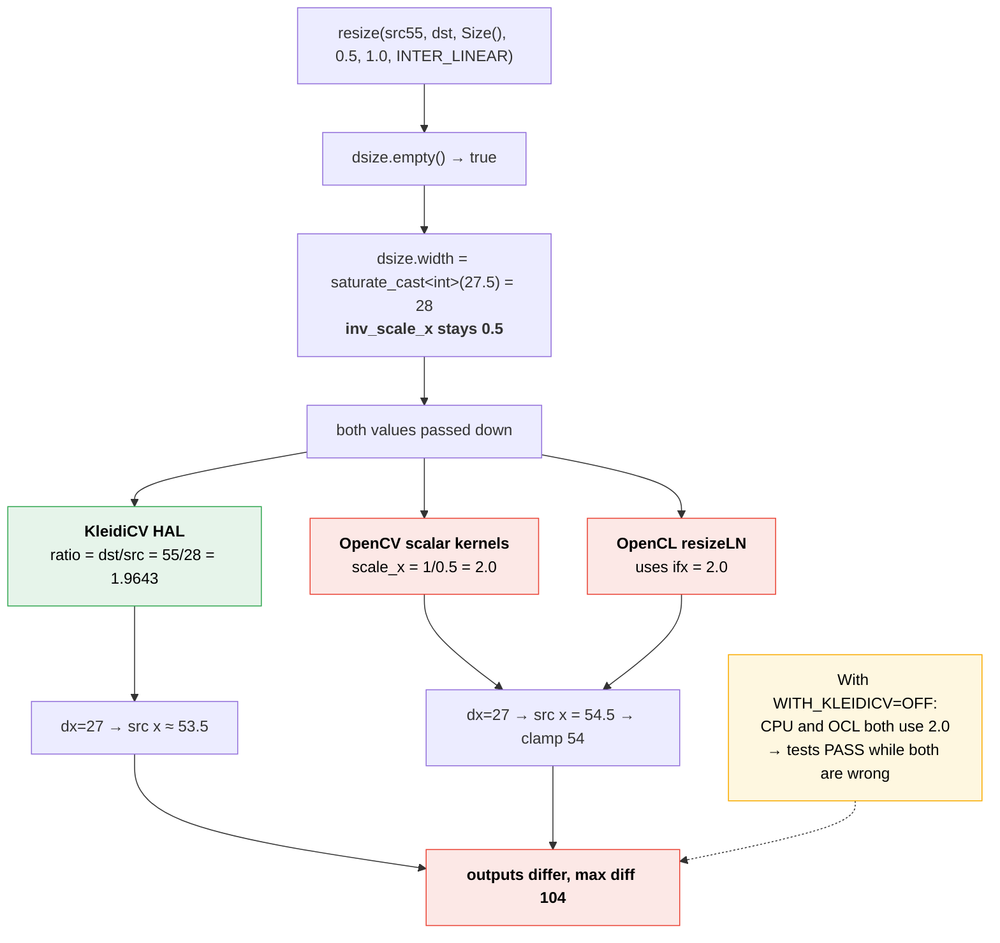
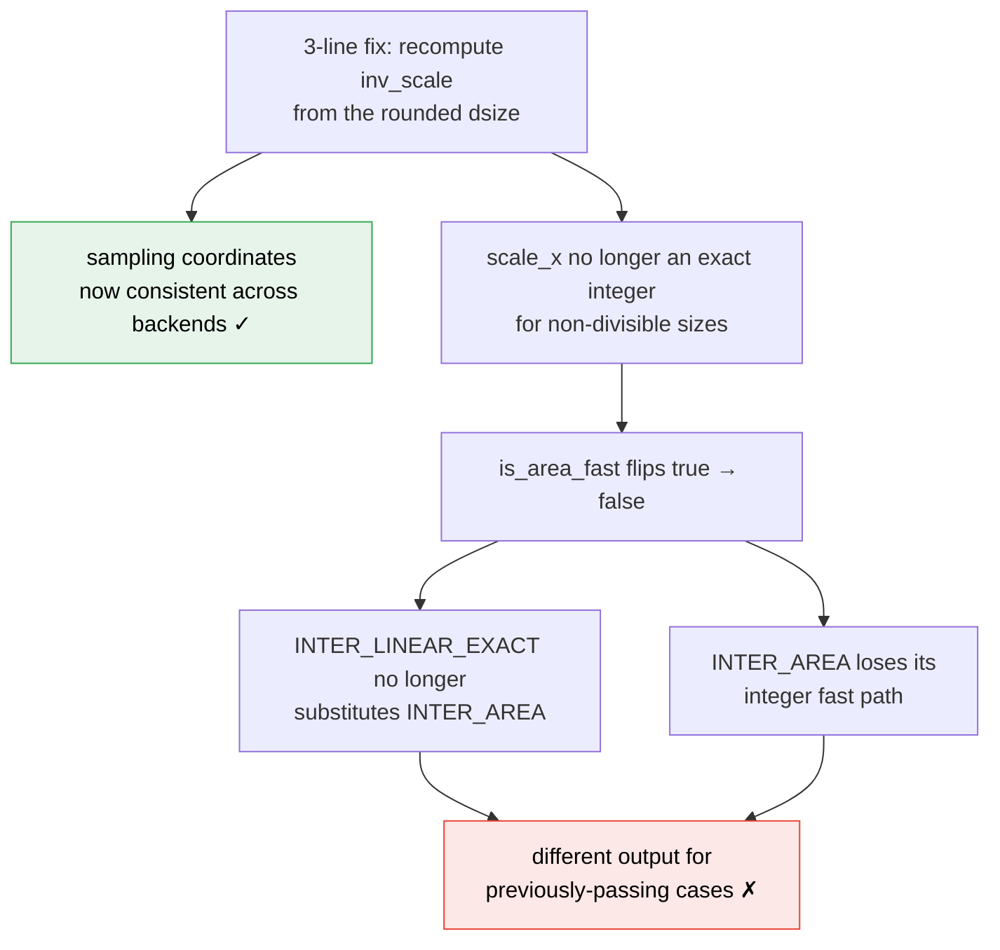

# #29985 — `resize` Gives Different Results on Different Backends

[← issue-studies index](README.md) · **Difficulty:** Hard · **Module:** `imgproc`

| | |
|---|---|
| **Upstream issue** | [opencv/opencv#29985](https://github.com/opencv/opencv/issues/29985) — *"resize: INTER_LINEAR gives different results on OpenCL vs CPU-with-HAL when dsize is derived from fx/fy"* |
| **Labels** | `bug`, `category: imgproc` |
| **Upstream state** | **Open** (as of 2026-11-22) |
| **Branch** | `fix/issue-29985-resize-scale-recompute` |
| **Files** | `modules/imgproc/src/resize.cpp` (+3), `modules/imgproc/test/test_imgwarp.cpp` (+26) |

---

## 1. The report

`opencv_test_imgproc` on 4.14.0 with `WITH_KLEIDICV=ON`, on an NXP i.MX95 (Cortex-A55, Mali
GPU):

```
FAILED   OCL_ImgprocWarp/Resize.Mat/4  (8UC1, 0.5, 0.5, INTER_LINEAR, false, 1)
FAILED   OCL_ImgprocWarp/Resize.Mat/5  (8UC1, 0.5, 0.5, INTER_LINEAR, false, 16)
FAILED   OCL_ImgprocWarp/Resize.Mat/6  (8UC1, 0.5, 0.5, INTER_LINEAR, true, 1)
FAILED   OCL_ImgprocWarp/Resize.Mat/7  (8UC1, 0.5, 0.5, INTER_LINEAR, true, 16)
```

> For the same `resize(src, dst, Size(), 0.5, 0.5)` call, `cvRound` makes `dsize` (28) and
> `inv_scale` (0.5) inconsistent, so KleidiCV derives coordinates from the actual size ratio
> 55/28 (correct, max diff 1) while both the OpenCL kernel and OpenCV's own scalar CPU path
> use the passed-in `1/0.5 = 2.0` (wrong, max diff 104) — hence CPU and OCL disagree and the
> test fails with KleidiCV enabled, but **"passes" with `WITH_KLEIDICV=OFF` because both sides
> are then wrong in the same way.**

The reporter then asked which fix was wanted, rather than sending a patch:

> **a) `cv::resize`** — recompute `inv_scale_x/y` after `dsize` is rounded, so the ratio and
> the output size agree for all back ends. Fixes these 4 tests, but changes INTER_LINEAR
> output, needs INTER_AREA excluded, and **broke 8 other cases** (fx=1.5/2.0, fy=0.5) in my
> testing.
>
> **b) OpenCL only** — `resizeLN` already gets `src_rows/cols` and `dst_rows/cols`, so it
> could derive the ratio itself instead of trusting `ifx`/`ify`.

Three things make this the most nuanced study in the set. The bug was **masked by its own
test suite** — the tests passed while everything was wrong. A **third-party HAL acted as a
correctness oracle**: enabling KleidiCV did not introduce the bug, it revealed it. And the
reporter, who had done the work, declined to send the obvious fix because they had measured
its collateral damage.

---

## 2. Implementation background

### Two calling conventions, both converted to both forms

`cv::resize` (`modules/imgproc/src/resize.cpp:3579`):

```cpp
void cv::resize( InputArray _src, OutputArray _dst, Size dsize,
                 double inv_scale_x, double inv_scale_y, int interpolation )
{
    Size ssize = _src.size();
    CV_Assert( !ssize.empty() );
    if( dsize.empty() )
    {
        CV_Assert(inv_scale_x > 0); CV_Assert(inv_scale_y > 0);
        dsize = Size(saturate_cast<int>(ssize.width*inv_scale_x),
                     saturate_cast<int>(ssize.height*inv_scale_y));
        CV_Assert( !dsize.empty() );
        // ← inv_scale_x/y keep their NOMINAL values here
    }
    else
    {
        inv_scale_x = (double)dsize.width/ssize.width;     // ← REALIZED ratio
        inv_scale_y = (double)dsize.height/ssize.height;
        CV_Assert(inv_scale_x > 0); CV_Assert(inv_scale_y > 0);
    }
```

Both `dsize` **and** `inv_scale_x/y` are then handed downstream:

```cpp
    CV_OCL_RUN(_src.dims() <= 2 && _dst.isUMat() && _src.cols() > 10 && _src.rows() > 10,
               ocl_resize(_src, _dst, dsize, inv_scale_x, inv_scale_y, interpolation))
    ...
    hal::resize(_src.type(), src.data, src.step, src.cols, src.rows,
                dst.data, dst.step, dst.cols, dst.rows,
                inv_scale_x, inv_scale_y, interpolation);
```

### Nominal vs. realized

```
src width 55, fx = 0.5
  dsize.width = saturate_cast<int>(55 × 0.5) = saturate_cast<int>(27.5) = 28
  nominal  ratio = inv_scale_x  = 0.5      →  scale_x = 1/0.5    = 2.0
  realized ratio = 28/55        ≈ 0.50909  →  scale_x = 55/28    ≈ 1.9643
```

Rounding has made the two representations describe different transforms. The output is 28
columns wide, so 55/28 is what the output *actually* is; 2.0 is what the caller *asked for*.

### Who believes what

`hal::resize` (`resize.cpp:3207`) trusts the passed ratio unless it is ~0:

```cpp
    CV_Assert((dst_width > 0 && dst_height > 0) || (inv_scale_x > 0 && inv_scale_y > 0));
    if (inv_scale_x < DBL_EPSILON || inv_scale_y < DBL_EPSILON)
    {
        inv_scale_x = static_cast<double>(dst_width) / src_width;
        inv_scale_y = static_cast<double>(dst_height) / src_height;
    }

    CALL_HAL(resize, cv_hal_resize, src_type, src_data, src_step, src_width, src_height,
             dst_data, dst_step, dst_width, dst_height, inv_scale_x, inv_scale_y, interpolation);

    int  depth = CV_MAT_DEPTH(src_type), cn = CV_MAT_CN(src_type);
    Size dsize = Size(saturate_cast<int>(src_width*inv_scale_x),
                      saturate_cast<int>(src_height*inv_scale_y));
    ...
    double scale_x = 1./inv_scale_x, scale_y = 1./inv_scale_y;   // ← drives all sampling
```

So the HAL receives **both** `dst_width`/`dst_height` *and* `inv_scale_x`/`inv_scale_y`, and is
free to use either. KleidiCV used the sizes; OpenCV's own kernels use `1./inv_scale_x`.

---

## 3. Root cause



The defect is **two representations of one parameter, allowed to disagree**. For
`INTER_LINEAR`, output pixel `dx` samples source coordinate

```
fx = (dx + 0.5) × scale_x − 0.5
```

For `dx = 27`: nominal gives `27.5 × 2.0 − 0.5 = 54.5`, clamped to `width−1 = 54`; realized
gives `27.5 × 1.9643 − 0.5 ≈ 53.52`. A full pixel of divergence at the right edge, which on
high-contrast content reaches the reported 104 grey levels.

Note which backend the diagram marks green. The HAL's reading is the defensible one: the
output has 28 columns, so the mapping should span 55 source columns across 28 destination
columns. **The entry point, not the HAL, introduced the inconsistency** — "which backend
differs" and "which backend is wrong" are different questions.

### Why the test suite hid it

This is the part worth internalising. `OCL_ImgprocWarp/Resize` compares the OpenCL result
against the CPU result. Both used the nominal scale, so both were wrong *identically* and the
comparison passed. Enabling KleidiCV replaced the CPU side with an implementation that
disagreed — and the test started failing, correctly.

**A differential test between two implementations that share an input bug cannot detect it.**
The HAL was a correctness oracle precisely because it was written independently.

---

## 4. The fix

```diff
--- a/modules/imgproc/src/resize.cpp
+++ b/modules/imgproc/src/resize.cpp
@@ -3591,6 +3591,9 @@ void cv::resize( InputArray _src, OutputArray _dst, Size dsize,
         dsize = Size(saturate_cast<int>(ssize.width*inv_scale_x),
                      saturate_cast<int>(ssize.height*inv_scale_y));
         CV_Assert( !dsize.empty() );
+        // Recompute realized scale after rounding to keep all backends consistent
+        inv_scale_x = (double)dsize.width / ssize.width;
+        inv_scale_y = (double)dsize.height / ssize.height;
     }
     else
     {
```

This is the reporter's **option (a)**. Three lines, and it makes the `dsize.empty()` branch
match the `else` branch exactly — one source of truth, derived from the output size that
actually exists. Every backend, whichever value it believes, now gets the same transform.

### ⚠️ Why this fix is not obviously safe

The reporter measured that it "broke 8 other cases (fx=1.5/2.0, fy=0.5)". Reading
`hal::resize` shows the mechanism, and it is not about sampling coordinates at all
(`resize.cpp:3344`):

```cpp
double scale_x = 1./inv_scale_x, scale_y = 1./inv_scale_y;

int iscale_x = saturate_cast<int>(scale_x);
int iscale_y = saturate_cast<int>(scale_y);

bool is_area_fast = std::abs(scale_x - iscale_x) < DBL_EPSILON &&
                    std::abs(scale_y - iscale_y) < DBL_EPSILON;

if (interpolation == INTER_LINEAR_EXACT)
{
    // in case of inv_scale_x && inv_scale_y is equal to 0.5
    // INTER_AREA (fast) is equal to bit exact INTER_LINEAR
    if (is_area_fast && iscale_x == 2 && iscale_y == 2 && cn != 2)
        interpolation = INTER_AREA;        // ← ALGORITHM SUBSTITUTION
    else
    { /* bit-exact linear path */ }
}
```

`is_area_fast` asks "is the scale an exact integer?" — and the answer **changes**:

| | `scale_x` | `iscale_x` | `is_area_fast` |
|---|---|---|---|
| Before fix (nominal) | 2.0 | 2 | **true** |
| After fix (realized) | 1.9643 | 1 | **false** |

So the patch does not merely shift sample positions. For `INTER_LINEAR_EXACT` it stops
substituting `INTER_AREA`, and for `INTER_AREA` it disables the integer fast path — **a
different algorithm now runs**. That is a far larger behaviour change than the diff suggests,
and it is why eight unrelated cases moved.



There is also a subtle **self-consistency gain** worth noting: `hal::resize` recomputes its own
`dsize` from `inv_scale` (`resize.cpp:3223`) and ignores the `dst_width`/`dst_height` it was
passed. Before the fix, `saturate_cast<int>(55 × 0.5) = 28` happened to agree with the caller's
28. For other ratios the two could in principle diverge, giving the HAL layer a `Mat dst`
header whose width disagrees with the real buffer. After the fix, deriving `inv_scale` from
`dsize` makes this round-trip exact by construction. **(Not probed for a concrete divergent
case here — unverified.)**

### The alternatives

| Option | Effect | Assessment |
|--------|--------|------------|
| **(a) Recompute `inv_scale`** (this fix) | One source of truth; fixes all backends at once | Correct in principle; **changes `INTER_LINEAR`/`INTER_AREA` output** via `is_area_fast` |
| **(b) Fix the OpenCL kernel only** | `resizeLN` derives the ratio from sizes it already has | Narrow and low-risk, but leaves OpenCV's scalar CPU path disagreeing with the HAL — treats a symptom |
| **(c) Stop passing both** | Pass only `dsize`; every backend derives the ratio | The real fix; a HAL ABI change, so it cannot be done quietly |
| **(d) Decouple `is_area_fast`** | Keep nominal scale *only* for the algorithm-selection test, use realized for sampling | Preserves existing fast-path selection while fixing coordinates — plausibly the best short-term compromise |

Option (c) is where this should end up: the parameter duplication is the bug, and as long as
both values travel, some backend will eventually believe the wrong one. Option (d) is not in
the branch but is worth putting to upstream, since it is the only one that fixes the
coordinates without perturbing which algorithm runs.

---

## 5. The test

```cpp
TEST(Imgproc_Resize, scale_recomputed_from_dsize_29985)
{
    // Regression: when resize() is called with fx/fy (empty dsize),
    // the realized scale after rounding must be used consistently across
    // all backends. Previously, inv_scale was not updated to match the
    // rounded dsize, causing up to ~104 pixel error near image edges.
    int src_width = 55;  // chosen so round(55 * 0.5) = 28 (realized scale != 0.5)
    Mat src(1, src_width, CV_8UC1);
    for (int i = 0; i < src_width; i++)
        src.at<uchar>(0, i) = (uchar)(i * 4);  // ramp

    Mat dst_cpu, dst_reference;
    cv::resize(src, dst_cpu, Size(), 0.5, 1.0, INTER_LINEAR);

    // Compute reference: use explicit dsize to force correct scale computation
    cv::resize(src, dst_reference, Size(dst_cpu.cols, dst_cpu.rows), 0, 0, INTER_LINEAR);

    ASSERT_EQ(dst_cpu.size(), dst_reference.size());
    for (int i = 0; i < dst_cpu.cols; i++)
    {
        int diff = std::abs((int)dst_cpu.at<uchar>(0,i) - (int)dst_reference.at<uchar>(0,i));
        EXPECT_LE(diff, 1) << "Pixel " << i << " differs by " << diff
                            << " (fx/fy path vs dsize path should match after scale recompute)";
    }
}
```

The design is **exactly right in principle**: it asserts the *invariant* that the two calling
conventions must agree, rather than hard-coding expected pixel values. `resize(src, dst,
Size(), 0.5, 1.0)` and `resize(src, dst, Size(28, 1))` describe the same operation and must
produce the same image. That is the property the bug violated, it needs no GPU or HAL, and it
fails on the old code and passes on the new.

The width choice is deliberate and well commented: 55 is not divisible by 2, so
`round(27.5) = 28` and the realized scale differs from nominal. A ramp makes any coordinate
shift visible.

Gaps:

- **Only `INTER_LINEAR`.** The riskiest consequence of this fix is to `INTER_AREA` and
  `INTER_LINEAR_EXACT` via `is_area_fast` (§4), and neither is tested. Given the reporter's
  warning about eight broken cases, these are the cases that most needed covering.
- **Only `fx = 0.5`.** The reporter named `fx = 1.5` and `fx = 2.0` as the regressing
  configurations. None appears here.
- **One dimension.** `fy = 1.0`, so vertical scaling is untested; a `1 × 55` source cannot
  exercise it.
- **`tolerance ≤ 1` is loose for an identity claim.** Since both calls should now follow the
  identical code path with identical parameters, the results ought to be bit-exact.
  `EXPECT_EQ(0, cv::norm(dst_cpu, dst_reference, NORM_INF))` would be a stronger and simpler
  assertion — and if it does not hold, that is itself worth knowing.
- **No OpenCL leg**, though the issue is titled "OpenCL vs CPU". An `OCL_` variant comparing
  `UMat` and `Mat` results would test the reported configuration. Understandable — it needs a
  GPU in CI — but it is the actual reported scenario.

---

## 6. Assessment

**Is the fix correct?** It makes the function self-consistent, which is strictly better than
before, and it is the same expression already used in the sibling branch. In that narrow sense,
yes.

**Should it be merged as-is?** Probably not, and the reporter — who had the hardware and ran
the suite — reached the same conclusion, which is why they asked before patching. Two things
are missing:

1. **The `is_area_fast` interaction is unaddressed.** The patch silently changes which
   interpolation algorithm runs for `INTER_LINEAR_EXACT` and `INTER_AREA` on non-divisible
   sizes. That needs either explicit handling (option (d)) or a deliberate decision, with
   release notes, that the new output is correct.
2. **The eight regressing cases are not reproduced or triaged.** Before accepting this, one
   needs to know whether those eight were *previously-correct* results now broken, or
   *previously-wrong* results now fixed. The reporter says "broke", but given that the whole
   issue is about tests passing while both sides were wrong, it is entirely possible some of
   the eight were masked failures too. **That distinction decides whether this patch is a
   regression or a correction, and it was not established here. (unverified)**

**Is the diagnosis right?** Yes, and it is well supported by the code: `hal::resize` takes both
representations, uses the ratio for sampling, and the entry point leaves them inconsistent in
exactly one of its two branches.

**Why "hard".** Everything about this bug is indirect. The symptom is four OpenCL test failures
on one SoC with one optional HAL enabled. The tests *passed* in the default configuration while
the code was wrong. The culprit is a parameter the caller never set. The obvious three-line fix
is correct in principle and changes algorithm selection as a side effect through a predicate
200 lines away. And deciding whether the fix is safe requires re-running a test suite on
specific hardware. This is what a mature, heavily-optimised code path looks like when two
representations of one quantity are allowed to drift.

---

## 7. Lessons

1. **One parameter, one source of truth.** Passing both a size and a ratio invites two
   backends to disagree. Either derive one from the other at the boundary, or pass only one.
2. **Differential tests cannot catch shared input bugs.** CPU-vs-OpenCL passed because both
   consumed the same wrong value. An independent implementation — here a vendor HAL — was the
   only thing that could reveal it.
3. **Enabling a HAL that "breaks tests" may be exposing a bug, not causing one.** Check which
   implementation is defensible before blaming the new one.
4. **Rounding creates a second version of a parameter.** The moment `dsize = round(src × fx)`
   runs, `fx` and `dsize/src` are different numbers, and every consumer must be told which to
   use.
5. **Watch for parameters that select algorithms, not just values.** `is_area_fast` turns a
   numerical change into a control-flow change, which is why a 3-line patch moved eight
   unrelated results.
6. **A reporter who declines to send the obvious patch is telling you something.** The measured
   collateral damage was the most valuable content in the issue.

---

## 8. Related

- [features/05 — Geometric Transforms §4–5](../features/05-imgproc-geometric-transforms.md#4-cvresizes-two-calling-conventions) — `resize`'s conventions and the nominal/realized split.
- [features/03 — HAL & Backends §2](../features/03-core-hal-backends.md#2-the-hal-contract) — why only primitives cross the HAL boundary, and what that costs.
- [#29573](hard-29573-solvepnp-ransac-inliers.md) — the other study where one function's two
  outputs describe different things.
