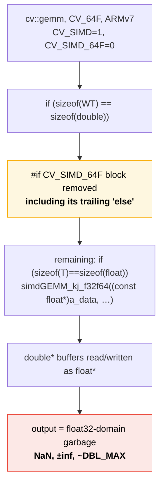
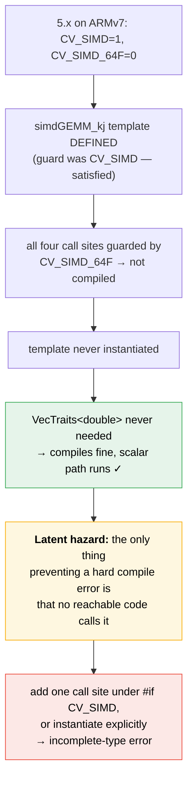

# #30151 — `CV_64F` GEMM Produces Garbage on 32-bit Arm

[← issue-studies index](README.md) · **Difficulty:** Hard · **Module:** `core`

| | |
|---|---|
| **Upstream issue** | [opencv/opencv#30151](https://github.com/opencv/opencv/issues/30151) — *"CV_64F cv::gemm produces garbage on 32-bit ARM (ARMv7 NEON): double buffers are reinterpreted as float32"* |
| **Labels** | `bug`, `category: core`, `platform: arm` |
| **Upstream state** | **Closed** |
| **Branch** | `fix/issue-30151-gemm-cv64f-armv7` |
| **Files** | `modules/core/src/matmul.simd.hpp` (+1 −1), `modules/core/test/test_mat.cpp` (+24) |

---

## 1. The report

Reported against **OpenCV 4.14.0** on a Zynq / i.MX-class ARMv7 target (Yocto,
`cortexa9t2hf-neon`):

> On 32-bit ARM (ARMv7 with NEON, no FP64 SIMD), `cv::gemm` with `CV_64F` matrices produces
> completely wrong results: the output contains float32-domain garbage (NaN, ±inf, values up
> to ~DBL_MAX) instead of the dot products.
>
> Root cause: in `modules/core/src/matmul.simd.hpp`, the `#if CV_SIMD_64F ... #endif`
> preprocessor nesting silently removes the double-precision SIMD branches **and** the `else`
> keyword on platforms where `CV_SIMD_64F == 0`. What remains inside
> `if( sizeof(WT) == sizeof(double) )` is an unconditional call with `(const float*)` casts of
> `double*` buffers, so the CV_64F GEMM reads its inputs and writes its output through a
> float32 type-punned view.
>
> This is a source-level type confusion, not a floating-point hardware issue: all other
> double-precision computations on the affected device behave correctly.

With precise conditions and affected sites:

> - Condition: `CV_SIMD == 1 && CV_SIMD_64F == 0` — i.e. 32-bit ARMv7 NEON. On x86-64 and
>   AArch64 (`CV_SIMD_64F == 1`) the same code is correct.
> - Affected sites in `modules/core/src/matmul.simd.hpp` (4.14.0):
>   `GEMMSingleMul()`: GEMM_2_T branch (~line 623-634) and plain branch (~line 678-692);
>   `GEMMBlockMul()`: dot-product branch (~line 958-967)

An unusually competent report: it names the macro condition, the mechanism, and the line
numbers. The subtlety — and the reason this study spends most of its length on the question —
is that **those line numbers are 4.x line numbers, and the 5.x code has been restructured.**

---

## 2. Implementation background

### `CV_SIMD` ≠ `CV_SIMD_64F`

`intrin_neon.hpp:59`:

```cpp
#define CV_SIMD128 1
#if defined(__aarch64__) || defined(_M_ARM64) || defined(_M_ARM64EC)
#define CV_SIMD128_64F 1       // AArch64 has float64 NEON
#else
#define CV_SIMD128_64F 0       // ARMv7 NEON: 32-bit floats only
#endif
```

and `intrin.hpp:524`:

```cpp
#define CV_SIMD      CV_SIMD128
#define CV_SIMD_64F  CV_SIMD128_64F
```

**On ARMv7: `CV_SIMD == 1`, `CV_SIMD_64F == 0`.** ARMv7's NEON has no double-precision vector
arithmetic; AArch64's does. This single asymmetry is the whole bug.

Recall also from
[features/02](../features/02-core-simd-dispatch.md#3-cpu-dispatch-compiling-one-file-many-times)
that `matmul.simd.hpp` is **compiled once per instruction set**, each time with a different
macro environment. A `#if` inside it is evaluated many times with different answers, so the
author of a guard is choosing behaviour for every target at once.

### The vector-type traits

`matmul.simd.hpp:201` — note the deliberately *different* guards:

```cpp
#if (CV_SIMD || CV_SIMD_SCALABLE)
template<typename ST> struct VecTraits;

template<> struct VecTraits<float> {              // ← CV_SIMD is enough for float
    typedef v_float32 VT;
    static inline VT zero() { return vx_setzero_f32(); }
    static inline VT load(const float* p) { return vx_load(p); }
    static inline VT setall(float v) { return vx_setall_f32(v); }
};
#endif

#if (CV_SIMD_64F || CV_SIMD_SCALABLE_64F)         // ← double REQUIRES CV_SIMD_64F
template<> struct VecTraits<double> {
    typedef v_float64 VT;
    static inline VT zero() { return vx_setzero_f64(); }
    static inline VT load(const double* p) { return vx_load(p); }
    static inline VT setall(double v) { return vx_setall_f64(v); }
};
#endif
```

These are correct and are the specification: **`VecTraits<double>` exists only where
`CV_SIMD_64F` is set.** On ARMv7 only the forward declaration
`template<typename ST> struct VecTraits;` is visible for `double` — an incomplete type.

### The kernel and its guard, before the fix (`matmul.simd.hpp:411`)

```cpp
#if (CV_SIMD || CV_SIMD_SCALABLE)                 // ← too weak for this body
template<typename ST>
static inline void simdGEMM_kj(
    const ST* a_data, const ST* _b_data, size_t b_step,
    const ST* _c_data, size_t c_step1,
    ST* d_data, int n, int m, double alpha, double beta, int& j)
{
    typedef typename VecTraits<ST>::VT VecT;      // ← incomplete for ST = double on ARMv7
    const int vlanes = VTraits<VecT>::vlanes();
    ...
}
#endif
```

The body's only dependency is `VecTraits<ST>`, which for `ST = double` needs `CV_SIMD_64F`.
The guard tests `CV_SIMD`. **The guard does not match the dependency it protects.**

---

## 3. Root cause

### In 4.x — the reported failure

The reporter's description is of a preprocessor-nesting accident. With structure of the form:

```cpp
if( sizeof(WT) == sizeof(double) )
{
#if CV_SIMD_64F
    if( sizeof(T) == sizeof(double) )
        simdGEMM_kj((const double*)a_data, ...);
    else
#endif
    if( sizeof(T) == sizeof(float) )
        simdGEMM_kj_f32f64((const float*)a_data, ...);   // ← float* casts
}
```

when `CV_SIMD_64F == 0` the `#if` block vanishes — **taking the `else` with it**. What remains
is an unconditional call to the `float`-pointer variant, reached even when `T` is `double`. The
`double*` buffers are then read and written through a `float*` view: type punning, and the
observed NaN/±inf garbage.



A preprocessor conditional that eats an `else` is a classic and genuinely nasty failure: it is
invisible in the source as written, appears only on one target, and produces type confusion
rather than a compile error.

### In 5.x — what this tree actually contains

Reading the current call sites changes the conclusion. `matmul.simd.hpp:695`:

```cpp
            j = 0;
#if (CV_SIMD_64F || CV_SIMD_SCALABLE_64F) && CV_GEMM_SIMD_ENABLED
            if( sizeof(WT) == sizeof(double) )
            {
                if( sizeof(T) == sizeof(double) )
                    simdGEMM_kj((const double*)a_data, (const double*)_b_data, b_step,
                                        (const double*)_c_data, c_step1,
                                (double*)d_data, n, m, alpha, beta, j);
                else if( sizeof(T) == sizeof(float) )
                    simdGEMM_kj_f32f64((const float*)a_data, (const float*)_b_data, b_step,
                                        (const float*)_c_data, c_step1,
                                (float*)d_data, n, m, alpha, beta, j);
            }
#endif
```

The entire block — not a fragment of it — is guarded by `CV_SIMD_64F`, and the inner
`if`/`else if` are both inside it. The same pattern holds at the other three call sites
(`:645`, `:960`, `:998`), all guarded by `CV_SIMD_64F`:

```
645:  #if CV_SIMD_64F && CV_GEMM_SIMD_ENABLED          (GEMMSingleMul, GEMM_2_T)
695:  #if (CV_SIMD_64F || CV_SIMD_SCALABLE_64F) && CV_GEMM_SIMD_ENABLED
960:  #if CV_SIMD_64F && CV_GEMM_SIMD_ENABLED          (GEMMBlockMul)
998:  #if (CV_SIMD_64F || CV_SIMD_SCALABLE_64F) && CV_GEMM_SIMD_ENABLED
```

**The 4.x nesting bug has already been restructured away in 5.x.** On ARMv7 none of these
blocks is compiled, so no `float*`-punned call is reachable and `cv::gemm` falls through to the
scalar accumulator below.

And because `simdGEMM_kj` is a **template**, its body is only instantiated when called. Its
sole instantiation is with `double`, from a call site that ARMv7 does not compile. So on ARMv7
the template is declared, never instantiated, and the incomplete `VecTraits<double>` is never
required — which is why the file compiles.



> ### ⚠️ What the 5.x patch actually does
>
> On this tree the change is **guard hardening against a latent hazard**, not a fix for an
> observable NaN. `cv::gemm` with `CV_64F` on ARMv7 in 5.x already takes the scalar path and
> already returns correct results. *(Established by reading the four call sites and the
> template-instantiation rule; not verified by building for ARMv7 — no cross-compilation was
> performed. **unverified**)*
>
> Earlier documentation in this fork (`FIXES_DOCUMENTATION.md` on `docs/fixes-documentation`)
> describes this patch as fixing NaN output on 5.x, with a flow diagram showing ARMv7 entering
> `simdGEMM_kj` and degrading to float32 operations. That describes the **4.x** defect. In 5.x
> the call sites prevent entry.

---

## 4. The fix

```diff
--- a/modules/core/src/matmul.simd.hpp
+++ b/modules/core/src/matmul.simd.hpp
@@ -408,7 +408,7 @@ static inline void simdGEMM_kj_f32f64(
 }
 #endif
 
-#if (CV_SIMD || CV_SIMD_SCALABLE)
+#if (CV_SIMD_64F || CV_SIMD_SCALABLE_64F)
 template<typename ST>
 static inline void simdGEMM_kj(
     const ST* a_data, const ST* _b_data, size_t b_step,
```

One token pair. The value is that it establishes a single consistent rule across three places
that must agree:

| Element | Guard before | Guard after |
|---------|--------------|-------------|
| `VecTraits<double>` (`:212`) | `CV_SIMD_64F \|\| CV_SIMD_SCALABLE_64F` | unchanged |
| `simdGEMM_kj` definition (`:411`) | `CV_SIMD \|\| CV_SIMD_SCALABLE` ✗ | `CV_SIMD_64F \|\| CV_SIMD_SCALABLE_64F` ✓ |
| `simdGEMM_kj` call sites (`:645, 695, 960, 998`) | `CV_SIMD_64F …` | unchanged |

After the change, the definition's guard matches both its dependency and its callers. The
function now exists **exactly** where it can legally be instantiated, so the "it compiles only
because nothing calls it" accident is removed. A future call site added under `CV_SIMD` would
now fail to find the function — a clear error — rather than failing with an incomplete-type
diagnostic inside a template body, or worse, silently selecting a punned overload.

Also note `simdGEMM_kj_f32f64` (`:248`, `:280`) is already guarded by
`CV_SIMD_64F || CV_SIMD_SCALABLE_64F`, because it accumulates `float` inputs into `double`
vectors. So the patched line was the lone outlier among the double-touching helpers.

### ⚠️ The fix is incomplete

`simdDotProduct` has the identical mismatch, and the patch does not touch it
(`matmul.simd.hpp:221`):

```cpp
#if (CV_SIMD || CV_SIMD_SCALABLE)                 // ← same too-weak guard
template<typename ST>
static inline ST simdDotProduct(const ST* a, const ST* b, int n, int& k)
{
    typedef typename VecTraits<ST>::VT VecT;      // ← same dependency on VecTraits<ST>
    const int vlanes = VTraits<VecT>::vlanes();
    ...
}
#endif
```

and it too is instantiated only with `double`, from call sites guarded by `CV_SIMD_64F`
(`:649`, `:964`):

```cpp
#if CV_SIMD_64F && CV_GEMM_SIMD_ENABLED
            if( sizeof(WT) == sizeof(double) )
            {
                if( sizeof(T) == sizeof(double) )
                    s0 = (WT)simdDotProduct((const double*)a_data, (const double*)b_data, n, k);
                else if( sizeof(T) == sizeof(float) )
                    s0 = (WT)simdDotProduct_f32f64((const float*)a_data, (const float*)b_data, n, k);
            }
#endif
```

So `simdDotProduct` is in exactly the state `simdGEMM_kj` was in before the patch: guarded by
`CV_SIMD`, depending on `CV_SIMD_64F`, safe only by virtue of lazy instantiation. Note also
that `:649` and `:964` use bare `CV_SIMD_64F` while `:695` and `:998` use
`CV_SIMD_64F || CV_SIMD_SCALABLE_64F` — an inconsistency that would matter on a scalable-vector
target with FP64 (RISC-V RVV, Arm SVE), where the dot-product paths would be disabled while the
GEMM paths are enabled. **(unverified — no RVV build was tested.)**

A complete patch would change both guards and normalise all four call sites to the same
condition. As committed, the fix is correct but addresses one of two identical instances.

---

## 5. The test

```cpp
// Regression test for issue #30151: CV_64F gemm NaN on ARMv7 NEON
// (CV_SIMD=1 but CV_SIMD_64F=0): simdGEMM_kj was defined inside
// #if CV_SIMD, causing double data to be mishandled on those targets.
TEST(Core_GEMM, gemm_double_no_nan_30151)
{
    Mat A = (Mat_<double>(2,2) << 1.0, 2.0, 3.0, 4.0);
    Mat B = (Mat_<double>(2,2) << 5.0, 6.0, 7.0, 8.0);
    Mat C;
    cv::gemm(A, B, 1.0, noArray(), 0.0, C);
    ASSERT_EQ(C.type(), CV_64F);
    ASSERT_EQ(C.rows, 2);
    ASSERT_EQ(C.cols, 2);
    // A*B = [[19,22],[43,50]]
    EXPECT_NEAR(C.at<double>(0,0), 19.0, 1e-9) << "Unexpected value at (0,0)";
    EXPECT_NEAR(C.at<double>(0,1), 22.0, 1e-9) << "Unexpected value at (0,1)";
    EXPECT_NEAR(C.at<double>(1,0), 43.0, 1e-9) << "Unexpected value at (1,0)";
    EXPECT_NEAR(C.at<double>(1,1), 50.0, 1e-9) << "Unexpected value at (1,1)";
    // Verify no NaN in output (the symptom on ARMv7 NEON before the fix)
    for(int i = 0; i < C.rows; i++)
        for(int j = 0; j < C.cols; j++)
            EXPECT_FALSE(std::isnan(C.at<double>(i,j)))
                << "NaN at (" << i << "," << j << ") — CV_SIMD_64F guard missing?";
}
```

The arithmetic is right (`[[1,2],[3,4]] × [[5,6],[7,8]] = [[19,22],[43,50]]`), and the
analytically exact expectation is a good choice.

But it cannot detect this bug, for two independent reasons:

**1. It does not run on the affected platform.** The bug is `CV_SIMD == 1 && CV_SIMD_64F == 0`
— 32-bit ARMv7. On x86-64 and AArch64 CI, `CV_SIMD_64F == 1` and the test passes before and
after the fix. Only an ARMv7 build could distinguish them, and this is a plain `TEST` with no
platform guard or annotation saying so.

**2. The matrix is far too small to reach any SIMD path.** `simdGEMM_kj`'s own entry condition
is (`matmul.simd.hpp:424`):

```cpp
if( m >= 2 * vlanes && n >= 64 )
```

With `m = n = 2`, this is false for every vector width. A 2×2 GEMM also goes nowhere near
`GEMMBlockMul`. Even on a hypothetically broken target, this input would take the scalar path
and pass. To exercise the SIMD branches the test needs `n >= 64` and `m >= 2 × vlanes` — say
128×128.

A test that exercises the relevant code path would look like:

```cpp
// Illustrative.
TEST(Core_GEMM, gemm_double_simd_path_30151)
{
    const int N = 128;                       // n >= 64 and m >= 2*vlanes for all widths
    Mat A(N, N, CV_64F), B(N, N, CV_64F);
    cv::randu(A, -1.0, 1.0);
    cv::randu(B, -1.0, 1.0);

    Mat C;  cv::gemm(A, B, 1.0, noArray(), 0.0, C);

    // Reference: force the scalar path by disabling vectorised code.
    cv::setUseOptimized(false);
    Mat Cref; cv::gemm(A, B, 1.0, noArray(), 0.0, Cref);
    cv::setUseOptimized(true);

    EXPECT_LT(cv::norm(C, Cref, NORM_INF), 1e-9);
    EXPECT_EQ(0, cv::countNonZero(C != C));   // NaN check
    // Also worth covering: GEMM_2_T, GEMM_1_T, and non-zero beta with a C matrix.
}
```

That is a **differential test against the scalar path** — which is the right shape for any
SIMD-correctness question, and is portable, since it compares two paths on whatever hardware is
running.

The committed test does have residual value as a basic `cv::gemm` `CV_64F` smoke test, which
the suite may otherwise lack at this exact shape. It just does not test what its name claims.

---

## 6. Assessment

**Is the change correct?** Yes. Aligning the guard with `VecTraits<double>`'s availability and
with the call sites is unambiguously right, and it cannot regress anything: on `CV_SIMD_64F`
targets the function is still compiled; on others it was never instantiated.

**Does it fix the reported bug?** In 4.x, the class of bug — yes, the guard mismatch is the
root. On 5.x, there is **nothing observably broken to fix**: the call sites already prevent
entry, so `CV_64F` GEMM on ARMv7 already uses the scalar accumulator. The patch removes a
latent hazard and an inconsistency. That is worth doing and should be described as such.

The upstream issue being **closed** suggests the restructuring in 5.x (and whatever was done on
4.x) resolved it to the maintainers' satisfaction.

**Is it complete?** No — `simdDotProduct` at `:221` has the identical mismatch and is
untouched, and the four call sites use two different conditions
(`CV_SIMD_64F` vs `CV_SIMD_64F || CV_SIMD_SCALABLE_64F`). A follow-up should normalise all of
them.

**Why "hard".** Three layers of indirection. You need to know that `CV_SIMD` and `CV_SIMD_64F`
differ and on which targets; that `matmul.simd.hpp` is compiled once per instruction set so its
`#if`s have several answers; and that C++ templates are instantiated lazily, which is both why
the file compiles and why the hazard is latent rather than fatal. Then, to assess the patch, you
must determine whether the 4.x mechanism still exists in 5.x — and it does not, which is the
opposite of what the issue text leads you to expect. Finally, the bug is on hardware most
developers do not have, and the committed test cannot reach the code path on any hardware.

---

## 7. Lessons

1. **A `#if` must name the capability its body actually requires.** `CV_SIMD` does not imply
   `CV_SIMD_64F`; guarding `double`-vector code with the former is wrong even when it happens to
   compile.
2. **Keep the guards on a declaration, its dependencies, and its callers identical.** Three
   places agreeing is the invariant; divergence is the bug.
3. **Lazy template instantiation hides guard errors.** An uninstantiated template with an
   ill-formed body compiles silently. That is a reprieve, not safety.
4. **Preprocessor conditionals can swallow control flow.** An `#if ... #endif` pair ending just
   before an `else` deletes the `else` on the disabled path — invisible in the source, visible
   only in behaviour on one target.
5. **SIMD tests must reach the SIMD path.** A 2×2 GEMM cannot enter a kernel gated on
   `m >= 2*vlanes && n >= 64`. Check the entry condition, then size the input past it.
6. **For SIMD correctness, test differentially against the scalar path.**
   `setUseOptimized(false)` gives a portable reference and tests the real question on any host.
7. **Re-establish the mechanism on the branch you are patching.** The reported 4.x cause did
   not survive into 5.x; assuming it had would have produced a confidently wrong write-up.

---

## 8. Related

- [features/02 — SIMD & Dispatch §2, §5](../features/02-core-simd-dispatch.md#2-universal-intrinsics) — the capability macros and the GEMM work-type pattern.
- [#29893](hard-29893-multiply-16u-work-type.md) — the other `core` SIMD study, also a mismatch
  between a declaration and what the code needs.
