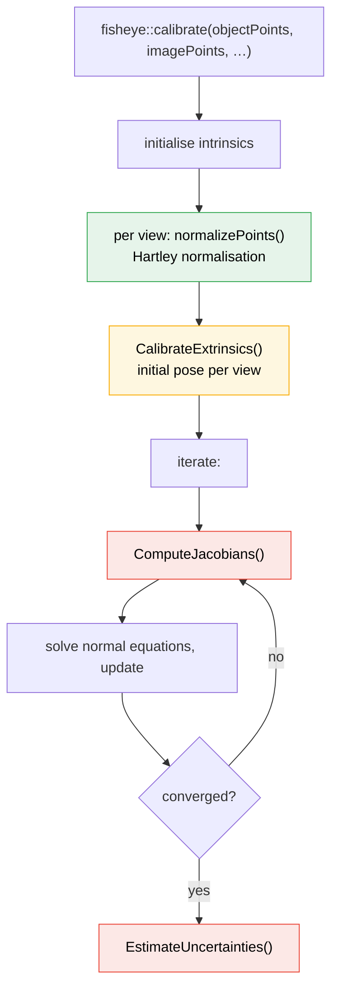
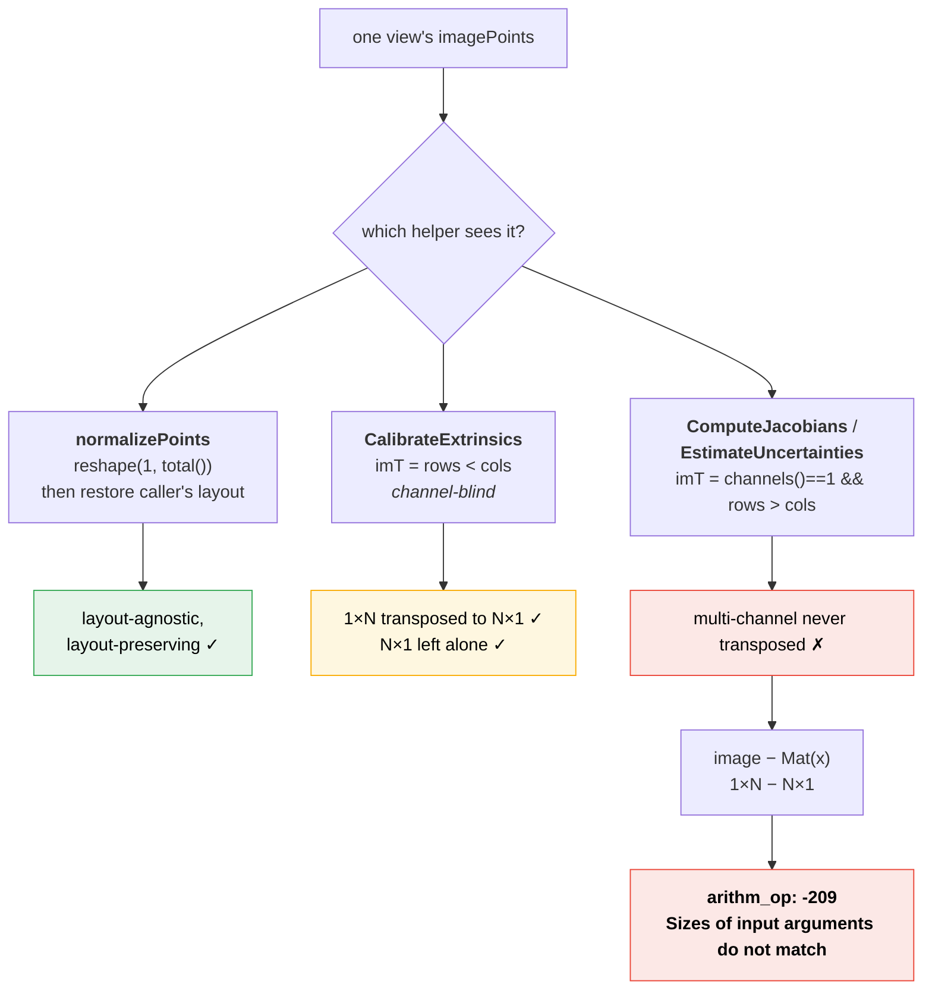

# #29692 — `fisheye::calibrate` Rejects Valid Point-Array Layouts

[← issue-studies index](README.md) · **Difficulty:** Medium · **Module:** `calib`

| | |
|---|---|
| **Upstream issue** | [opencv/opencv#29692](https://github.com/opencv/opencv/issues/29692) — *"cv2.fisheye.calibrate() fails with (N, 1, C) point arrays in OpenCV 5.0.0"* |
| **Labels** | `bug`, `category: calib3d` |
| **Upstream state** | **Open** (as of 2026-11-22) |
| **Branch** | `fix/issue-29692-fisheye-calibrate-shape` |
| **Files** | `modules/calib/src/fisheye.cpp` (+10), `modules/calib/test/test_fisheye.cpp` (+74) |

---

## 1. The report

> `cv2.fisheye.calibrate()` fails in OpenCV 5.0.0 when the calibration point arrays are
> represented as (N, 1, 3) for object points and (N, 1, 2) for image points. This is (was?)
> the default output of the Charuco board marker/corner point detection code in OpenCV 3 […]
> and was still needed, or at least worked, in OpenCV 4. […] The exact same data and array
> representation I'm using work in OpenCV 4 (4.14.0.94).
>
> Changing the representation to (1, N, 3) and (1, N, 2) allows the calibration to succeed.

The error:

```
cv2.error: OpenCV(5.0.0) .../modules/core/src/arithm.cpp:691:
error: (-209:Sizes of input arguments do not match)
The operation is neither 'array op array' (where arrays have the same size and the same
number of channels), nor 'array op scalar', nor 'scalar op array' in function 'arithm_op'
```

Three things make this a good study. The error surfaces in `core/arithm.cpp`, nowhere near
`calib` — the stack has been thrown away by the time the user sees it. It is a **regression**
from 4.x, so working code broke on upgrade. And the failing layout is the one OpenCV's own
ChArUco detection used to emit, so the library was rejecting its own output format.

---

## 2. Implementation background

### The layout contract

For N points, OpenCV accepts several equivalent layouts
([features/01 §5](../features/01-core-mat-and-inputarray.md#5-point-array-layouts--the-other-ambiguity)):

| Layout | `rows` | `cols` | `channels()` | `total()` |
|--------|--------|--------|--------------|-----------|
| `(N, 1, C)` | N | 1 | C | N |
| `(1, N, C)` | 1 | N | C | N |
| `(N, C)` | N | C | 1 | N·C |
| `std::vector<Point3f>` | N | 1 | 3 | N |

All describe the same N points. Nothing in the type system distinguishes them, so every
function must decide what it accepts — and the decision lives in code, not in the signature.

The robust idiom, used by `cv::calibrateCamera`, canonicalises immediately after `getMat()`:

```cpp
Mat object = objectPoints.getMat(i);
object = object.reshape(3, (int)object.total());    // → always (N, 1, 3)
```

`total()` is layout-independent, so `reshape(channels, total())` maps every valid input onto
the canonical column-of-points form in O(1) (header-only, no data movement).

### How `fisheye::calibrate` is structured



Four helpers each receive the user's point arrays independently: `normalizePoints`,
`CalibrateExtrinsics`, `ComputeJacobians`, `EstimateUncertainties` (plus `stereoCalibrate` for
the stereo entry point). **They do not share layout-handling code.** Each re-derives what it
thinks the layout is.

---

## 3. Root cause: three heuristics, one algorithm

This is the heart of the bug. The three helpers interpret layout three different ways.

### Helper 1 — `normalizePoints` (`fisheye.cpp:97`): canonicalises correctly

```cpp
static double normalizePoints(const Mat& points, Mat& normalizedPoints, Mat& pointMean)
{
    const Mat pointCoordinates = points.reshape(1, static_cast<int>(points.total()));
    reduce(pointCoordinates, pointMean, 0, REDUCE_AVG);
    Mat centeredPoints = pointCoordinates - Mat::ones(pointCoordinates.rows, 1, CV_64F) * pointMean;
    ...
    normalizedPoints = scaledPoints.reshape(points.channels(), points.rows);
    return maximumCoordinate * standardDeviation;
}
```

`reshape(1, total())` flattens any layout to N×C single-channel — correct for all four
layouts. But the last line **restores the caller's layout** via `reshape(channels(), rows())`.
So this helper is layout-agnostic in and layout-*preserving* out: it does not fix anything for
the helpers downstream, it faithfully propagates whatever came in.

### Helper 2 — `CalibrateExtrinsics` (`fisheye.cpp:1012`): transposes on `rows < cols`

```cpp
bool imT = image.rows < image.cols;
bool obT = object.rows < object.cols;

if (!InitExtrinsics(imT ? image.t() : image, obT ? object.t() : object, param, omckk, Tckk))
    CV_Error(...);

ComputeExtrinsicRefine(!imT ? image.t() : image, !obT ? object.t() : object, omckk, Tckk, JJ_kk, maxIter, param);
```

Ignores channels; a `1 × N` array is transposed to `N × 1`, an `N × 1` array is left alone.
Note the **negated** conditions on the second call — the two callees want opposite
orientations. Convoluted, but self-consistent: both layouts arrive at `InitExtrinsics` as
`N × 1`.

### Helper 3 — `ComputeJacobians` (`fisheye.cpp:1053`) and `EstimateUncertainties` (`fisheye.cpp:1120`): require single-channel, and reverse the comparison

```cpp
bool imT = image.channels() == 1 && image.rows > image.cols;
Mat om(omc.getMat().col(image_idx)), T(Tc.getMat().col(image_idx));

std::vector<Point2d> x;
Mat jacobians;
projectPoints(object, x, om, T, param, jacobians);
Mat exkk = (imT ? image.t() : image) - Mat(x);      // ← the failing line
```

Two differences from helper 2, both decisive:

- `channels() == 1` is required, so **a multi-channel array is never transposed** — `imT` is
  always `false` for `CV_64FC2` input, whatever its shape.
- The comparison is `rows > cols`, the opposite direction from helper 2.

Now the shape arithmetic. `projectPoints` writes into `std::vector<Point2d>`, so `Mat(x)` is
**always `N × 1` `CV_64FC2`**, regardless of how `object` was laid out. The subtraction
therefore demands that `image` also be `N × 1`. Since `imT` can never be true for
multi-channel input, `image` is used verbatim — and any view arriving as `1 × N` reaches:

```
1×N CV_64FC2  −  N×1 CV_64FC2
```

which is exactly what `arithm_op` rejects with the reported `-209` error.



**The defect is not any single heuristic — it is that one algorithm contains three of them.**
No input layout can satisfy all three, because helper 2 and helper 3 disagree about which
orientation needs transposing and about whether channel count matters. Whatever the user
passes, some helper mishandles it.

### ⚠️ A discrepancy worth flagging

The report says `(N,1,C)` fails and `(1,N,C)` works on 5.0.0. A static read of the **current**
tree points the other way: the fragile line in helper 3 breaks for `1 × N` multi-channel
input, i.e. `(1,N,C)`.

This is explained — though not proven — by the area having been reworked between the report
and this tree. `normalizePoints` and the Hartley normalisation around it did not exist in
5.0.0; `git log -S normalizePoints` dates them to commit `faced5037`
(*"calib: improve fisheye extrinsic refinement"*, 2026-02-13), merged via
[PR #30173](https://github.com/opencv/opencv/pull/30173) on 2026-10-08. The refactor changed
which helper sees which shape, so the layout that fails plausibly flipped.

I did not build either version, so **which layout fails in which release is unverified
here.** What *is* verifiable by reading the current source, and is what the fix addresses, is
the structural defect: three mutually inconsistent layout heuristics, and a subtraction whose
operands' shapes depend on which of them ran.

---

## 4. The fix

Replace guessing with canonicalisation at every point where a user array enters the algorithm.

```diff
--- a/modules/calib/src/fisheye.cpp
+++ b/modules/calib/src/fisheye.cpp
@@ -268,6 +268,7 @@ double cv::fisheye::calibrate(InputArrayOfArrays objectPoints, InputArrayOfArray
         Mat object;
         objectPoints.getMat(static_cast<int>(image_idx)).convertTo(object,
                                                                     CV_64FC3);
+        object = object.reshape(3, (int)object.total());
         Mat objectPointMean;
```

```diff
@@ -527,8 +528,11 @@ double cv::fisheye::stereoCalibrate(InputArrayOfArrays objectPoints, InputArrayO
             Mat object  = objectPoints.getMat(image_idx).clone();
+            object = object.reshape(object.channels(), (int)object.total());
             Mat imageLeft  = imagePoints1.getMat(image_idx).clone();
+            imageLeft = imageLeft.reshape(imageLeft.channels(), (int)imageLeft.total());
             Mat imageRight  = imagePoints2.getMat(image_idx).clone();
+            imageRight = imageRight.reshape(imageRight.channels(), (int)imageRight.total());
```

```diff
@@ -1009,7 +1013,9 @@ void cv::internal::CalibrateExtrinsics(...)
         objectPoints.getMat(image_idx).convertTo(object,  CV_64FC3);
+        object = object.reshape(3, (int)object.total());
         imagePoints.getMat (image_idx).convertTo(image, CV_64FC2);
+        image = image.reshape(2, (int)image.total());
```

The same two lines are added in `ComputeJacobians` (`:1048`) and `EstimateUncertainties`
(`:1115`). Ten insertions across five functions.

### Why this works

After `reshape(C, total())`, every array is `(N, 1, C)`:

| Helper | Heuristic | With canonical `(N,1,C)` input |
|--------|-----------|-------------------------------|
| `normalizePoints` | `reshape(1, total())` | unchanged — already correct |
| `CalibrateExtrinsics` | `rows < cols` → `N < 1` = **false** | no transpose; `N×1` passed on ✓ |
| `ComputeJacobians` | `channels()==1 && …` = **false** | no transpose; `image` is `N×1`, `Mat(x)` is `N×1` ✓ |

All three heuristics become no-ops that agree. The fix does not remove them — it makes them
unreachable in the problematic direction, which is the minimal-diff choice. A more thorough
patch would delete them, since dead branches invite the next regression; the counter-argument
is that other callers of these `cv::internal::` helpers might still rely on them.

Two details in the diff are deliberate:

- `calibrate()` reshapes **before** `normalizePoints`, so the normalised output is canonical
  too (recall that helper preserves the input layout).
- `stereoCalibrate` uses `object.reshape(object.channels(), …)` rather than a hard-coded `3`,
  because it has not yet run `convertTo(CV_64FC3)` at that point. Hard-coding would be wrong
  for a `CV_64FC2` array.

---

## 5. The test

```cpp
TEST(Fisheye_Calibrate, point_array_shape_N1C_29692)
{
    const cv::Matx33d K_true(500, 0, 320,  0, 500, 240,  0, 0, 1);
    const cv::Vec4d D_true(0, 0, 0, 0);

    // 5x5 planar grid with 0.05 m spacing
    const int gridN = 25;
    std::vector<cv::Point3d> objPts3d;
    for (int r = 0; r < 5; ++r)
        for (int c = 0; c < 5; ++c)
            objPts3d.push_back({c * 0.05, r * 0.05, 0.0});

    // 5 views with slightly different rotations / translations
    const double rdata[5][3] = {{0.10, 0.10, 0.05}, …};
    const double tdata[5][3] = {{0.00, 0.00, 0.50}, …};

    std::vector<cv::Mat> objPts_col, imgPts_col;  // (N, 1, C)
    std::vector<cv::Mat> objPts_row, imgPts_row;  // (1, N, C)

    for (int v = 0; v < 5; ++v)
    {
        cv::Vec3d rvec(…), tvec(…);
        std::vector<cv::Point2d> imgPts2d;
        cv::fisheye::projectPoints(objPts3d, imgPts2d, rvec, tvec, K_true, D_true);

        cv::Mat o_col(gridN, 1, CV_64FC3, objPts3d.data());   // column of points
        cv::Mat i_col(gridN, 1, CV_64FC2, imgPts2d.data());
        objPts_col.push_back(o_col.clone());
        imgPts_col.push_back(i_col.clone());

        cv::Mat o_row(1, gridN, CV_64FC3, objPts3d.data());   // row of points
        cv::Mat i_row(1, gridN, CV_64FC2, imgPts2d.data());
        objPts_row.push_back(o_row.clone());
        imgPts_row.push_back(i_row.clone());
    }

    // Both layouts must succeed without throwing
    EXPECT_NO_THROW(cv::fisheye::calibrate(objPts_col, imgPts_col, imgSize, K_col, D_col,
                                           cv::noArray(), cv::noArray(), 0));
    EXPECT_NO_THROW(cv::fisheye::calibrate(objPts_row, imgPts_row, imgSize, K_row, D_row,
                                           cv::noArray(), cv::noArray(), 0));

    // Results must be numerically equivalent
    EXPECT_NEAR(K_col(0, 0), K_row(0, 0), 1e-3);
    EXPECT_NEAR(K_col(1, 1), K_row(1, 1), 1e-3);
    EXPECT_NEAR(K_col(0, 2), K_row(0, 2), 1e-3);
    EXPECT_NEAR(K_col(1, 2), K_row(1, 2), 1e-3);
}
```

The design is well chosen, because it tests the *property* rather than the symptom:
**both layouts must succeed, and must agree.** That catches the reported crash *and* a silent
wrong-answer variant where one layout is misread as a single point. Using
`fisheye::projectPoints` to synthesise the image points means ground truth is exact, and
`.clone()` after wrapping `objPts3d.data()` avoids dangling pointers into the vector.

Gaps:

- **`D` is not compared.** `K_col(0,0)` etc. are checked, but `D_col` vs `D_row` is not,
  though both are computed. One more `EXPECT_NEAR` block would close it.
- **`D_true` is all zeros** — no actual fisheye distortion. The test exercises layout
  handling, not the distortion model; fair for this bug, but it means a layout error that only
  affects the distortion terms would pass.
- **`stereoCalibrate` is untested**, although the fix changed it. That is the largest gap: three
  `reshape` calls were added there with no coverage.
- **`CalibrateExtrinsics` / `ComputeJacobians` are only tested indirectly**, through
  `calibrate`.
- **The `(N, C)` and `std::vector<Point3d>` layouts are not tested**, though they are also
  legal input.

---

## 6. Assessment

**Is the fix correct?** The canonicalisation is sound and the idiom matches
`cv::calibrateCamera`. `reshape` is O(1) and requires continuity, which holds here: the arrays
come from `convertTo` or `clone()`, both of which produce continuous output. Passing a
non-continuous user array would make `reshape` throw — but it would have thrown in
`calibrateCamera` too, so this is consistent with the rest of the library rather than a new
hazard.

**Is it complete?** For the reported failure, yes. Two residual concerns:

1. **The heuristics survive.** Three inconsistent layout guesses remain in the code, now
   fed canonical input so they do nothing. Any future caller reaching
   `cv::internal::ComputeJacobians` directly, or any new helper added without the `reshape`,
   re-opens the same bug. The durable fix is to delete the heuristics and assert the canonical
   shape instead.
2. **Upstream is still open.** This fix was not accepted upstream as of 2026-11-22, and the
   refactor in PR #30173 may have changed the problem. Anyone resurrecting this work should
   first re-reproduce against current `5.x`.

**Why "medium" rather than "hard".** The mechanism is ordinary once found — a shape mismatch
in a subtraction — and the fix is a known idiom. The difficulty is entirely in localisation:
the exception is thrown in `core/arithm.cpp` from a line in `calib` that looks innocuous, and
understanding it requires knowing that `projectPoints`-into-a-vector always yields `N × 1`.
Three competing heuristics in one file is also a genuinely confusing thing to read.

---

## 7. Lessons

1. **Canonicalise input at the boundary; never guess layout later.**
   `reshape(cn, total())` immediately after `getMat()` costs nothing and removes a bug class.
2. **One algorithm, one convention.** Three helpers with three heuristics is a defect even
   when some of them work, because no single input can satisfy all of them.
3. **`rows`/`cols` heuristics are unreliable for point data.** `rows < cols` cannot
   distinguish "a row of N points" from "N points of C coordinates", and adding
   `channels() == 1` changes the answer rather than fixing it.
4. **A helper that preserves its caller's layout fixes nothing downstream.**
   `normalizePoints` handles every layout correctly and still passes the problem along.
5. **When an exception surfaces in a distant module, suspect a shape contract.** `-209` from
   `arithm_op` almost always means two arrays that were supposed to be the same shape are not.

---

## 8. Related

- [features/07 — Camera Calibration §5](../features/07-calib-camera-calibration.md#5--the-point-array-layout-contract) — the layout contract in context.
- [features/01 — Mat & InputArray §5](../features/01-core-mat-and-inputarray.md#5-point-array-layouts--the-other-ambiguity) — the four legal layouts.
- [#26498](hard-26498-flip-nd-arrays.md) — the other shape-contract bug in this set.
