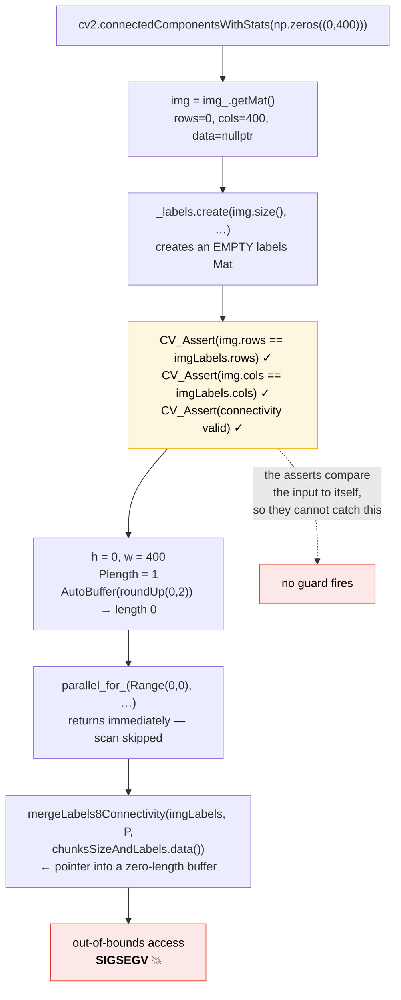

# #29854 — `connectedComponents` Segfaults on Zero-Size Input

[← issue-studies index](README.md) · **Difficulty:** Medium · **Module:** `imgproc`

| | |
|---|---|
| **Upstream issue** | [opencv/opencv#29854](https://github.com/opencv/opencv/issues/29854) — *"connectedComponents / connectedComponentsWithStats segfault on zero-size input instead of raising"* |
| **Labels** | `category: python bindings`, `category: imgproc` |
| **Upstream state** | **Closed** |
| **Branch** | `fix/issue-29854-connectedcomponents-empty` |
| **Files** | `modules/imgproc/src/connectedcomponents.cpp` (+2), `modules/imgproc/test/test_connectedcomponents.cpp` (+15) |

---

## 1. The report

```python
import numpy as np
import cv2

mask = np.zeros((0, 400), dtype=np.uint8)   # zero rows, valid dtype, 2-D
cv2.connectedComponentsWithStats(mask, connectivity=8)   # SIGSEGV
```

The process dies. No `cv2.error`, no Python traceback, no stack — the interpreter is simply
gone. Reproduced identically on 4.10.0, 4.12.0 and 5.0.0, so not a regression.

The reporter's crash table is the most informative part of the report, and it is why this bug
is interesting rather than trivial:

| call | (0, 400) | (400, 0) | (0, 0) | (1, 400) |
|---|---|---|---|---|
| `connectedComponentsWithStats(m, connectivity=8)` | **CRASH** | **CRASH** | **CRASH** | ok |
| `connectedComponentsWithStats(m, connectivity=4)` | **CRASH** | ok | ok | ok |

Different connectivities crash on different shapes. That asymmetry rules out a single shared
guard being absent at one spot and points at *several* algorithm variants each indexing
differently — which is exactly what the code shows.

The reporter also made the case for severity better than a crash report usually does:

> This is inconsistent with every other OpenCV function I tested on the same input, all of
> which validate and raise `cv2.error` (or return cleanly). In particular `findContours`,
> which solves an overlapping problem and is the natural function to swap connected-components
> code to and from, handles zero-size input without complaint.
>
> […] In our case the array came from a NumPy slice that legitimately clipped to zero rows;
> under a multiprocess test runner the segfault presented as workers dying and respawning in
> a loop, i.e. as a hang rather than a crash.

Two points worth extracting. First, an empty array is not an exotic input — it is what a
NumPy slice produces at a boundary. Second, **the cost of a segfault is not the crash, it is
the lost diagnosis.** A `cv2.error` naming the function would have been a one-minute fix on
the caller's side; a bare SIGSEGV under a process pool looked like a hang.

---

## 2. Implementation background

`cv::connectedComponents` labels connected regions of a binary image. OpenCV implements
several published algorithms, selected by `ccltype`:

| `ccltype` | Algorithm |
|-----------|-----------|
| `CCL_WU` | SAUF — Scan Array-based Union Find (Wu et al.) |
| `CCL_GRANA` | BBDT — Block-Based Decision Trees (Grana et al.) |
| `CCL_BOLELLI` / `CCL_SPAGHETTI` | Spaghetti labeling (Bolelli et al.) |
| `CCL_DEFAULT` | → Spaghetti |

Each exists in 4- and 8-connectivity and in serial and parallel variants, giving roughly a
dozen template instantiations reached through `connectedComponents_sub1`
(`connectedcomponents.cpp:5652`). All of them are performance-tuned scanline algorithms that
compute buffer sizes and loop bounds arithmetically from `img.rows` and `img.cols`.

The entry point, before the fix (`connectedcomponents.cpp:5759`):

```cpp
int cv::connectedComponents(InputArray img_, OutputArray _labels, int connectivity, int ltype, int ccltype){
    const cv::Mat img = img_.getMat();
    _labels.create(img.size(), CV_MAT_DEPTH(ltype));      // ← allocates before validating
    cv::Mat labels = _labels.getMat();
    connectedcomponents::NoOp sop;
    if (ltype == CV_16U){
        return connectedComponents_sub1(img, labels, connectivity, ccltype, sop);
    }
    else if (ltype == CV_32S){
        return connectedComponents_sub1(img, labels, connectivity, ccltype, sop);
    }
    else{
        CV_Error(cv::Error::StsUnsupportedFormat, "the type of labels must be 16u or 32s");
    }
}
```

**There is no validation at all.** Not of emptiness, not of type, not of channel count. The
only `CV_Error` concerns `ltype`. The labeling functors do assert, but only about agreement
between the two arrays (`connectedcomponents.cpp:2298`):

```cpp
LabelT operator()(const cv::Mat& img, cv::Mat& imgLabels, int connectivity, StatsOp& sop){
    CV_Assert(img.rows == imgLabels.rows);
    CV_Assert(img.cols == imgLabels.cols);
    CV_Assert(connectivity == 8 || connectivity == 4);
    ...
```

For a `(0, 400)` input these all **pass**: `labels` was created with `img.size()`, so both are
`0 × 400`, and the connectivity is valid. The guards that exist cannot catch this input,
because they compare the input to itself.

---

## 3. Root cause

With `rows == 0` (or `cols == 0`), two things are simultaneously true:

1. `img.data == nullptr` — an empty `Mat` allocates nothing.
2. Every derived quantity degenerates to zero or one, without any code noticing.

Walking the Spaghetti/parallel functor with `h = 0, w = 400`
(`connectedcomponents.cpp:2302` onward):

```cpp
const int h = img.rows;      // 0
const int w = img.cols;      // 400

const size_t Plength = (size_t(h) * size_t(w) + 1) / 2 + 1;     // (0 + 1)/2 + 1 = 1

AutoBuffer<int> chunksSizeAndLabels(roundUp(h, 2));             // ← zero-length buffer
AutoBuffer<LabelT> P_(Plength, 0);
LabelT *P = P_.data();

cv::Range range2(0, divUp(h, 2));                               // Range(0, 0) — empty
const double nParallelStripes = std::max(1, std::min(h / 2, getNumThreads()*4));   // 1
...
cv::parallel_for_(range2, FirstScan8Connectivity(img, imgLabels, P, chunksSizeAndLabels.data()), nParallelStripes);
mergeLabels8Connectivity(imgLabels, P, chunksSizeAndLabels.data());   // ← data() of an empty buffer
```

`parallel_for_` returns immediately on an empty range, so the scan itself is skipped. But
`chunksSizeAndLabels.data()` is the pointer of a **zero-length** `AutoBuffer`, and it is
handed to `mergeLabels8Connectivity`, which indexes it. Further down, `AutoBuffer<StatsOp>
sopArray(h)` is likewise zero-length and passed to `StatsOp::mergeStats`.



> **On precision:** the above identifies the mechanism — buffer lengths and loop bounds derived
> from `h`/`w` with no empty-input guard, and zero-length buffers passed on to helpers that
> index them. It does **not** pin the exact faulting instruction, which differs by algorithm;
> that is precisely what the reporter's crash table shows, with 4-connectivity surviving
> `(400, 0)` and `(0, 0)` while 8-connectivity does not. Establishing the faulting line per
> variant would need a debugger on a built library, which was not done here. **(unverified)**

### Why this is the right diagnosis anyway

Chasing the individual faults would be the wrong fix. There is no useful labeling of an empty
image: the correct number of components is zero, there is nothing to write, and the caller
almost certainly did not intend it. Hardening a dozen template instantiations to produce
"correct" empty output would add code to every hot path to serve an input that is a bug at the
call site.

**An empty image is a precondition violation, and the entry point is where preconditions
belong.**

---

## 4. The fix

```diff
--- a/modules/imgproc/src/connectedcomponents.cpp
+++ b/modules/imgproc/src/connectedcomponents.cpp
@@ -5758,6 +5758,7 @@ int cv::connectedComponents(InputArray img_, OutputArray _labels, int connectivi
 
 int cv::connectedComponents(InputArray img_, OutputArray _labels, int connectivity, int ltype, int ccltype){
     const cv::Mat img = img_.getMat();
+    CV_Assert(!img.empty());
     _labels.create(img.size(), CV_MAT_DEPTH(ltype));
     cv::Mat labels = _labels.getMat();
     connectedcomponents::NoOp sop;
@@ -5783,6 +5784,7 @@ int cv::connectedComponentsWithStats(InputArray img_, OutputArray _labels, Outpu
     OutputArray centroids, int connectivity, int ltype, int ccltype)
 {
     const cv::Mat img = img_.getMat();
+    CV_Assert(!img.empty());
     _labels.create(img.size(), CV_MAT_DEPTH(ltype));
     cv::Mat labels = _labels.getMat();
     connectedcomponents::CCStatsOp sop(statsv, centroids);
```

Two lines. Four properties make this the right shape of fix:

1. **Placed after `getMat()`, before `create()`.** `getMat()` is needed to inspect the input;
   `create()` must not run, or a throwing call would leave a half-allocated output behind. This
   ordering is the entry-point convention described in
   [features/01 §6](../features/01-core-mat-and-inputarray.md#6-inputarray--collapsing-the-container-dimension).
2. **`CV_Assert`, not `assert`.** `CV_Assert` survives release builds and throws
   `cv::Exception`, which the Python bindings translate to `cv2.error`. That is the entire
   user-visible improvement: a catchable exception naming the function instead of a dead
   process.
3. **Both entry points.** The two public functions share no validation code, so each needs the
   check. The ABI-compatibility wrappers above them delegate to these, so all four public
   overloads are covered.
4. **No change to any algorithm.** The dozen labeling instantiations are untouched, so there
   is no performance or behaviour risk for valid input.

`!img.empty()` covers all three failing shapes at once — `Mat::empty()` is true when any
dimension is zero or `data` is null — which is why one condition replaces the reporter's
3-row crash table.

---

## 5. The test

```cpp
TEST(Imgproc_ConnectedComponents, empty_input_29854)
{
    // Regression test for #29854:
    // Zero-size input must raise cv::Exception instead of SIGSEGV.
    const int shapes[][2] = {{0, 400}, {400, 0}, {0, 0}};
    for (const auto& s : shapes)
    {
        Mat mask(s[0], s[1], CV_8UC1);
        Mat labels, stats, centroids;
        EXPECT_THROW(connectedComponents(mask, labels), cv::Exception);
        EXPECT_THROW(connectedComponentsWithStats(mask, labels, stats, centroids), cv::Exception);
    }
}
```

What it establishes: all three degenerate shapes, through both entry points, raise rather than
crash. Six assertions from three shapes — the table from the report turned into a test.

What it does not cover:

- **Only `CCL_DEFAULT`.** The overloads taking an explicit `ccltype` (`CCL_WU`, `CCL_GRANA`,
  `CCL_BOLELLI`) are not exercised. They route through the same two entry points, so the guard
  applies — but the test does not demonstrate it.
- **`EXPECT_THROW(..., cv::Exception)` is coarse.** It would also pass if the function threw
  for an unrelated reason. `CV_Assert` failures are `cv::Exception` with code `StsAssert`;
  asserting the error code would be stricter.
- **No positive control.** A test that a `(1, 400)` image still labels correctly would guard
  against the assert being over-eager. The reporter's table lists `(1, 400)` as working, so
  this is a known-good case that was available for free.

A note on test style: `EXPECT_THROW` inside a loop reports failures without the shape that
caused them. `SCOPED_TRACE` on `s[0]`/`s[1]`, or a parameterised test, would make a failure
self-describing.

---

## 6. Assessment

**Is the fix correct?** Yes. It converts undefined behaviour into a documented exception,
touches nothing else, and matches how the rest of `imgproc` validates — `cv::resize` opens with
`CV_Assert(!ssize.empty())` (`resize.cpp:3586`).

**Is it complete?** For the reported bug, yes. Two adjacent gaps remain visible in the same
function:

- The entry points still do not validate **type or channel count**. The labeling functors are
  instantiated for `uchar` input, and a `CV_32FC3` image would reach them. Whether that is
  caught downstream was not checked. **(unverified)**
- `connectedComponentsWithStats` does not validate `statsv`/`centroids`.

Both are out of scope for a one-issue fix, and OpenCV's contribution guidelines explicitly ask
for minimal diffs — but they are the next things an interested contributor would look at.

**Is there a behaviour-compatibility concern?** Marginal, and worth stating. Code that today
passes an empty image and *happens* not to crash — plausible for `(400, 0)` with
4-connectivity, which the reporter lists as "ok" — will now throw. That is the intended
change, and the alternative (returning 0 components for empty input) was available. The
reporter argued for raising, on the grounds that `findContours` returning cleanly is the
*inconsistency*; a maintainer could reasonably have decided the opposite. The issue is closed
upstream, so the project accepted raising.

**Why this is "medium" and not "easy".** The fix is two lines, but the diagnosis is not: the
failure is in C++ with no Python traceback, the guards that exist look adequate until you
notice they compare the input against itself, and the shape-dependent crash pattern suggests a
far deeper problem than it is. The skill tested is recognising that a dozen algorithm variants
crashing in a dozen ways share one missing precondition — and resisting the urge to fix each
crash.

---

## 7. Lessons

1. **Validate at the entry point, before allocating output.** Preconditions established once
   at the top beat guards scattered through implementations.
2. **A guard comparing two derived values is not a precondition check.**
   `CV_Assert(img.rows == imgLabels.rows)` can never fail when `labels` was created from
   `img.size()`.
3. **In a wrapped library, a segfault is always a bug.** The binding layer can only translate
   exceptions; anything that kills the process destroys the user's ability to diagnose it.
4. **Empty is not exotic.** Zero-size arrays fall out of ordinary slicing. Every entry point
   taking an image should decide, explicitly, whether empty is an error or a no-op.

---

## 8. Related

- [features/05 — Geometric Transforms §7](../features/05-imgproc-geometric-transforms.md#7-empty-and-degenerate-inputs) — how `resize` guards the same class of input.
- [features/11 — Bindings §7](../features/11-bindings.md#7-practical-notes) — why exceptions matter at the language boundary.
- [#26498](hard-26498-flip-nd-arrays.md) — the opposite call: an input the library *should*
  have accepted rather than rejected.
