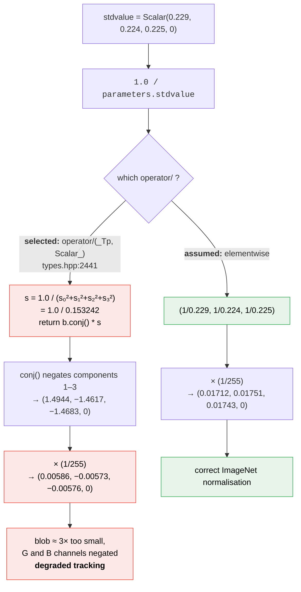

# #30164 — `TrackerVit` Normalises Input with Quaternion Division

[← issue-studies index](README.md) · **Difficulty:** Medium · **Module:** `video`

| | |
|---|---|
| **Upstream issue** | [opencv/opencv#30164](https://github.com/opencv/opencv/issues/30164) — *"TrackerVit: input scalefactor computed with Scalar's quaternion operator/, two of three channels negated (since 4.11.0)"* |
| **Labels** | `bug`, `category: video` |
| **Upstream state** | **Closed** |
| **Branch** | `fix/issue-30164-trackervit-scalefactor` |
| **Files** | `modules/video/src/tracking/tracker_vit.cpp` (+9 −2) |

---

## 1. The report

The reporter measured the affected versions directly:

> OpenCV python versions (PyPI `opencv-python` wheels), each measured with the script below:
> - 4.10.0.84: **not affected**
> - 4.11.0.86, 4.12.0.88, 4.13.0.92, 4.14.0.94, 5.0.0.93: **affected**

and identified the mechanism precisely:

> `stdvalue` is a `cv::Scalar`, and `operator/(double, Scalar)` is not an elementwise
> reciprocal. It is the quaternion inverse […] `conj()` negates elements 1 to 3.

This is the most instructive bug in the set, because the offending line is *perfectly
plausible*. Every reviewer who looked at it since 4.11.0 read it as "one over the standard
deviation, divided by 255" — which is what it says, and not what it does.

---

## 2. Implementation background

### What the preprocessing must compute

`TrackerVit` feeds crops to a vision transformer trained with standard ImageNet
normalisation:

```
normalised[c] = (pixel[c] / 255 − mean[c]) / std[c]
```

OpenCV's `blobFromImageWithParams` applies (`dnn.hpp:1306`):

```
output = (input − mean) × scalefactor
```

on **raw 0–255 pixels**. The parameters are stored pre-divided by 255
(`tracker_vit.cpp:26`):

```cpp
TrackerVit::Params::Params()
{
    net = "vitTracker.onnx";
    meanvalue = Scalar{0.485, 0.456, 0.406}; // normalized mean (already divided by 255)
    stdvalue  = Scalar{0.229, 0.224, 0.225}; // normalized std (already divided by 255)
    ...
}
```

so the constructor must scale both back to pixel units:

```
i2bp.mean[c]        = mean[c] × 255
i2bp.scalefactor[c] = 1 / (std[c] × 255)
```

### What the code did (`tracker_vit.cpp:52`)

```cpp
i2bp.mean = parameters.meanvalue * 255.0;
i2bp.scalefactor = (1.0 / parameters.stdvalue) * (1 / 255.0);
```

Line 1 is correct. Line 2 is the bug, and the asymmetry is the trap: the two lines look like
mirror images, but only one of the operators involved is elementwise.

### `cv::Scalar`'s operator overloads

`cv::Scalar` is `Scalar_<double>`, which derives from `Vec<double, 4>`. OpenCV gives `Scalar_`
**quaternion semantics** for some operators (`modules/core/include/opencv2/core/types.hpp`):

```cpp
// types.hpp:2427 — Scalar / double : ELEMENTWISE ✓
template<typename _Tp> inline
Scalar_<double> operator / (const Scalar_<double>& a, double alpha)
{
    double s = 1 / alpha;
    return Scalar_<double>(a.val[0] * s, a.val[1] * s, a.val[2] * s, a.val[3] * s);
}

// types.hpp:2441 — double / Scalar : QUATERNION INVERSE ✗
template<typename _Tp> inline
Scalar_<_Tp> operator / (_Tp a, const Scalar_<_Tp>& b)
{
    _Tp s = a / (b[0]*b[0] + b[1]*b[1] + b[2]*b[2] + b[3]*b[3]);
    return b.conj() * s;
}

// types.hpp:2449 — Scalar / Scalar : also quaternion
template<typename _Tp> inline
Scalar_<_Tp> operator / (const Scalar_<_Tp>& a, const Scalar_<_Tp>& b)
{
    return a * ((_Tp)1 / b);
}
```

and `conj()` negates components 1–3 (`types.hpp:2283`):

```cpp
template<typename _Tp> inline
Scalar_<_Tp> Scalar_<_Tp>::conj() const
{
    return Scalar_<_Tp>(saturate_cast<_Tp>( this->val[0]),
                        saturate_cast<_Tp>(-this->val[1]),
                        saturate_cast<_Tp>(-this->val[2]),
                        saturate_cast<_Tp>(-this->val[3]));
}
```

So the operand **order** decides the semantics:

| Expression | Semantics |
|------------|-----------|
| `Scalar * double` | elementwise ✓ |
| `Scalar / double` | elementwise ✓ |
| `Scalar ± Scalar` | elementwise ✓ |
| `double / Scalar` | **quaternion inverse** ✗ |
| `Scalar / Scalar` | **quaternion** ✗ |
| `Scalar * Scalar` | **quaternion product** ✗ |
| `Scalar::mul(Scalar)` | elementwise ✓ |

`1.0 / stdvalue` puts the `Scalar` on the right-hand side, so it selects the quaternion
inverse.

---

## 3. Root cause

For `b = (s₀, s₁, s₂, 0)`:

```
1.0 / b  =  conj(b) / |b|²  =  (s₀, −s₁, −s₂, 0) / (s₀² + s₁² + s₂²)
```

Two errors at once: the divisor is the **squared L2 norm of all components** instead of each
component, and components 1 and 2 are **negated**.

With the default `stdvalue = (0.229, 0.224, 0.225)`:

```
|b|² = 0.229² + 0.224² + 0.225² = 0.15324200
1.0 / stdvalue = (1.494368, −1.461740, −1.468266, 0)
   × (1/255)  = (0.00586027, −0.00573231, −0.00575791, 0)
```

against the intended `1 / (std[c] × 255)`:

| Channel | Intended | Applied | Ratio |
|---------|----------|---------|-------|
| R | 0.01712475 | 0.00586027 | **2.92×** too small |
| G | 0.01750700 | −0.00573231 | **−3.05×** (sign flipped) |
| B | 0.01742919 | −0.00575791 | **−3.03×** (sign flipped) |

Every pixel reaching the transformer is ~3× too small in magnitude, with **two of three
colour channels inverted**. The mean subtraction is still correct, so the input is centred
properly and then scaled and reflected — a systematically corrupted colour space.



### Why it survived five releases

1. **The expression reads correctly.** `(1.0 / std) * (1/255)` is the formula, transcribed
   literally. Nothing signals that operand order changes the operator's meaning.
2. **The neighbouring line is genuinely elementwise.** `meanvalue * 255.0` works, so the
   pattern appears validated.
3. **The tracker still tracks.** A CNN/transformer fed consistently mis-scaled input still
   produces plausible responses — accuracy drops, nothing crashes. There is no assertion that
   could fire.
4. **Python users cannot see it.** `cv::Scalar` maps to a plain tuple in the bindings
   ([features/11 §5](../features/11-bindings.md#5-type-mapping)), so the quaternion semantics
   are invisible from the language most users write.
5. **The same line appears twice**, in both constructors — so a reader comparing them finds
   consistency rather than a discrepancy.

An assertion-free, crash-free, plausible-output bug in an expression that reads as correct:
this is the profile of a defect that lives for years.

---

## 4. The fix

```diff
--- a/modules/video/src/tracking/tracker_vit.cpp
+++ b/modules/video/src/tracking/tracker_vit.cpp
@@ -50,7 +50,11 @@ public:
         net.setPreferableTarget(parameters.target);
 
         i2bp.mean = parameters.meanvalue * 255.0;
-        i2bp.scalefactor = (1.0 / parameters.stdvalue) * (1 / 255.0);
+        const Scalar& sv = parameters.stdvalue;
+        i2bp.scalefactor = Scalar(1.0 / (sv[0] * 255.0),
+                                  1.0 / (sv[1] * 255.0),
+                                  1.0 / (sv[2] * 255.0),
+                                  0.0);
         tracking_score_threshold = parameters.tracking_score_threshold;
     }
 
@@ -60,7 +64,10 @@ public:
 
         net = model;
         i2bp.mean = meanvalue * 255.0;
-        i2bp.scalefactor = (1.0 / stdvalue) * (1 / 255.0);
+        i2bp.scalefactor = Scalar(1.0 / (stdvalue[0] * 255.0),
+                                  1.0 / (stdvalue[1] * 255.0),
+                                  1.0 / (stdvalue[2] * 255.0),
+                                  0.0);
         tracking_score_threshold = _tracking_score_threshold;
     }
```

The approach is to **stop using `Scalar` arithmetic entirely** and construct the result
component by component. Three properties recommend it:

- **No overloaded operator is involved.** `sv[0] * 255.0` is `double` arithmetic; there is no
  operand order to get wrong, and no reader has to know about quaternions.
- **It is explicit about the 4th component.** `0.0` for alpha, stated rather than implied.
- **Both constructors are fixed.** The `dnn::Net` overload had the identical bug; fixing one
  would have left a path still broken.

### Alternatives considered

| Alternative | Verdict |
|-------------|---------|
| `Scalar(1.0/sv[0], 1.0/sv[1], 1.0/sv[2], 0) / 255.0` | Correct (`Scalar / double` is elementwise) but relies on the reader knowing *which* overload is safe |
| `stdvalue.mul(Scalar::all(255.0))` then reciprocal | `mul` is elementwise, but still needs an elementwise reciprocal — which does not exist |
| A loop over 4 components | Marginally shorter; obscures that alpha is deliberately 0 |
| Fix `Scalar`'s `operator/` | **Not viable.** The quaternion semantics are documented behaviour that other code (`cv::Quat`-adjacent math) may depend on. A wide API change for a local bug. |

The chosen form is the most defensive: it cannot regress if someone later changes `Scalar`'s
operators, and it needs no comment to be understood.

---

## 5. The test

**There is no test.** The branch contains a single commit (`c7ef073e9`) touching only
`tracker_vit.cpp`.

This is the one fix in the set where that is defensible, and worth reasoning through:

- A behavioural test needs `vitTracker.onnx`, which is not in the repository — DNN tracker
  tests depend on `opencv_extra` test data.
- The observable effect is *tracking accuracy on a video sequence*, which is a slow,
  threshold-based test, exactly the kind that becomes flaky.

But a cheap and valuable test was available: **assert the computed `scalefactor` directly.**
The arithmetic is deterministic and needs no model:

```cpp
// Illustrative — not in the branch.
TEST(Video_TrackerVit, scalefactor_is_elementwise_30164)
{
    const Scalar sv(0.229, 0.224, 0.225, 0.0);
    const Scalar expected(1.0/(0.229*255.0), 1.0/(0.224*255.0), 1.0/(0.225*255.0), 0.0);

    // What the buggy expression produced, for contrast:
    //   (1.0 / sv) * (1/255.0) == (0.00586, -0.00573, -0.00576, 0)
    const Scalar buggy = (1.0 / sv) * (1 / 255.0);
    EXPECT_LT(buggy[1], 0.0) << "documents that double/Scalar is a quaternion inverse";

    for (int c = 0; c < 3; ++c)
        EXPECT_NEAR(expected[c], 1.0 / (sv[c] * 255.0), 1e-12);
}
```

To test the real code path, `i2bp` would need to be observable — a getter, or moving the
computation into a free function. That refactor is arguably worth it: **a constructor that
computes something non-obvious and stores it privately cannot be unit-tested**, which is part
of why this bug survived.

A broader gap: no test anywhere in the tree appears to pin down `Scalar`'s elementwise vs.
quaternion operator behaviour. A `Core_Scalar` test documenting which operators are which
would have made this trap discoverable.

---

## 6. Assessment

**Is the fix correct?** Yes. It computes the intended per-channel reciprocal with plain
`double` arithmetic in both constructors, and the numbers in §3 confirm the magnitude and sign
of what it corrects.

**Is it complete?** For `TrackerVit`, yes. Two wider questions remain:

1. **Are there other `double / Scalar` sites?** This exact mistake can appear anywhere a
   `Scalar` holds per-channel coefficients — other trackers, `dnn` preprocessing helpers, user
   code. The pattern is `1.0 /` or `1 /` immediately before a `Scalar`-typed expression, and it
   is grep-able. The fix does not survey for siblings. **(unverified — no survey was run here.)**
2. **Should `cv::Scalar` warn?** The deeper problem is an API where operand order silently
   changes semantics. Options upstream could consider: documenting it prominently on
   `Scalar_`, adding `Scalar::recip()` for the elementwise case, or deprecating the quaternion
   overloads on `Scalar_` in favour of `cv::Quat`. All are out of scope for this issue, and all
   would prevent the next occurrence better than this fix does.

**Model-weight compatibility.** Worth thinking about and, as far as reading the code shows, a
non-issue. If anyone had tuned `vitTracker.onnx` *against* the buggy normalisation, correcting
it would degrade them. But the published weights come from the upstream VitTrack work trained
with standard ImageNet normalisation, and 4.10.0 was unaffected — so correct normalisation is
what the weights expect, and this restores it.

**Why "medium".** Finding it requires knowing that `cv::Scalar` inherits quaternion operators
— specialist knowledge, but a single fact. Once known, the diagnosis is immediate and the fix
is mechanical. There is no algorithmic subtlety, no platform dependence, no trade-off. What
earns the grade is that nothing in the code *looks* wrong: the bug is in the C++ type system's
interaction with a plausible expression, and five releases of reviewers read past it.

---

## 7. Lessons

1. **Operand order can change an overloaded operator's meaning.** `Scalar / double` is
   elementwise; `double / Scalar` is a quaternion inverse. The expressions look symmetric and
   are not.
2. **Prefer explicit scalar arithmetic for per-channel constants.** `1.0 / (sv[c] * 255.0)`
   has no overload-resolution surprises.
3. **Vector-like types with exotic algebra are a hazard.** `cv::Scalar` is simultaneously "a
   tuple of 4 channel values" and "a quaternion". Most users want the former; the operators
   implement the latter.
4. **Plausible output hides bugs better than crashes.** A neural network fed mis-scaled input
   degrades gracefully, so there is nothing to notice. Numerically verifying preprocessing
   against the reference recipe is the only defence.
5. **Non-obvious computation in a constructor is untestable.** Extracting it into a function
   would have made it checkable, which is itself a reason to extract it.

---

## 8. Related

- [features/09 — Object Tracking §4](../features/09-video-tracking.md#4--preprocessing-scalar-arithmetic-is-not-elementwise) — the preprocessing path in context.
- [features/10 — DNN Engine §6](../features/10-dnn-engine.md#6-blobs-the-nchw-convention) — blob conventions and common preprocessing errors.
- [#29893](hard-29893-multiply-16u-work-type.md) — the other type-system bug in this set, also
  a wrong intermediate type in correct-looking arithmetic.
